# THIẾT KẾ CÁC LỚP CỦA HỆ THỐNG (CẬP NHẬT ĐẦY ĐỦ 100% THEO MÃ NGUỒN HIỆN TẠI)
**NextCode – Website đăng ký và học tập trực tuyến các khóa học lập trình**  
*Tài liệu mô tả đầy đủ 100% thuộc tính, ràng buộc, chỉ mục và phương thức của toàn bộ các lớp chính, lớp phụ, subdocument nhúng, kiểu liệt kê, lớp dịch vụ – bảo vệ và sơ đồ lớp UML theo mã nguồn thực tế mới nhất*

---

## 1. Giới thiệu
Tài liệu này mô tả chi tiết toàn bộ các lớp nghiệp vụ, cấu trúc dữ liệu và lớp dịch vụ của **NextCode**, được đối chiếu **100% không rút gọn** với mã nguồn Backend NestJS + Mongoose/MongoDB ngày **21/11/2026**. Toàn bộ **37 lớp/cấu trúc** (gồm 23 lớp dữ liệu và 14 lớp dịch vụ/bảo vệ) cùng **17 kiểu liệt kê (16 Enum & 1 Constant/Union)** đều được liệt kê **đầy đủ mọi thuộc tính (`public` & `private`), kiểu dữ liệu, giá trị mặc định, ràng buộc schema, chỉ mục (`Indexes`) và toàn bộ phương thức (`public` & `private`)**.

Các thành phần được chia thành:
1. **Nhóm lớp chính (11 lớp)** – Xương sống của nghiệp vụ quản lý người dùng, khóa học, học tập tuần tự, thanh toán tự động VietQR (payOS), cấp chứng chỉ và hỏi đáp bài giảng (`User`, `Course`, `Chapter`, `Lesson`, `QuizQuestion`, `Enrollment`, `LessonProgress`, `Order`, `PaymentTransaction`, `Certificate`, `LessonComment`).
2. **Nhóm lớp phụ & cấu trúc con (12 lớp)** – Hỗ trợ xác thực phiên (`Otp`, `RefreshToken`), danh mục (`Category`), lịch sử làm bài trắc nghiệm (`QuizAttempt`), đánh giá khóa học (`CourseReview`), kiểm duyệt báo cáo vi phạm 2 tuyến (`Report`), thông báo (`Notification`), các subdocument nhúng (`ViolationHistoryItem`, `CommentReplyToUser`, `CommentReaction`, `CommentReport`) và cấu trúc quy tắc mã giảm giá (`BuiltinCouponRule`).
3. **Các kiểu liệt kê (16 enum khai báo và 1 constant/union `CourseLevel`)**.
4. **Nhóm lớp dịch vụ – bảo vệ (12 Service & 2 Guard)** – Liệt kê đầy đủ toàn bộ thuộc tính tiêm phụ thuộc (Injected Models/Services, Logger, cấu hình nội bộ) và toàn bộ phương thức `public` lẫn `private` của từng lớp.

### Quy ước trình bày
* **Kiểu dữ liệu** – Viết theo quy ước TypeScript / MongoDB (`ObjectId`, `String`, `Date`, `boolean`, `int`, `number`, `double`, `List<T>`, `Record<String, unknown>`).
* **Phạm vi truy cập (Visibility)** – Ký hiệu `+` biểu thị thuộc tính hoặc phương thức `public`; ký hiệu `-` biểu thị thuộc tính hoặc phương thức `private` (như các Model/Service được tiêm qua `constructor(private readonly ...)` và các hàm xử lý nội bộ trong Service/Guard).
* **Collection độc lập vs. Subdocument nhúng** – Với MongoDB, các thực thể có vòng đời gắn chặt vào lớp cha (như `Chapter`, `Lesson`, `QuizQuestion` trong `Course`; `ViolationHistoryItem` trong `User`; hoặc `CommentReplyToUser`, `CommentReaction`, `CommentReport` trong `LessonComment`/`CourseReview`) được lưu dưới dạng **Subdocument nhúng** ngay trong tài liệu cha để tối ưu hiệu năng truy vấn nguyên tử. Các thực thể có số lượng bản ghi tăng trưởng lớn hoặc cần truy vấn độc lập (`User`, `Course`, `Enrollment`, `LessonProgress`, `QuizAttempt`, `Order`, `PaymentTransaction`, `Certificate`, `LessonComment`, `CourseReview`, `Report`, `Notification`, `Otp`, `RefreshToken`, `Category`) được tách thành **Collection riêng**.
* **Association (liên kết)** – Liên kết cấu trúc giữa các thực thể, thường qua `ObjectId`; không đòi hỏi hai phía cùng lưu tham chiếu.
* **Composition (hợp thành)** – Lớp con phụ thuộc chặt vào vòng đời lớp cha (nhúng trực tiếp dưới dạng Subdocument).
* **Dependency (phụ thuộc)** – Một lớp kích hoạt hoặc sử dụng lớp kia trong một luồng nghiệp vụ mà không giữ khóa ngoại trực tiếp.
* **Bội số** – Ví dụ $1 - N$ nghĩa là một đối tượng ở phía trái liên kết với nhiều đối tượng ở phía phải; $0..1$ là tùy chọn (có thể `null`).

### Kết quả đối chiếu và bản vẽ
* Có **15 collection độc lập**, **7 cấu trúc nhúng** (trong đó `ViolationHistoryItem` là cấu trúc inline trong `User.violationHistory`) và **1 interface `BuiltinCouponRule`**.
* `User.isActive` là virtual getter (`UserSchema.virtual('isActive').get(...)`), được biểu diễn là thuộc tính dẫn xuất (`{derived, readOnly}`).
* `Course.chapters` và `Chapter.lessons` có thể rỗng ở trạng thái nháp (`default: []`), nên bội số cấu trúc tổng quát là `0..*`. Điều kiện ít nhất một chương và mỗi chương có ít nhất một bài được kiểm tra khi gửi duyệt hoặc phê duyệt qua hàm `getCourseReadiness()`.
* `LessonProgress` thuộc collection riêng (`lesson_progresses`) và tham chiếu `Enrollment` qua `enrollmentId`.
* Các liên kết qua `lessonId`, `questionId`, `lastLessonId` là tham chiếu logic đến `_id` của subdocument nhúng trong `Course`.
* Các bản vẽ nằm trong thư mục [diagrams](diagrams/README.md): [file StarUML](diagrams/So_Do_Lop_NextCode.mdj), [sơ đồ tổng quan SVG](diagrams/00_Tong_Quan.svg), cùng năm sơ đồ chi tiết hiển thị đầy đủ 100% thuộc tính không cắt bớt.

---

## 2. Tổng quan danh sách lớp và đối chiếu thay đổi so với thiết kế ban đầu

### 2.1. Bảng phân nhóm các lớp hiện tại

| Nhóm nghiệp vụ | Lớp chính (11) | Lớp phụ & Cấu trúc nhúng (12) | Lớp Dịch vụ & Bảo vệ (14) |
| :--- | :--- | :--- | :--- |
| **Người dùng và xác thực** | `User` | `Otp`, `RefreshToken`, `ViolationHistoryItem` *(nhúng)* | `AuthService`, `UsersService`, `MailService`, `JwtAuthGuard`, `RolesGuard` |
| **Khóa học và nội dung** | `Course`, `Chapter` *(nhúng)*, `Lesson` *(nhúng)*, `QuizQuestion` *(nhúng)* | `Category` | `CoursesService`, `CourseManageService`, `UploadsService` |
| **Đăng ký học và tiến độ** | `Enrollment`, `LessonProgress` | `QuizAttempt` | `EnrollmentsService` |
| **Đơn hàng và thanh toán** | `Order`, `PaymentTransaction` | `BuiltinCouponRule` *(cấu hình dịch vụ)* | `OrdersService`, `PayosService` |
| **Chứng chỉ** | `Certificate` | *(Tích hợp trực tiếp vào `Certificate`)* | `CertificatesService` |
| **Tương tác, đánh giá & kiểm duyệt** | `LessonComment` | `CourseReview`, `Report`, `Notification`, `CommentReplyToUser` *(nhúng)*, `CommentReaction` *(nhúng)*, `CommentReport` *(nhúng)* | `QuestionsService`, `ReviewsService` |

### 2.2. Tóm tắt các điểm tinh chỉnh từ thiết kế ban đầu sang mã nguồn hiện tại
* **Bổ sung `RefreshToken` (`refreshtokens`)**: Quản lý phiên đăng nhập dài hạn (7 ngày) trong HttpOnly Cookie, hỗ trợ xoay vòng token (Token Rotation) và tự động thu hồi các phiên của người dùng khi phát hiện tái sử dụng token đã thu hồi (Reuse Detection).
* **Mở rộng `Lesson` và giản lược các lớp phụ chưa dùng**: `Lesson` được bổ sung nội dung bài đọc văn bản (`content`) và tệp tài liệu đính kèm (`fileUrl`, `fileName` hỗ trợ xem trực tiếp định dạng gốc `.docx`, `.pdf`, `.md`, `.txt`) bên cạnh video, ghi chép (`note`), tóm tắt (`summary`) và danh sách câu hỏi trắc nghiệm (`quizQuestions`). Các lớp dự kiến ban đầu như `FlashcardSet`, `Flashcard`, `PracticeProject`, `CourseFaq`, `ActivityLog`, `CertificateTemplate` được lược bỏ để tập trung chiều sâu cho luồng học tập thực tế.
* **Theo dõi thời lượng xem thực tế trên `LessonProgress`**: Bổ sung thuộc tính `watchedSeconds` để kiểm soát điều kiện học viên phải xem tối thiểu **60% thời lượng video** trước khi mở khóa bài trắc nghiệm hoặc hoàn thành bài giảng.
* **Tích hợp cổng thanh toán tự động VietQR payOS API v2**:
  * Lớp `Order` bổ sung `payosOrderCode`, `finalAmount`, `paymentMethod`, trạng thái `EXPIRED` và lưu trực tiếp thông tin link thanh toán / mã VietQR (`paymentLinkId`, `checkoutUrl`, `qrCode`, `qrImageUrl`, `bankBin`, `bankName`, `accountNumber`, `accountName`, `transferDescription`, `transactionReference`), thay thế cho lớp `BankAccountConfig` rời rạc.
  * Lớp `Transaction` được chuẩn hóa thành `PaymentTransaction` (`payment_transactions`), lưu cả thông tin tài khoản đối ứng và `rawPayload` của giao dịch thanh toán.
  * Lớp `Coupon` được hiện thực hóa thành cấu trúc quy tắc `BuiltinCouponRule` tại tầng dịch vụ (`NEXTCODE10`, `SINHVIEN20`, `PRO50K`, `TEST2K`) và lưu mã `couponCode` trực tiếp trên `Order`.
* **Hợp nhất `Question` & `Answer` thành `LessonComment` và bổ sung hệ thống Kiểm duyệt 2 tuyến (`Report`)**:
  * Hỏi đáp dưới bài giảng dùng cấu trúc cây tự tham chiếu `LessonComment` (`parentId = null` là câu hỏi gốc, `parentId != null` là câu trả lời) kèm thả cảm xúc (`CommentReaction`) và báo cáo vi phạm (`CommentReport`).
  * Đánh giá khóa học được chuẩn hóa thành `CourseReview` (`course_reviews`) chỉ mở cho học viên đã hoàn thành 100% khóa học.
  * Bổ sung thực thể `Report` (`reports`) kết nối với `User.violationCount`, `User.commentBannedUntil`, `User.violationHistory` và `Notification` để vận hành quy trình kiểm duyệt 2 tuyến (Tuyến 1: Giảng viên khóa học; Tuyến 2: Admin hệ thống) kèm thang xử phạt lũy tiến tự động 5 cấp độ.

---

## 3. Sơ đồ lớp tổng quan (Mermaid Class Diagram – Đầy đủ 100% thuộc tính & phương thức)

### 3.1. Sơ đồ các lớp thực thể và cấu trúc dữ liệu (Domain & Schema Class Diagram)

```mermaid
classDiagram
    direction TB

    class User {
        +ObjectId _id
        +String id
        +String fullName
        +String email
        +String passwordHash
        +Date dateOfBirth
        +String occupation
        +Role role
        +String avatar
        +UserStatus status
        +List~Mixed~ interestedCategories
        +int violationCount
        +Date commentBannedUntil
        +List~ViolationHistoryItem~ violationHistory
        +Date createdAt
        +Date updatedAt
        +boolean isActive
    }

    class ViolationHistoryItem {
        <<EmbeddedStructure>>
        +ObjectId reportId
        +ObjectId commentId
        +ObjectId courseId
        +String reason
        +String actionTaken
        +String penaltySummary
        +ObjectId resolvedBy
        +Date resolvedAt
    }

    class Otp {
        +ObjectId _id
        +String email
        +String codeHash
        +OtpPurpose purpose
        +Date expiresAt
        +int failedAttempts
        +Date lastSentAt
        +boolean isUsed
        +Date createdAt
        +Date updatedAt
    }

    class RefreshToken {
        +ObjectId _id
        +ObjectId userId
        +String tokenHash
        +Date expiresAt
        +boolean isRevoked
        +Date createdAt
        +Date updatedAt
    }

    class Category {
        +ObjectId _id
        +String name
        +Date createdAt
        +Date updatedAt
    }

    class Course {
        +ObjectId _id
        +String title
        +String description
        +CourseType type
        +CourseLevel level
        +String targetAudience
        +List~String~ learningOutcomes
        +String requirements
        +double price
        +double discountPrice
        +CourseStatus status
        +ObjectId instructorId
        +ObjectId categoryId
        +double avgRating
        +int totalChapters
        +int totalLessons
        +int totalDuration
        +String thumbnail
        +String rejectReason
        +List~Chapter~ chapters
        +Date createdAt
        +Date updatedAt
    }

    class Chapter {
        <<Subdocument>>
        +ObjectId _id
        +String title
        +int order
        +List~Lesson~ lessons
    }

    class Lesson {
        <<Subdocument>>
        +ObjectId _id
        +String title
        +int order
        +String videoUrl
        +int duration
        +String content
        +String fileUrl
        +String fileName
        +String note
        +String summary
        +List~QuizQuestion~ quizQuestions
        +boolean hasQuiz
    }

    class QuizQuestion {
        <<Subdocument>>
        +ObjectId _id
        +String content
        +List~String~ options
        +int correctOption
        +String explanation
    }

    class Enrollment {
        +ObjectId _id
        +ObjectId studentId
        +ObjectId courseId
        +Date enrolledAt
        +double progressPercent
        +EnrollmentStatus status
        +Date completedAt
        +ObjectId lastLessonId
        +Date createdAt
        +Date updatedAt
    }

    class LessonProgress {
        +ObjectId _id
        +ObjectId enrollmentId
        +ObjectId lessonId
        +LessonStatus status
        +int lastPositionSec
        +int watchedSeconds
        +boolean watchedFully
        +boolean quizPassed
        +Date createdAt
        +Date updatedAt
    }

    class QuizAttempt {
        +ObjectId _id
        +ObjectId studentId
        +ObjectId questionId
        +int selectedOption
        +boolean isCorrect
        +Date attemptedAt
    }

    class Order {
        +ObjectId _id
        +String orderCode
        +number payosOrderCode
        +ObjectId studentId
        +ObjectId courseId
        +double originalPrice
        +double discountPrice
        +String couponCode
        +double discountAmount
        +double finalAmount
        +OrderStatus status
        +PaymentMethod paymentMethod
        +String paymentLinkId
        +String checkoutUrl
        +String qrCode
        +String qrImageUrl
        +String bankBin
        +String bankName
        +String accountNumber
        +String accountName
        +String transferDescription
        +String transactionReference
        +Date expiresAt
        +Date paidAt
        +Date cancelledAt
        +String cancelReason
        +Date createdAt
        +Date updatedAt
    }

    class PaymentTransaction {
        +ObjectId _id
        +ObjectId orderId
        +String orderCode
        +number payosOrderCode
        +ObjectId studentId
        +ObjectId courseId
        +double amount
        +String reference
        +String provider
        +String status
        +String counterAccountBankId
        +String counterAccountName
        +String counterAccountNumber
        +String transactionDateTime
        +Record~String,unknown~ rawPayload
        +Date createdAt
        +Date updatedAt
    }

    class BuiltinCouponRule {
        <<interface>>
        +String code
        +String title
        +String discountType
        +double discountValue
        +double maxDiscountAmount
        +double minOrderAmount
        +boolean devOnly
        +double fixedFinalAmount
    }

    class Certificate {
        +ObjectId _id
        +String certificateCode
        +ObjectId studentId
        +ObjectId courseId
        +Date issuedAt
        +String qrCode
        +String fileUrl
        +CertificateStatus status
        +Date createdAt
        +Date updatedAt
    }

    class LessonComment {
        +ObjectId _id
        +ObjectId courseId
        +ObjectId lessonId
        +ObjectId parentId
        +CommentReplyToUser replyToUser
        +ObjectId authorId
        +String content
        +CommentVisibilityStatus visibilityStatus
        +String moderationNote
        +boolean violationRecorded
        +List~CommentReaction~ reactions
        +List~CommentReport~ reports
        +Date createdAt
        +Date updatedAt
    }

    class CommentReplyToUser {
        <<Subdocument>>
        +ObjectId userId
        +String fullName
    }

    class CommentReaction {
        <<Subdocument>>
        +ObjectId userId
        +CommentReactionType type
    }

    class CommentReport {
        <<Subdocument>>
        +ObjectId userId
        +String reason
        +Date createdAt
    }

    class CourseReview {
        +ObjectId _id
        +ObjectId courseId
        +ObjectId studentId
        +int rating
        +String comment
        +boolean hasComment
        +CommentVisibilityStatus visibilityStatus
        +String moderationNote
        +boolean violationRecorded
        +List~CommentReport~ reports
        +Date createdAt
        +Date updatedAt
    }

    class Report {
        +ObjectId _id
        +ObjectId reporterId
        +ReportTargetType targetType
        +ObjectId targetId
        +ObjectId targetAuthorId
        +ObjectId courseId
        +ObjectId lessonId
        +String reason
        +ReportStatus status
        +boolean escalatedToAdmin
        +ObjectId resolvedBy
        +Date resolvedAt
        +ReportActionType actionTaken
        +String moderationNote
        +Date createdAt
        +Date updatedAt
    }

    class Notification {
        +ObjectId _id
        +ObjectId recipientId
        +NotificationType type
        +String title
        +String message
        +ObjectId courseId
        +ObjectId lessonId
        +boolean isRead
        +Date createdAt
        +Date updatedAt
    }

    User "1" *-- "0..*" ViolationHistoryItem : embeds
    User "1" --> "0..*" RefreshToken : owns
    User "1" ..> "0..*" Otp : email
    User "1" --> "0..*" Course : instructs
    Category "0..1" --> "0..*" Course : classifies

    Course "1" *-- "0..*" Chapter : embeds
    Chapter "1" *-- "0..*" Lesson : embeds
    Lesson "1" *-- "0..*" QuizQuestion : embeds

    User "1" --> "0..*" Enrollment : enrolls
    Course "1" --> "0..*" Enrollment : has
    Enrollment "1" --> "0..*" LessonProgress : enrollmentId
    LessonProgress "*" --> "1" Lesson : references
    User "1" --> "0..*" QuizAttempt : submits
    QuizAttempt "*" --> "1" QuizQuestion : answers

    User "1" --> "0..*" Order : places
    Course "1" --> "0..*" Order : ordered in
    Order "0..*" ..> "0..1" BuiltinCouponRule : couponCode
    Order "1" --> "0..*" PaymentTransaction : paid via

    User "1" --> "0..*" Certificate : receives
    Course "1" --> "0..*" Certificate : grants

    Course "1" --> "0..*" LessonComment : contains
    Lesson "1" --> "0..*" LessonComment : discussed in
    User "1" --> "0..*" LessonComment : authors
    LessonComment "0..1" --> "0..*" LessonComment : parentId (replies)
    LessonComment "1" *-- "0..1" CommentReplyToUser : embeds
    LessonComment "1" *-- "0..*" CommentReaction : embeds
    LessonComment "1" *-- "0..*" CommentReport : embeds

    Course "1" --> "0..*" CourseReview : reviewed in
    User "1" --> "0..*" CourseReview : rates
    CourseReview "1" *-- "0..*" CommentReport : embeds

    User "1" --> "0..*" Report : reporterId
    User "1" --> "0..*" Report : targetAuthorId
    User "0..1" --> "0..*" Report : resolvedBy
    Report "*" --> "1" Course : belongs to
    Report "0..*" --> "0..1" LessonComment : targetId QUESTION or ANSWER
    Report "0..*" --> "0..1" CourseReview : targetId REVIEW

    User "1" --> "0..*" Notification : recipientId
    Course "0..1" --> "0..*" Notification : courseId
    Lesson "0..1" --> "0..*" Notification : lessonId
    Lesson "0..1" --> "0..*" Report : lessonId
    Enrollment "0..*" --> "0..1" Lesson : lastLessonId
    User "1" --> "0..*" PaymentTransaction : studentId
    Course "1" --> "0..*" PaymentTransaction : courseId
    User "1" --> "0..*" CommentReplyToUser : userId
    User "1" --> "0..*" CommentReaction : userId
    User "1" --> "0..*" CommentReport : userId
```

### 3.2. Sơ đồ kiến trúc các lớp dịch vụ & bảo vệ (Service & Guard Layer – Đầy đủ thuộc tính và phương thức)

```mermaid
classDiagram
    direction LR

    class AuthService {
        -Logger logger
        -UsersService usersService
        -MailService mailService
        -JwtService jwtService
        -ConfigService configService
        -Model~OtpDocument~ otpModel
        -Model~RefreshTokenDocument~ refreshTokenModel
        -generateOtp()
        -hashValue(val)
        -verifyHash(hash, plain)
        +generateAccessToken(payload)
        +generateRefreshToken(userId)
        +register(registerDto)
        +verifyRegisterOtp(verifyOtpDto)
        +resendOtp(resendOtpDto)
        +login(loginDto)
        +refresh(rawRefreshToken)
        +logout(rawRefreshToken)
        +forgotPassword(forgotPasswordDto)
        +resetPassword(resetPasswordDto)
        +getMe(userId)
        +assignRole(currentAdminId, targetUserId, newRole)
    }

    class UsersService {
        -Logger logger
        -Model~UserDocument~ userModel
        -UploadsService uploadsService
        -Model~RefreshTokenDocument~ refreshTokenModel
        +onApplicationBootstrap()
        +serializeUser(user)
        +create(data)
        +findByEmail(email, includePassword)
        +findById(id, includePassword)
        +findActiveInstructors()
        +isActiveInstructor(id)
        +markActive(email)
        +updateRole(id, role)
        +updateStatus(id, status)
        +updatePassword(id, passwordHash)
        +update(id, updateData)
        +getProfile(userId)
        +updateProfile(userId, dto)
        +changePassword(userId, dto)
        +listManageUsers(query)
        +createManageUser(dto)
        +updateManageUserRole(currentAdminId, targetUserId, role)
        +updateManageUserStatus(currentAdminId, targetUserId, status)
    }

    class MailService {
        -Logger logger
        -Transporter transporter
        -ConfigService configService
        +sendRegisterOtp(email, otp)
        +sendForgotPasswordOtp(email, otp)
    }

    class CoursesService {
        -Model~Course~ courseModel
        -Model~Category~ categoryModel
        +getCategories()
        +getCourses(query)
        +getFeaturedCourses(query)
        +getCourseById(id)
        +recalculateTotals(courseId)
    }

    class CourseManageService {
        -Model~Course~ courseModel
        -Model~Category~ categoryModel
        -UsersService usersService
        -UploadsService uploadsService
        +listCourses(query, actor)
        +getActiveInstructors(actor)
        +createCourse(input, actor)
        +getCourse(id, actor)
        +updateCourse(id, input, actor)
        +deleteCourse(id, actor)
        +submitCourse(id, actor)
        +withdrawCourse(id, actor)
        +approveCourse(id, actor)
        +rejectCourse(id, input, actor)
        +hideCourse(id, actor)
        +addChapter(courseId, input, actor)
        +updateChapter(courseId, chapterId, input, actor)
        +deleteChapter(courseId, chapterId, actor)
        +reorderChapters(courseId, input, actor)
        +addLesson(courseId, chapterId, input, actor)
        +updateLesson(courseId, chapterId, lessonId, input, actor)
        +deleteLesson(courseId, chapterId, lessonId, actor)
        +reorderLessons(courseId, chapterId, input, actor)
        +addQuizQuestion(courseId, chapterId, lessonId, input, actor)
        +updateQuizQuestion(courseId, chapterId, lessonId, questionId, input, actor)
        +deleteQuizQuestion(courseId, chapterId, lessonId, questionId, actor)
        -transitionCourse(id, actor, action, rejectReason)
        -actionLabel(action)
        -findCourseForActor(id, actor)
        -findEditableCourse(id, actor)
        -assertCanDelete(course, actor)
        -assertCategoryExists(categoryId)
        -saveAndReturn(course, actor, recalculate)
        -findChapter(course, chapterId)
        -findLesson(course, chapterId, lessonId)
        -assertExactReorder(currentIds, requestedIds, label)
        -assertValidQuestion(question)
    }

    class UploadsService {
        -Logger logger
        -String publicRoot
        +finalizeUploadedImage(file, folder)
        +finalizeUploadedVideo(file)
        +finalizeUploadedDocument(file)
        +deleteLocalFile(publicUrl)
        +discardTempFile(filePath)
        -readAndDetectImageMime(filePath)
        -readAndDetectVideoMime(filePath)
        -readHeaderBytes(filePath, length)
        -safeUnlink(filePath)
    }

    class EnrollmentsService {
        -Model~EnrollmentDocument~ enrollmentModel
        -Model~LessonProgressDocument~ lessonProgressModel
        -Model~QuizAttemptDocument~ quizAttemptModel
        -Model~Course~ courseModel
        -Model~User~ userModel
        -CertificatesService certificatesService
        +enrollCourse(studentId, courseId)
        +createEnrollmentForCompletedOrder(studentId, courseId)
        +getEnrollmentStatus(userId, courseId)
        +getMyCourses(studentId, query)
        +getCourseLearning(studentId, courseId, role)
        +getLessonForLearning(studentId, courseId, lessonId, role)
        +updateLessonProgress(studentId, courseId, lessonId, dto, role)
        +submitLessonQuiz(studentId, courseId, lessonId, dto, role)
        +getCourseStudentsForManager(courseId, actor, query)
        -initializeEnrollment(studentObjectId, courseObjectId, course)
        -completeLessonAndAdvance(studentId, courseId, enrollment, orderedLessons, progressMap, lessonIndex)
        -findApprovedCourseOrThrow(courseId)
        -findCourseForPreviewOrThrow(actorUserId, courseId, role)
        -findEnrollmentAndCourseOrThrow(studentId, courseId)
        -ensureLessonProgressMap(enrollment, orderedLessons)
    }

    class CertificatesService {
        -Model~CertificateDocument~ certificateModel
        -Model~Course~ courseModel
        -Model~User~ userModel
        +findByStudentAndCourse(studentId, courseId)
        +issueForEnrollment(studentId, courseId)
        +getMyCertificates(studentId)
        +verifyByCode(rawCode)
        -serializeCertificate(cert)
    }

    class OrdersService {
        -Logger logger
        -Model~OrderDocument~ orderModel
        -Model~PaymentTransactionDocument~ transactionModel
        -Model~Course~ courseModel
        -Model~User~ userModel
        -Model~EnrollmentDocument~ enrollmentModel
        -ConfigService configService
        -PayosService payosService
        -EnrollmentsService enrollmentsService
        +isSimulationEnabled()
        +previewCheckout(studentId, dto)
        +createOrder(studentId, dto)
        +getOrderByIdForUser(orderId, user)
        +syncOrderPayment(orderId, user)
        +handlePayosWebhook(payload)
        +simulateOrderPayment(orderId, user)
        +confirmOrderManually(orderId, adminUser)
        +cancelOrder(orderId, user, dto)
        +getMyOrders(studentId, query)
        +getManageOrders(query)
        -getOrderExpireMinutes()
        -getPrimaryClientOrigin()
        -getAvailableCouponRules()
        -computePriceAndCoupon(course, rawCouponCode)
        -syncOrderWithPayosInternal(order)
        -completeOrderWithTransaction(params)
        -recordTransactionIfNotExists(params)
        -findOrderOrThrow(orderId)
        -assertCanAccessOrder(order, user)
        -serializeOrder(order)
    }

    class PayosService {
        -Logger logger
        -ConfigService configService
        -getCredentials()
        +isConfigured()
        +createPaymentRequestSignature(params)
        +verifyWebhookSignature(data, signature)
        +createPaymentLink(params)
        +getPaymentLinkInfo(payosOrderCode)
        +cancelPaymentLink(payosOrderCode, cancellationReason)
    }

    class QuestionsService {
        -Model~LessonCommentDocument~ commentModel
        -Model~ReportDocument~ reportModel
        -Model~NotificationDocument~ notificationModel
        -Model~Course~ courseModel
        -Model~EnrollmentDocument~ enrollmentModel
        -Model~LessonProgressDocument~ lessonProgressModel
        -Model~UserDocument~ userModel
        -Model~CourseReviewDocument~ reviewModel
        -verifyLessonDiscussionAccess(user, courseId, lessonId)
        -buildReactionSummary(reactions)
        -mapCommentToDto(comment, authorMap, currentUserId, isCourseModerator, replies, courseInstructorId)
        +listLessonComments(user, courseId, lessonId)
        +createLessonComment(user, courseId, lessonId, dto)
        +toggleCommentReaction(user, courseId, lessonId, commentId, dto)
        +reportComment(user, courseId, lessonId, commentId, dto)
        +deleteComment(user, courseId, lessonId, commentId)
        +listManageReports(user, query)
        +resolveReport(user, reportId, dto)
        +listMyNotifications(user)
        +markAllNotificationsRead(user)
    }

    class ReviewsService {
        -Model~CourseReviewDocument~ reviewModel
        -Model~Course~ courseModel
        -Model~EnrollmentDocument~ enrollmentModel
        -Model~UserDocument~ userModel
        -Model~ReportDocument~ reportModel
        +listCourseReviews(courseId, query)
        +getMyCourseReviewState(user, courseId)
        +upsertMyCourseReview(user, courseId, dto)
        +reportCourseReview(user, courseId, reviewId, dto)
        +recalculateCourseRating(courseObjectId)
        -computeSummaryFromVisibleReviews(reviews)
    }

    class JwtAuthGuard {
        <<Guard>>
        -Reflector reflector
        -JwtService jwtService
        -ConfigService configService
        +canActivate(context)
        -extractTokenFromHeader(request)
    }

    class RolesGuard {
        <<Guard>>
        -Reflector reflector
        +canActivate(context)
    }

    AuthService --> UsersService : uses
    AuthService --> MailService : uses
    UsersService --> UploadsService : deletes old avatar
    CourseManageService --> UsersService : verifies instructor
    CourseManageService --> UploadsService : cleans up media files
    EnrollmentsService --> CertificatesService : issues certificate
    OrdersService --> PayosService : creates & syncs VietQR
    OrdersService --> EnrollmentsService : unlocks PRO course
    QuestionsService ..> CourseReview : reads and moderates model
    AuthService ..> Otp : verifies email OTP
    AuthService ..> RefreshToken : rotates sessions
    OrdersService ..> BuiltinCouponRule : computes coupon discount
    OrdersService ..> Order : completes payment
    EnrollmentsService ..> Enrollment : creates and completes
    CertificatesService ..> Certificate : issues
    QuestionsService ..> Report : resolves
    QuestionsService ..> Notification : creates
```

---

## 4. Chi tiết các lớp chính (11 lớp – Đầy đủ 100% thuộc tính, ràng buộc & chỉ mục)

### 4.1. User (Người dùng)
* **Nguồn mã**: [user.schema.ts](../src/modules/users/schemas/user.schema.ts) (`collection: 'users'`, `timestamps: true`)
* **Ý nghĩa**: Đại diện cho mọi tài khoản trong hệ thống (Học viên, Giảng viên, Kế toán, Quản trị viên). Hệ thống sử dụng mô hình phân quyền dựa trên vai trò (RBAC) với thuộc tính `role`, đồng thời tích hợp bộ đếm vi phạm cộng đồng và lịch sử xử phạt để phục vụ kiểm duyệt hỏi đáp/đánh giá.

#### Bảng thuộc tính đầy đủ (16 thuộc tính)
| Thuộc tính | Kiểu dữ liệu | Ràng buộc & Mặc định trong Schema | Mô tả chi tiết |
| :--- | :--- | :--- | :--- |
| `_id` | `ObjectId` | Khóa chính tự động của MongoDB | Mã định danh BSON ObjectId duy nhất của tài khoản |
| `id` | `String` | Virtual getter chuẩn của Mongoose | Chuỗi hex 24 ký tự biểu diễn `_id` |
| `fullName` | `String` | `required: true`, `trim: true` | Họ và tên đầy đủ của người dùng |
| `email` | `String` | `required: true`, `unique: true`, `lowercase: true`, `trim: true`, `index: true` | Địa chỉ email đăng nhập duy nhất trong toàn hệ thống |
| `passwordHash` | `String` | `required: true`, `select: false`, tự động `delete` trong `toJSON.transform` | Mật khẩu đã băm bằng thuật toán Argon2 (không bao giờ trả về JSON) |
| `dateOfBirth` | `Date \| null` | `type: Date`, `default: null`, optional (`?`) | Ngày tháng năm sinh của người dùng |
| `occupation` | `String \| null` | `trim: true`, `default: null`, optional (`?`) | Nghề nghiệp hoặc chuyên môn hiện tại |
| `role` | `Role` | `type: String`, `enum: Object.values(Role)`, `default: Role.STUDENT` | Vai trò phân quyền RBAC: `STUDENT`, `INSTRUCTOR`, `ACCOUNTANT`, `ADMIN` |
| `avatar` | `String \| null` | `type: String`, `default: null`, optional (`?`) | Đường dẫn ảnh đại diện (`/public/images/avatars/...`) |
| `status` | `UserStatus` | `type: String`, `enum: Object.values(UserStatus)`, `default: UserStatus.PENDING`, `index: true` | Trạng thái tài khoản: `PENDING` (chờ xác thực OTP), `ACTIVE` (hoạt động), `LOCKED` (đã khóa) |
| `interestedCategories` | `List<ObjectId \| String>` | `type: [{ type: Mixed }]`, `default: []` | Danh sách lĩnh vực quan tâm (chấp nhận cả `ObjectId` lẫn chuỗi nhãn lĩnh vực) |
| `violationCount` | `int` | `type: Number`, `default: 0`, `min: 0` | Tổng số lần vi phạm tiêu chuẩn cộng đồng đã được xác nhận (dùng tính bậc phạt 1–5) |
| `commentBannedUntil` | `Date \| null` | `type: Date`, `default: null`, optional (`?`) | Thời điểm hết hạn cấm bình luận/đánh giá có chữ (`null` nếu không bị cấm) |
| `violationHistory` | `List<ViolationHistoryItem>` | `type: [ViolationHistoryItem]`, `default: []` | Mảng nhúng lưu lịch sử các lần tài khoản bị xử lý vi phạm |
| `isActive` | `boolean` *(Virtual)* | `UserSchema.virtual('isActive').get(...)` (`{derived, readOnly}`) | Thuộc tính ảo dẫn xuất trả về `true` khi `this.status === UserStatus.ACTIVE` |
| `createdAt`, `updatedAt` | `Date` | Tự động sinh bởi `@Schema({ timestamps: true })` | Thời điểm tạo tài khoản và thời điểm cập nhật gần nhất |

*Chỉ mục (Indexes)*: Single-field unique index trên `email`; single-field index trên `status`.

#### Phương thức, hành vi chính (thực hiện qua `AuthService` và `UsersService`)
* `register()` / `verifyRegisterOtp()` – Đăng ký tài khoản ở trạng thái `PENDING`, gửi mã OTP qua email và kích hoạt sang `ACTIVE` sau khi xác thực OTP hợp lệ.
* `login()` / `refresh()` / `logout()` – Xác thực mật khẩu bằng Argon2, cấp JWT Access Token ngắn hạn (mặc định 15 phút, cấu hình bằng `JWT_ACCESS_TTL`) và lưu `RefreshToken` dài hạn (7 ngày) trong HttpOnly Cookie.
* `forgotPassword()` / `resetPassword()` – Khôi phục mật khẩu qua OTP email và thu hồi toàn bộ `RefreshToken` cũ.
* `getProfile()` / `updateProfile()` / `changePassword()` – Xem, cập nhật hồ sơ cá nhân (tự động xóa file ảnh đại diện cũ nếu thay ảnh mới) và đổi mật khẩu.
* `listManageUsers()` / `createManageUser()` / `updateManageUserRole()` / `updateManageUserStatus()` – Admin quản lý danh sách tài khoản, tạo tài khoản kích hoạt ngay, đổi vai trò hoặc khóa/mở khóa tài khoản (chặn Admin tự hạ quyền hoặc tự khóa chính mình).

#### Quan hệ với các lớp khác
* Một `User` sở hữu nhiều phiên `RefreshToken` ($1 - 0..N$) và nhúng danh sách `ViolationHistoryItem` ($1 - 0..N$).
* Một giảng viên (`role = INSTRUCTOR`) phụ trách nhiều `Course` ($1 - 0..N$).
* Một học viên (`role = STUDENT`) có nhiều `Enrollment`, `Order`, `PaymentTransaction`, `Certificate`, `CourseReview`, `QuizAttempt` ($1 - 0..N$).
* Một `User` là tác giả của nhiều `LessonComment` ($1 - 0..N$), có thể gửi hoặc xử lý nhiều `Report` ($1 - 0..N$) và nhận nhiều `Notification` ($1 - 0..N$).

---

### 4.2. Course (Khóa học)
* **Nguồn mã**: [course.schema.ts](../src/modules/courses/schemas/course.schema.ts) (`collection: 'courses'`, `timestamps: true`)
* **Ý nghĩa**: Lớp trung tâm của hệ thống, mô tả một khóa học lập trình trực tuyến. Có hai loại là khóa miễn phí (`FREE`) và khóa trả phí chuyên sâu (`PRO`). Trong quy trình vận hành thực tế, Admin khởi tạo khóa học nền ở trạng thái `DRAFT` và gán cho một Giảng viên (`instructorId`); Giảng viên biên soạn chương, bài giảng, câu hỏi trắc nghiệm và gửi duyệt (`PENDING`); Admin kiểm duyệt để xuất bản (`APPROVED`), từ chối (`DRAFT` kèm `rejectReason`) hoặc ẩn khóa học (`HIDDEN`).

#### Bảng thuộc tính đầy đủ (22 thuộc tính)
| Thuộc tính | Kiểu dữ liệu | Ràng buộc & Mặc định trong Schema | Mô tả chi tiết |
| :--- | :--- | :--- | :--- |
| `_id` | `ObjectId` | Khóa chính tự động của MongoDB | Mã định danh khóa học |
| `title` | `String` | `required: true`, `trim: true` | Tên khóa học |
| `description` | `String` | `required: true`, `trim: true` | Mô tả tổng quan khóa học |
| `type` | `CourseType` | `type: String`, `enum: Object.values(CourseType)`, `required: true` | Loại khóa học: `FREE` (miễn phí) hoặc `PRO` (trả phí) |
| `level` | `CourseLevel` | `type: String`, `enum: COURSE_LEVELS`, `required: true` | Trình độ: `'Người mới bắt đầu'`, `'Có cơ bản'`, `'Chuyên nghiệp'` |
| `targetAudience` | `String` | `type: String`, `default: ''`, `trim: true` | Mô tả mục “Khóa học phù hợp với ai?” (tùy chọn, có thể để trống) |
| `learningOutcomes` | `List<String>` | `type: [String]`, `default: []` | Danh sách mục “Bạn học được gì trong khóa học?” (tùy chọn, có thể rỗng) |
| `requirements` | `String` | `type: String`, `default: ''`, `trim: true` | Yêu cầu đầu vào khi tham gia khóa học (tùy chọn, có thể để trống) |
| `price` | `double` | `required: true`, `min: 0`, `default: 0` | Giá gốc tính bằng VND (`0` với khóa `FREE`, `> 0` với khóa `PRO`) |
| `discountPrice` | `double \| null` | `type: Number`, `min: 0`, `default: null` | Giá ưu đãi của khóa `PRO` (`> 0` và `< price`; bằng `null` nếu không giảm hoặc khóa `FREE`) |
| `status` | `CourseStatus` | `type: String`, `enum: Object.values(CourseStatus)`, `default: CourseStatus.DRAFT`, `index: true` | Trạng thái vòng đời: `DRAFT`, `PENDING`, `APPROVED`, `HIDDEN` |
| `instructorId` | `ObjectId` | `type: ObjectId`, `ref: 'User'`, `required: true`, `index: true` | Giảng viên phụ trách khóa học (tham chiếu `User._id`) |
| `categoryId` | `ObjectId \| null` | `type: ObjectId`, `ref: 'Category'`, `default: null`, `index: true` | Danh mục lĩnh vực của khóa học (tham chiếu `Category._id`, có thể `null`) |
| `avgRating` | `double` | `required: true`, `min: 0`, `max: 5`, `default: 0` | Điểm đánh giá sao trung bình (`0..5`, tự động tính lại từ các `CourseReview` hợp lệ) |
| `totalChapters` | `int` | `required: true`, `min: 0`, `default: 0` | Tổng số chương hiện có trong khóa học |
| `totalLessons` | `int` | `required: true`, `min: 0`, `default: 0` | Tổng số bài giảng của toàn bộ chương trong khóa học |
| `totalDuration` | `int` | `required: true`, `min: 0`, `default: 0` | Tổng thời lượng video của toàn khóa học tính bằng giây |
| `thumbnail` | `String \| null` | `type: String`, `default: null` | Đường dẫn tệp ảnh bìa khóa học (`/public/images/courses/...`) |
| `rejectReason` | `String \| null` | `type: String`, `default: null` | Lý do Admin từ chối duyệt khóa học (độ dài `10..500` ký tự khi từ chối) |
| `chapters` | `List<Chapter>` | `type: [ChapterSchema]`, `default: []` | Danh sách các chương học được nhúng trực tiếp (Subdocument) trong `Course` |
| `createdAt` | `Date` | Tự động sinh bởi `@Schema({ timestamps: true })` | Thời điểm tạo khóa học |
| `updatedAt` | `Date` | Tự động sinh bởi `@Schema({ timestamps: true })` | Thời điểm cập nhật khóa học gần nhất |

*Chỉ mục (Indexes)*:
* Single-field index trên `status`, `instructorId`, `categoryId`.
* Compound index `{ status: 1, createdAt: -1 }` và `{ status: 1, avgRating: -1, createdAt: -1 }`.

#### Phương thức, hành vi chính (thực hiện qua `CoursesService` và `CourseManageService`)
* `createCourse()` / `updateCourse()` / `deleteCourse()` – Admin tạo khóa học nền, gán giảng viên, cập nhật thông tin/giá bán và xóa khóa học ở trạng thái `DRAFT` hoặc `HIDDEN` (tự động dọn dẹp file ảnh bìa, video và tài liệu đính kèm trên ổ đĩa).
* Hàm tiện ích `getCourseReadiness()` (`manage-course-readiness.ts`) – Kiểm tra tính sẵn sàng của khóa học trước khi gửi duyệt hoặc duyệt.
* `submitCourse()` / `withdrawCourse()` – Giảng viên hoặc Admin gửi khóa học từ `DRAFT` sang `PENDING` hoặc thu hồi từ `PENDING` về `DRAFT`.
* `approveCourse()` / `rejectCourse()` / `hideCourse()` – Admin duyệt xuất bản (`APPROVED`), từ chối kèm lý do (`DRAFT`) hoặc ẩn khóa học (`HIDDEN`).
* Hàm tiện ích `recalculateCourseTotals()` (`course-totals.ts`) – Tự động tính lại `totalChapters`, `totalLessons`, `totalDuration` mỗi khi thêm/sửa/xóa chương hoặc bài giảng.

#### Quan hệ với các lớp khác
* `Course` $N - 1$ `User` (giảng viên phụ trách) và $N - 0..1$ `Category` (danh mục lĩnh vực).
* `Course` chứa (Composition / Subdocument nhúng) danh sách `Chapter` ($1 - 0..N$); mỗi `Chapter` nhúng `Lesson` ($1 - 0..N$); mỗi `Lesson` nhúng `QuizQuestion` ($1 - 0..N$).
* `Course` $1 - 0..N$ `Enrollment`, `Order`, `PaymentTransaction`, `Certificate`, `CourseReview`, `LessonComment`, `Report`, `Notification`.

---

### 4.3. Chapter (Chương học – Subdocument nhúng trong Course)
* **Nguồn mã**: [course.schema.ts](../src/modules/courses/schemas/course.schema.ts) (`@Schema({ _id: true })`)
* **Ý nghĩa**: Gom nhóm các bài giảng theo từng chủ đề trên lộ trình học tập tuần tự của một khóa học. Được nhúng trực tiếp trong mảng `Course.chapters`.

#### Bảng thuộc tính đầy đủ (4 thuộc tính)
| Thuộc tính | Kiểu dữ liệu | Ràng buộc & Mặc định trong Schema | Mô tả chi tiết |
| :--- | :--- | :--- | :--- |
| `_id` | `ObjectId` | Tự động sinh bởi `@Schema({ _id: true })` | Mã định danh riêng của chương học |
| `title` | `String` | `required: true`, `trim: true` | Tên chương học |
| `order` | `int` | `required: true`, `min: 1` | Thứ tự chương trong khóa học (`1..50`, quyết định lộ trình tuần tự) |
| `lessons` | `List<Lesson>` | `type: [LessonSchema]`, `default: []` | Danh sách các bài giảng được nhúng trực tiếp trong chương |

#### Phương thức, hành vi chính (thực hiện qua `CourseManageService`)
* `addChapter()` / `updateChapter()` / `deleteChapter()` – Thêm chương mới vào cuối khóa, đổi tên chương hoặc xóa chương (xóa toàn bộ bài giảng con, tệp video/tài liệu đính kèm và đánh lại `order`).
* `reorderChapters()` – Sắp xếp lại thứ tự toàn bộ chương trong khóa học.

#### Quan hệ với các lớp khác
* `Chapter` $N - 1$ `Course` (Composition – nhúng trực tiếp trong `Course`).
* `Chapter` $1 - 0..N$ `Lesson` (Composition – danh sách nhúng trong `Chapter`).

---

### 4.4. Lesson (Bài giảng – Subdocument nhúng trong Chapter)
* **Nguồn mã**: [course.schema.ts](../src/modules/courses/schemas/course.schema.ts) (`@Schema({ _id: true })`)
* **Ý nghĩa**: Đơn vị học tập nhỏ nhất trong chương trình. Một bài giảng có thể bao gồm video bài giảng, nội dung bài đọc văn bản trực tiếp (`content`), tệp tài liệu đính kèm (`.docx`, `.pdf`, `.md`, `.txt` hiển thị nguyên bản định dạng trên trang học), phần ghi chép & tóm tắt chuyên sâu (dành riêng cho khóa `PRO`) và bộ câu hỏi trắc nghiệm sau bài học.

#### Bảng thuộc tính đầy đủ (12 thuộc tính)
| Thuộc tính | Kiểu dữ liệu | Ràng buộc & Mặc định trong Schema | Mô tả chi tiết |
| :--- | :--- | :--- | :--- |
| `_id` | `ObjectId` | Tự động sinh bởi `@Schema({ _id: true })` | Mã định danh riêng của bài giảng |
| `title` | `String` | `required: true`, `trim: true` | Tên bài giảng (ví dụ: `"Bài 1: Giới thiệu..."`) |
| `order` | `int` | `required: true`, `min: 1` | Thứ tự bài giảng trong chương (`1..50`) |
| `videoUrl` | `String` | `type: String`, `default: ''`, `trim: true` | Đường dẫn file video trên hệ thống (`/public/videos/...`) hoặc mã nhúng `<iframe>` YouTube đã chuẩn hóa (khóa `PRO` chỉ cho phép video tải lên hệ thống) |
| `duration` | `int` | `required: true`, `min: 0`, `default: 0` | Thời lượng video tính bằng giây (`0` nếu bài không có video; `>= 1` nếu có `videoUrl`) |
| `content` | `String \| null` | `type: String`, `default: null`, optional (`?`) | Nội dung bài đọc văn bản do giảng viên biên soạn trực tiếp |
| `fileUrl` | `String \| null` | `type: String`, `default: null`, optional (`?`) | Đường dẫn tệp tài liệu đính kèm (`/public/files/...`, hỗ trợ `.pdf`, `.docx`, `.txt`, `.md`) |
| `fileName` | `String \| null` | `type: String`, `default: null`, optional (`?`) | Tên gốc của tệp tài liệu đính kèm để hiển thị và tải xuống |
| `note` | `String \| null` | `type: String`, `default: null` | Nội dung ghi chép chi tiết của bài học (chỉ áp dụng cho khóa `PRO`) |
| `summary` | `String \| null` | `type: String`, `default: null` | Tóm tắt kiến thức trọng tâm của bài học (chỉ áp dụng cho khóa `PRO`) |
| `quizQuestions` | `List<QuizQuestion>` | `type: [QuizQuestionSchema]`, `default: []` | Danh sách câu hỏi trắc nghiệm nhúng trong bài giảng (tối đa `10` câu mỗi bài) |
| `hasQuiz` | `boolean` | `default: false` | Cờ tự động đồng bộ (`quizQuestions.length > 0`) cho biết bài giảng có trắc nghiệm hay không |

#### Phương thức, hành vi chính (thực hiện qua `CourseManageService` và `EnrollmentsService`)
* `addLesson()` / `updateLesson()` / `deleteLesson()` / `reorderLessons()` – Quản lý nội dung bài giảng, kiểm tra ràng buộc loại video theo `CourseType`, tự động xóa file video/tài liệu cũ khi thay thế hoặc xóa bài.
* Hàm tiện ích `flattenOrderedLessons()` – Trải phẳng toàn bộ bài giảng theo đúng thứ tự `(chapter.order, lesson.order)` để xác định bài trước (`previousLessonId`) và bài kế tiếp (`nextLessonId`) trong cơ chế mở khóa tuần tự.

#### Quan hệ với các lớp khác
* `Lesson` $N - 1$ `Chapter` (Composition – nhúng trực tiếp trong `Chapter`).
* `Lesson` $1 - 0..N$ `QuizQuestion` (Composition – nhúng trực tiếp danh sách câu hỏi trắc nghiệm).
* `Lesson` $1 - 0..N$ `LessonProgress` (theo dõi tiến độ của từng học viên qua `lessonId`).
* `Lesson` $1 - 0..N$ `LessonComment` (thảo luận hỏi đáp dưới từng bài giảng qua `lessonId`).

---

### 4.5. QuizQuestion (Câu hỏi trắc nghiệm – Subdocument nhúng trong Lesson)
* **Nguồn mã**: [course.schema.ts](../src/modules/courses/schemas/course.schema.ts) (`@Schema({ _id: true })`)
* **Ý nghĩa**: Câu hỏi kiểm tra kiến thức cuối bài giảng. Đối với bài giảng có video và có câu hỏi trắc nghiệm, học viên phải xem tối thiểu 60% thời lượng video mới được mở khóa phần làm bài trắc nghiệm.

#### Bảng thuộc tính đầy đủ (5 thuộc tính)
| Thuộc tính | Kiểu dữ liệu | Ràng buộc & Mặc định trong Schema | Mô tả chi tiết |
| :--- | :--- | :--- | :--- |
| `_id` | `ObjectId` | Tự động sinh bởi `@Schema({ _id: true })` | Mã định danh câu hỏi trắc nghiệm |
| `content` | `String` | `required: true`, `trim: true` | Nội dung câu hỏi trắc nghiệm |
| `options` | `List<String>` | `type: [String]`, `required: true` | Danh sách từ `2` đến `6` phương án lựa chọn không trùng nhau |
| `correctOption` | `int` | `required: true`, `min: 0` | Chỉ số phương án đúng (0-based index: `0 <= correctOption < options.length`) |
| `explanation` | `String` | `required: true`, `trim: true` | Lời giải thích chi tiết vì sao đáp án đó đúng (chỉ hiển thị khi học viên chọn đúng) |

#### Phương thức, hành vi chính (thực hiện qua `CourseManageService` và `EnrollmentsService`)
* `addQuizQuestion()` / `updateQuizQuestion()` / `deleteQuizQuestion()` – Thêm, sửa, xóa câu hỏi trắc nghiệm trong bài giảng và tự động đồng bộ cờ `lesson.hasQuiz`.
* `submitLessonQuiz()` – Chấm điểm toàn bộ câu hỏi của bài giảng: nếu bài có `1` câu thì yêu cầu đúng **100%**, nếu bài có từ `2` câu trở lên thì yêu cầu đạt tối thiểu **70%** số câu đúng để qua bài.

#### Quan hệ với các lớp khác
* `QuizQuestion` $N - 1$ `Lesson` (Composition – nhúng trực tiếp trong `Lesson`).
* `QuizQuestion` $1 - 0..N$ `QuizAttempt` (lưu lịch sử từng lượt trả lời của học viên qua `questionId`).

---

### 4.6. Enrollment (Đăng ký học)
* **Nguồn mã**: [enrollment.schema.ts](../src/modules/enrollments/schemas/enrollment.schema.ts) (`collection: 'enrollments'`, `timestamps: true`)
* **Ý nghĩa**: Thể hiện quyền học tập và tiến độ tổng thể của một học viên đối với một khóa học. Với khóa `FREE`, bản ghi được tạo ngay khi học viên bấm "Đăng ký học". Với khóa `PRO`, bản ghi chỉ được tạo tự động sau khi `Order` được thanh toán hoàn tất (`COMPLETED`).

#### Bảng thuộc tính đầy đủ (10 thuộc tính)
| Thuộc tính | Kiểu dữ liệu | Ràng buộc & Mặc định trong Schema | Mô tả chi tiết |
| :--- | :--- | :--- | :--- |
| `_id` | `ObjectId` | Khóa chính tự động của MongoDB | Mã định danh lượt đăng ký học |
| `studentId` | `ObjectId` | `type: ObjectId`, `ref: 'User'`, `required: true`, `index: true` | Học viên đăng ký khóa học (tham chiếu `User._id`) |
| `courseId` | `ObjectId` | `type: ObjectId`, `ref: 'Course'`, `required: true`, `index: true` | Khóa học được đăng ký (tham chiếu `Course._id`) |
| `enrolledAt` | `Date` | `type: Date`, `required: true`, `default: () => new Date()` | Thời điểm bắt đầu đăng ký khóa học |
| `progressPercent` | `double` | `required: true`, `min: 0`, `max: 100`, `default: 0` | Phần trăm hoàn thành khóa học (`0..100`) |
| `status` | `EnrollmentStatus` | `type: String`, `enum: Object.values(EnrollmentStatus)`, `default: EnrollmentStatus.LEARNING`, `index: true` | Trạng thái học tập: `LEARNING` (đang học) hoặc `COMPLETED` (đã hoàn thành 100%) |
| `completedAt` | `Date \| null` | `type: Date`, `default: null` | Thời điểm hoàn thành 100% các bài giảng trong khóa |
| `lastLessonId` | `ObjectId \| null` | `type: ObjectId`, `default: null` | Mã bài giảng (`Lesson._id`) học viên đang học gần nhất để mở lại đúng bài |
| `createdAt` | `Date` | Tự động sinh bởi `@Schema({ timestamps: true })` | Thời điểm tạo bản ghi |
| `updatedAt` | `Date` | Tự động sinh bởi `@Schema({ timestamps: true })` | Thời điểm cập nhật tiến độ gần nhất |

*Chỉ mục (Indexes)*:
* Single-field index trên `studentId`, `courseId`, `status`.
* Unique compound index `{ studentId: 1, courseId: 1 }` đảm bảo mỗi học viên chỉ đăng ký một khóa học duy nhất một lần.

#### Phương thức, hành vi chính (thực hiện qua `EnrollmentsService`)
* `enrollCourse()` – Đăng ký trực tiếp đối với khóa `FREE` (chặn khóa `PRO`) và khởi tạo tiến độ ban đầu.
* `createEnrollmentForCompletedOrder()` – Được `OrdersService` gọi tự động ngay khi đơn hàng khóa `PRO` chuyển sang `COMPLETED`.
* `initializeEnrollment()` – Tạo bản ghi `Enrollment` cùng toàn bộ bản ghi `LessonProgress` cho các bài giảng của khóa (chỉ bài đầu tiên `UNLOCKED`, tất cả bài sau `LOCKED`).
* `completeLessonAndAdvance()` – Đánh dấu bài hiện tại `COMPLETED`, mở khóa bài kế tiếp (`UNLOCKED`), tính lại `progressPercent`; khi đạt 100% số bài thì chuyển `status` sang `COMPLETED` và gọi `CertificatesService.issueForEnrollment()` để cấp chứng chỉ tự động.
* `getCourseStudentsForManager()` – Phục vụ Giảng viên và Admin theo dõi danh sách học viên, tiến độ trung bình và mã chứng chỉ của từng học viên trong khóa.

#### Quan hệ với các lớp khác
* `Enrollment` $N - 1$ `User` (học viên) và $N - 1$ `Course` (lớp trung gian của quan hệ nhiều – nhiều giữa học viên và khóa học).
* `Enrollment` $1 - 0..N$ `LessonProgress` (Association qua `enrollmentId`).
* `Enrollment` $0..N - 0..1$ `Lesson` (Association logic qua `lastLessonId`).

---

### 4.7. LessonProgress (Tiến độ bài học)
* **Nguồn mã**: [lesson-progress.schema.ts](../src/modules/enrollments/schemas/lesson-progress.schema.ts) (`collection: 'lesson_progresses'`, `timestamps: true`)
* **Ý nghĩa**: Lưu trạng thái học tập chi tiết của một học viên trên từng bài giảng cụ thể, hiện thực hóa cơ chế học tuần tự (không học nhảy bài), lưu vị trí phát video và kiểm tra điều kiện xem tối thiểu 60% thời lượng video.

#### Bảng thuộc tính đầy đủ (10 thuộc tính)
| Thuộc tính | Kiểu dữ liệu | Ràng buộc & Mặc định trong Schema | Mô tả chi tiết |
| :--- | :--- | :--- | :--- |
| `_id` | `ObjectId` | Khóa chính tự động của MongoDB | Mã định danh bản ghi tiến độ bài học |
| `enrollmentId` | `ObjectId` | `type: ObjectId`, `ref: 'Enrollment'`, `required: true`, `index: true` | Lượt đăng ký học liên quan (tham chiếu `Enrollment._id`) |
| `lessonId` | `ObjectId` | `type: ObjectId`, `required: true`, `index: true` | Mã bài giảng tương ứng (tham chiếu logic `Lesson._id` trong `Course`) |
| `status` | `LessonStatus` | `type: String`, `enum: Object.values(LessonStatus)`, `default: LessonStatus.LOCKED`, `index: true` | Trạng thái mở khóa tuần tự: `LOCKED`, `UNLOCKED`, `COMPLETED` |
| `lastPositionSec` | `int` | `required: true`, `min: 0`, `default: 0` | Vị trí giây video đang xem gần nhất để phát tiếp khi học viên quay lại |
| `watchedSeconds` | `int` | `required: true`, `min: 0`, `default: 0` | Số giây video lớn nhất học viên đã theo dõi (dùng đối chiếu ngưỡng 60% thời lượng bài) |
| `watchedFully` | `boolean` | `required: true`, `default: false` | `true` khi `watchedSeconds >= Math.ceil(duration * 0.6)` (hoặc khi hoàn thành bài đọc không có video) |
| `quizPassed` | `boolean` | `required: true`, `default: false` | `true` khi đã vượt qua bài trắc nghiệm (hoặc tự động `true` nếu bài không có trắc nghiệm và đã `watchedFully`) |
| `createdAt` | `Date` | Tự động sinh bởi `@Schema({ timestamps: true })` | Thời điểm tạo bản ghi tiến độ |
| `updatedAt` | `Date` | Tự động sinh bởi `@Schema({ timestamps: true })` | Thời điểm cập nhật tiến độ gần nhất |

*Chỉ mục (Indexes)*:
* Single-field index trên `enrollmentId`, `lessonId`, `status`.
* Unique compound index `{ enrollmentId: 1, lessonId: 1 }`.

#### Phương thức, hành vi chính (thực hiện qua `EnrollmentsService`)
* `ensureLessonProgressMap()` – Đồng bộ tự động bảng tiến độ ngay cả khi khóa học được giảng viên bổ sung thêm bài giảng mới sau khi học viên đã đăng ký.
* `updateLessonProgress()` – Cập nhật `lastPositionSec`, `watchedSeconds`; tự động bật `watchedFully = true` khi đạt $\ge 60\%$ thời lượng video; nếu bài không có quiz thì tự động hoàn thành bài và mở khóa bài tiếp theo.

#### Quan hệ với các lớp khác
* `LessonProgress` $N - 1$ `Enrollment` (Association qua `enrollmentId`).
* `LessonProgress` $N - 1$ `Lesson` (Association logic qua `lessonId`).

---

### 4.8. Order (Đơn hàng mua khóa học PRO)
* **Nguồn mã**: [order.schema.ts](../src/modules/orders/schemas/order.schema.ts) (`collection: 'orders'`, `timestamps: true`)
* **Ý nghĩa**: Quản lý đơn hàng mua khóa học `PRO` tích hợp cổng thanh toán VietQR tự động **payOS API v2**. Lưu bản sao (snapshot) thông tin giá, mã giảm giá và toàn bộ thông tin liên kết thanh toán VietQR tại thời điểm đặt mua.

#### Bảng thuộc tính đầy đủ (28 thuộc tính)
| Thuộc tính | Kiểu dữ liệu | Ràng buộc & Mặc định trong Schema | Mô tả chi tiết |
| :--- | :--- | :--- | :--- |
| `_id` | `ObjectId` | Khóa chính tự động của MongoDB | Mã định danh đơn hàng |
| `orderCode` | `String` | `type: String`, `required: true`, `unique: true`, `uppercase: true`, `trim: true`, `index: true` | Mã đơn hàng nội bộ duy nhất (`DH` + 6 ký tự chữ/số in hoa, ví dụ `DH9K2M4P`) |
| `payosOrderCode` | `number` | `type: Number`, `required: true`, `unique: true`, `index: true` | Mã đơn hàng số nguyên duy nhất (12 chữ số) dùng để giao tiếp với API cổng payOS |
| `studentId` | `ObjectId` | `type: ObjectId`, `ref: 'User'`, `required: true`, `index: true` | Học viên đặt mua khóa học (tham chiếu `User._id`) |
| `courseId` | `ObjectId` | `type: ObjectId`, `ref: 'Course'`, `required: true`, `index: true` | Khóa học `PRO` được đặt mua (tham chiếu `Course._id`) |
| `originalPrice` | `double` | `type: Number`, `required: true`, `min: 0` | Bản sao giá gốc của khóa học tại thời điểm tạo đơn (VND) |
| `discountPrice` | `double \| null` | `type: Number`, `default: null`, `min: 0` | Bản sao giá ưu đãi của khóa học tại thời điểm tạo đơn (`null` nếu không có) |
| `couponCode` | `String \| null` | `type: String`, `default: null`, `uppercase: true`, `trim: true` | Mã giảm giá đã áp dụng (`NEXTCODE10`, `SINHVIEN20`, `PRO50K`, `TEST2K` hoặc `null`) |
| `discountAmount` | `double` | `type: Number`, `required: true`, `min: 0`, `default: 0` | Số tiền được giảm thêm từ mã giảm giá (VND) |
| `finalAmount` | `double` | `type: Number`, `required: true`, `min: 0` | Tổng số tiền thực tế phải thanh toán (tối thiểu `2.000đ` theo chuẩn payOS) |
| `status` | `OrderStatus` | `type: String`, `enum: Object.values(OrderStatus)`, `default: OrderStatus.PENDING`, `index: true` | Trạng thái đơn hàng: `PENDING`, `COMPLETED`, `CANCELLED`, `EXPIRED` |
| `paymentMethod` | `PaymentMethod` | `type: String`, `enum: Object.values(PaymentMethod)`, `default: PaymentMethod.PAYOS_VIETQR` | Phương thức thanh toán: `PAYOS_VIETQR`, `SIMULATION`, `MANUAL` |
| `paymentLinkId` | `String \| null` | `type: String`, `default: null` | Mã định danh link thanh toán do cổng payOS cấp |
| `checkoutUrl` | `String \| null` | `type: String`, `default: null` | URL trang thanh toán trực tuyến trên hệ thống payOS |
| `qrCode` | `String \| null` | `type: String`, `default: null` | Chuỗi dữ liệu EMVCo VietQR gốc trả về từ payOS |
| `qrImageUrl` | `String \| null` | `type: String`, `default: null` | Đường dẫn ảnh mã VietQR (`https://img.vietqr.io/image/...`) hiển thị trên giao diện |
| `bankBin` | `String \| null` | `type: String`, `default: null` | Mã BIN ngân hàng thụ hưởng (ví dụ `970422`) |
| `bankName` | `String \| null` | `type: String`, `default: null` | Tên ngân hàng thụ hưởng (ví dụ `MB Bank (Ngân hàng Quân đội)`) |
| `accountNumber` | `String \| null` | `type: String`, `default: null` | Số tài khoản ngân hàng nhận thanh toán |
| `accountName` | `String \| null` | `type: String`, `default: null` | Tên chủ tài khoản nhận thanh toán |
| `transferDescription` | `String \| null` | `type: String`, `default: null` | Nội dung chuyển khoản định danh đơn (`NEXTCODE <orderCode>`) |
| `transactionReference` | `String \| null` | `type: String`, `default: null` | Mã tham chiếu giao dịch thanh toán khi đơn hoàn tất |
| `expiresAt` | `Date` | `type: Date`, `required: true`, `index: true` | Thời điểm hết hạn chờ thanh toán (mặc định 15 phút kể từ lúc tạo đơn) |
| `paidAt` | `Date \| null` | `type: Date`, `default: null` | Thời điểm đơn hàng được xác nhận thanh toán thành công |
| `cancelledAt` | `Date \| null` | `type: Date`, `default: null` | Thời điểm đơn hàng bị hủy hoặc chuyển sang quá hạn |
| `cancelReason` | `String \| null` | `type: String`, `default: null` | Lý do hủy hoặc quá hạn thanh toán |
| `createdAt` | `Date` | Tự động sinh bởi `@Schema({ timestamps: true })` | Thời điểm khởi tạo đơn hàng |
| `updatedAt` | `Date` | Tự động sinh bởi `@Schema({ timestamps: true })` | Thời điểm cập nhật đơn hàng gần nhất |

*Chỉ mục (Indexes)*:
* Unique index trên `orderCode` và `payosOrderCode`.
* Single-field index trên `studentId`, `courseId`, `status`, `expiresAt`.
* Compound indexes: `{ studentId: 1, createdAt: -1 }`, `{ studentId: 1, courseId: 1, status: 1 }`, `{ status: 1, expiresAt: 1 }`.

#### Phương thức, hành vi chính (thực hiện qua `OrdersService` và `PayosService`)
* `previewCheckout()` – Tính toán giá tiền và kiểm tra điều kiện áp dụng mã giảm giá hoàn toàn ở phía Server.
* `createOrder()` – Tái sử dụng đơn `PENDING` còn hạn nếu cùng số tiền/mã giảm giá, hoặc hủy đơn chờ cũ để khởi tạo đơn mới và gọi `PayosService.createPaymentLink()` lấy mã VietQR.
* `syncOrderPayment()` / `handlePayosWebhook()` – Đồng bộ chủ động từ API payOS hoặc nhận Webhook biến động số dư có xác thực chữ ký HMAC-SHA256 để hoàn tất đơn hàng tự động.
* `simulateOrderPayment()` / `confirmOrderManually()` – Hỗ trợ giả lập thanh toán khi demo (chỉ bật ngoài môi trường Production) và xác nhận thủ công dành cho Admin.
* `cancelOrder()` – Hủy đơn hàng đang chờ và hủy link thanh toán tương ứng trên payOS.

#### Quan hệ với các lớp khác
* `Order` $N - 1$ `User` (học viên mua) và $N - 1$ `Course` (khóa học `PRO`).
* `Order` $1 - 0..N$ `PaymentTransaction` (lịch sử giao dịch gắn với đơn).

---

### 4.9. PaymentTransaction (Giao dịch thanh toán)
* **Nguồn mã**: [payment-transaction.schema.ts](../src/modules/orders/schemas/payment-transaction.schema.ts) (`collection: 'payment_transactions'`, `timestamps: true`)
* **Ý nghĩa**: Ghi nhận từng giao dịch thanh toán thực tế (từ Webhook/API payOS, giả lập demo hoặc xác nhận thủ công), đồng thời lưu dữ liệu thô (`rawPayload`) và thông tin tài khoản đối ứng để phục vụ đối soát doanh thu và chống xử lý trùng giao dịch.

#### Bảng thuộc tính đầy đủ (17 thuộc tính)
| Thuộc tính | Kiểu dữ liệu | Ràng buộc & Mặc định trong Schema | Mô tả chi tiết |
| :--- | :--- | :--- | :--- |
| `_id` | `ObjectId` | Khóa chính tự động của MongoDB | Mã định danh bản ghi giao dịch |
| `orderId` | `ObjectId` | `type: ObjectId`, `ref: 'Order'`, `required: true`, `index: true` | Đơn hàng liên quan (tham chiếu `Order._id`) |
| `orderCode` | `String` | `type: String`, `required: true`, `index: true` | Mã đơn hàng nội bộ (`DHxxxxxx`) |
| `payosOrderCode` | `number` | `type: Number`, `required: true`, `index: true` | Mã đơn hàng số nguyên trên cổng payOS |
| `studentId` | `ObjectId` | `type: ObjectId`, `ref: 'User'`, `required: true`, `index: true` | Học viên thực hiện thanh toán (tham chiếu `User._id`) |
| `courseId` | `ObjectId` | `type: ObjectId`, `ref: 'Course'`, `required: true`, `index: true` | Khóa học được thanh toán (tham chiếu `Course._id`) |
| `amount` | `double` | `type: Number`, `required: true`, `min: 0` | Số tiền giao dịch thực nhận (VND) |
| `reference` | `String` | `type: String`, `required: true`, `unique: true`, `trim: true`, `index: true` | Mã tham chiếu giao dịch duy nhất dùng để chống xử lý trùng lặp |
| `provider` | `String` | `type: String`, `enum: ['PAYOS', 'SIMULATION', 'MANUAL']`, `required: true` | Nguồn xác nhận giao dịch: `'PAYOS'`, `'SIMULATION'`, `'MANUAL'` |
| `status` | `String` | `type: String`, `enum: ['SUCCESS', 'IGNORED', 'FAILED']`, `default: 'SUCCESS'` | Trạng thái xử lý giao dịch: `'SUCCESS'`, `'IGNORED'`, `'FAILED'` |
| `counterAccountBankId` | `String \| null` | `type: String`, `default: null` | Mã ngân hàng đối ứng của tài khoản người chuyển tiền |
| `counterAccountName` | `String \| null` | `type: String`, `default: null` | Tên chủ tài khoản đối ứng người chuyển tiền |
| `counterAccountNumber` | `String \| null` | `type: String`, `default: null` | Số tài khoản đối ứng người chuyển tiền |
| `transactionDateTime` | `String \| null` | `type: String`, `default: null` | Thời gian phát sinh giao dịch từ ngân hàng/payOS |
| `rawPayload` | `Record<String, unknown>` | `type: MongooseSchema.Types.Mixed`, `default: {}` | Dữ liệu Mixed lưu toàn bộ payload gốc từ Webhook/API payOS hoặc metadata xác nhận thủ công |
| `createdAt` | `Date` | Tự động sinh bởi `@Schema({ timestamps: true })` | Thời điểm tạo bản ghi giao dịch |
| `updatedAt` | `Date` | Tự động sinh bởi `@Schema({ timestamps: true })` | Thời điểm cập nhật bản ghi gần nhất |

*Chỉ mục (Indexes)*:
* Unique index trên `reference`.
* Single-field index trên `orderId`, `orderCode`, `payosOrderCode`, `studentId`, `courseId`.
* Compound index `{ studentId: 1, createdAt: -1 }`.

#### Phương thức, hành vi chính (thực hiện qua `OrdersService`)
* `recordTransactionIfNotExists()` – Kiểm tra `reference` và lưu giao dịch với trạng thái tương ứng (`'FAILED'` nếu số tiền chuyển khoản thấp hơn `order.finalAmount`, `'SUCCESS'` khi khớp đủ số tiền).

#### Quan hệ với các lớp khác
* `PaymentTransaction` $N - 1$ `Order`, $N - 1$ `User` (học viên) và $N - 1$ `Course`.

---

### 4.10. Certificate (Chứng chỉ hoàn thành khóa học)
* **Nguồn mã**: [certificate.schema.ts](../src/modules/certificates/schemas/certificate.schema.ts) (`collection: 'certificates'`, `timestamps: true`)
* **Ý nghĩa**: Chứng chỉ điện tử được cấp tự động ngay khi học viên hoàn thành 100% bài giảng và bài trắc nghiệm của một khóa học (`FREE` hoặc `PRO`). Mỗi chứng chỉ có mã số định danh duy nhất và đường dẫn mã QR để tra cứu, xác thực công khai.

#### Bảng thuộc tính đầy đủ (10 thuộc tính)
| Thuộc tính | Kiểu dữ liệu | Ràng buộc & Mặc định trong Schema | Mô tả chi tiết |
| :--- | :--- | :--- | :--- |
| `_id` | `ObjectId` | Khóa chính tự động của MongoDB | Mã định danh chứng chỉ |
| `certificateCode` | `String` | `required: true`, `unique: true`, `trim: true`, `uppercase: true`, `index: true` | Mã số chứng chỉ duy nhất (định dạng `NC-YYYY-XXXXXXXX`) |
| `studentId` | `ObjectId` | `type: ObjectId`, `ref: 'User'`, `required: true`, `index: true` | Học viên được cấp chứng chỉ (tham chiếu `User._id`) |
| `courseId` | `ObjectId` | `type: ObjectId`, `ref: 'Course'`, `required: true`, `index: true` | Khóa học đã hoàn thành (tham chiếu `Course._id`) |
| `issuedAt` | `Date` | `type: Date`, `required: true`, `default: () => new Date()` | Thời điểm cấp chứng chỉ |
| `qrCode` | `String` | `required: true`, `trim: true` | Đường dẫn xác thực công khai gắn với mã QR (`/certificates/verify/<certificateCode>`) |
| `fileUrl` | `String \| null` | `type: String`, `default: null` | Đường dẫn tệp chứng chỉ tĩnh (mặc định `null`, giao diện kết xuất trực tiếp) |
| `status` | `CertificateStatus` | `type: String`, `enum: Object.values(CertificateStatus)`, `default: CertificateStatus.VALID`, `index: true` | Trạng thái hiệu lực của chứng chỉ: `VALID` hoặc `REVOKED` |
| `createdAt` | `Date` | Tự động sinh bởi `@Schema({ timestamps: true })` | Thời điểm tạo bản ghi |
| `updatedAt` | `Date` | Tự động sinh bởi `@Schema({ timestamps: true })` | Thời điểm cập nhật bản ghi gần nhất |

*Chỉ mục (Indexes)*:
* Unique index trên `certificateCode`.
* Single-field index trên `studentId`, `courseId`, `status`.
* Unique compound index `{ studentId: 1, courseId: 1 }`.

#### Phương thức, hành vi chính (thực hiện qua `CertificatesService`)
* `issueForEnrollment()` – Kiểm tra chứng chỉ hiện có hoặc sinh mã `NC-YYYY-XXXXXXXX` mới (chống trùng lặp) và cấp chứng chỉ khi `Enrollment` hoàn thành.
* `getMyCertificates()` – Lấy danh sách chứng chỉ của học viên kèm tên khóa học và tên giảng viên.
* `verifyByCode()` – API tra cứu công khai (`@Public()`) kiểm tra tính hợp lệ của chứng chỉ theo mã số.

#### Quan hệ với các lớp khác
* `Certificate` $N - 1$ `User` (học viên) và $N - 1$ `Course` (mỗi cặp học viên – khóa học có tối đa 1 chứng chỉ).

---

### 4.11. LessonComment (Bình luận hỏi đáp bài giảng)
* **Nguồn mã**: [lesson-comment.schema.ts](../src/modules/questions/schemas/lesson-comment.schema.ts) (`collection: 'lesson_comments'`, `timestamps: true`)
* **Ý nghĩa**: Lớp thực thể đại diện cho toàn bộ hoạt động hỏi đáp, thảo luận dưới từng bài giảng. Thay vì tách riêng hai bảng `Question` và `Answer`, hệ thống sử dụng cấu trúc tự tham chiếu thông qua `parentId`: bản ghi có `parentId = null` là câu hỏi/bình luận gốc, bản ghi có `parentId != null` là câu trả lời phản hồi trong luồng thảo luận đó.

#### Bảng thuộc tính đầy đủ (14 thuộc tính)
| Thuộc tính | Kiểu dữ liệu | Ràng buộc & Mặc định trong Schema | Mô tả chi tiết |
| :--- | :--- | :--- | :--- |
| `_id` | `ObjectId` | Khóa chính tự động của MongoDB | Mã định danh bình luận hỏi đáp |
| `courseId` | `ObjectId` | `type: ObjectId`, `ref: 'Course'`, `required: true`, `index: true` | Khóa học chứa bài giảng (tham chiếu `Course._id`) |
| `lessonId` | `ObjectId` | `type: ObjectId`, `required: true`, `index: true` | Bài giảng có bình luận (tham chiếu logic `Lesson._id`) |
| `parentId` | `ObjectId \| null` | `type: ObjectId`, `ref: 'LessonComment'`, `default: null`, `index: true` | Tự tham chiếu `LessonComment._id`: `null` với câu hỏi gốc, khác `null` với câu trả lời |
| `replyToUser` | `CommentReplyToUser \| null` | `type: CommentReplyToUserSchema`, `default: null` | Subdocument lưu thông tin người được phản hồi trực tiếp (`userId`, `fullName`) |
| `authorId` | `ObjectId` | `type: ObjectId`, `ref: 'User'`, `required: true`, `index: true` | Tác giả đăng bình luận (tham chiếu `User._id`) |
| `content` | `String` | `type: String`, `required: true`, `trim: true`, `maxlength: 2000` | Nội dung câu hỏi hoặc câu trả lời (tối đa `2000` ký tự) |
| `visibilityStatus` | `CommentVisibilityStatus` | `type: String`, `enum: Object.values(CommentVisibilityStatus)`, `default: CommentVisibilityStatus.VISIBLE`, `index: true` | Trạng thái hiển thị: `VISIBLE` (công khai) hoặc `HIDDEN` (đã ẩn do vi phạm) |
| `moderationNote` | `String \| null` | `type: String`, `default: null` | Ghi chú của Giảng viên hoặc Admin khi ẩn bình luận vi phạm |
| `violationRecorded` | `boolean` | `type: Boolean`, `default: false` | Đánh dấu đã cộng `+1` lần vi phạm vào `User.violationCount` cho bình luận này hay chưa |
| `reactions` | `List<CommentReaction>` | `type: [CommentReactionSchema]`, `default: []` | Danh sách lượt thả cảm xúc (`LIKE`, `LOVE`, `CARE`, `HAHA`, `WOW`, `SAD`, `ANGRY`) nhúng trong bình luận |
| `reports` | `List<CommentReport>` | `type: [CommentReportSchema]`, `default: []` | Danh sách lượt báo cáo nhanh nhúng trong bình luận |
| `createdAt` | `Date` | Tự động sinh bởi `@Schema({ timestamps: true })` | Thời điểm đăng bình luận |
| `updatedAt` | `Date` | Tự động sinh bởi `@Schema({ timestamps: true })` | Thời điểm cập nhật bình luận gần nhất |

*Chỉ mục (Indexes)*:
* Single-field index trên `courseId`, `lessonId`, `parentId`, `authorId`, `visibilityStatus`.
* Compound index `{ courseId: 1, lessonId: 1, parentId: 1, createdAt: -1 }`.

#### Phương thức, hành vi chính (thực hiện qua `QuestionsService`)
* `verifyLessonDiscussionAccess()` – Kiểm tra quyền truy cập thảo luận: học viên phải có `Enrollment` và bài học đó đã mở khóa (`status !== LOCKED`); Giảng viên phụ trách khóa học hoặc Admin có quyền điều phối (`isCourseModerator = true`).
* `listLessonComments()` / `createLessonComment()` / `deleteComment()` – Hiển thị cây thảo luận 2 cấp, đăng câu hỏi/phản hồi (kiểm tra hạn cấm `commentBannedUntil`) và xóa bình luận.
* `toggleCommentReaction()` – Thả, đổi hoặc gỡ cảm xúc trên bình luận.
* `reportComment()` – Ghi nhận báo cáo vi phạm và đẩy vào hàng đợi `Report`.

#### Quan hệ với các lớp khác
* `LessonComment` $N - 1$ `Course`, $N - 1$ `Lesson` và $N - 1$ `User` (tác giả).
* `LessonComment` $0..1 - 0..N$ `LessonComment` (tự tham chiếu cha – con qua `parentId`).
* `LessonComment` nhúng (Composition) `CommentReplyToUser` ($0..1$), `CommentReaction` ($0..N$) và `CommentReport` ($0..N$).

---

## 5. Chi tiết các lớp phụ và cấu trúc bổ trợ (12 lớp – Đầy đủ 100% bảng thuộc tính)

### 5.1. Otp (Mã xác thực dùng một lần)
* **Nguồn mã**: [otp.schema.ts](../src/modules/auth/schemas/otp.schema.ts) (`collection: 'otps'`, `timestamps: true`)
* **Ý nghĩa**: Lưu mã OTP 6 chữ số (đã băm bằng Argon2) gửi qua email khi đăng ký tài khoản hoặc đặt lại mật khẩu, có giới hạn thời gian sống (5 phút), giới hạn số lần nhập sai (tối đa 5 lần) và thời gian chờ gửi lại (cooldown 60 giây).

#### Bảng thuộc tính đầy đủ (10 thuộc tính)
| Thuộc tính | Kiểu dữ liệu | Ràng buộc & Mặc định trong Schema | Mô tả chi tiết |
| :--- | :--- | :--- | :--- |
| `_id` | `ObjectId` | Khóa chính tự động của MongoDB | Mã định danh bản ghi OTP |
| `email` | `String` | `required: true`, `lowercase: true`, `trim: true`, `index: true` | Địa chỉ email nhận mã xác thực |
| `codeHash` | `String` | `required: true` | Mã OTP 6 chữ số đã được băm bằng Argon2 |
| `purpose` | `OtpPurpose` | `required: true`, `type: String`, `enum: Object.values(OtpPurpose)` | Mục đích sử dụng mã OTP: `REGISTER` hoặc `RESET_PASSWORD` |
| `expiresAt` | `Date` | `required: true` | Thời điểm hết hạn mã OTP (mặc định 5 phút kể từ khi sinh) |
| `failedAttempts` | `int` | `default: 0` | Số lần nhập sai liên tiếp (đạt ngưỡng 5 lần sẽ khóa mã) |
| `lastSentAt` | `Date` | `default: Date.now` | Thời điểm gửi gần nhất để kiểm tra cooldown 60 giây khi yêu cầu gửi lại |
| `isUsed` | `boolean` | `default: false` | Đánh dấu mã OTP đã được sử dụng thành công hay chưa |
| `createdAt` | `Date` | Tự động sinh bởi `@Schema({ timestamps: true })` | Thời điểm tạo bản ghi |
| `updatedAt` | `Date` | Tự động sinh bởi `@Schema({ timestamps: true })` | Thời điểm cập nhật bản ghi |

*Chỉ mục (Indexes)*: Single-field index trên `email`; compound index `{ email: 1, purpose: 1 }`.  
*Quan hệ*: Đối chiếu người dùng bằng `email` trong `AuthService`; không lưu khóa ngoại `userId`.

---

### 5.2. RefreshToken (Phiên làm mới xác thực)
* **Nguồn mã**: [refresh-token.schema.ts](../src/modules/auth/schemas/refresh-token.schema.ts) (`collection: 'refreshtokens'`, `timestamps: true`)
* **Ý nghĩa**: Lưu trữ bản băm của Refresh Token cấp cho người dùng khi đăng nhập, phục vụ cơ chế xoay vòng token (Token Rotation) và phát hiện hành vi đánh cắp/tái sử dụng token đã thu hồi.

#### Bảng thuộc tính đầy đủ (7 thuộc tính)
| Thuộc tính | Kiểu dữ liệu | Ràng buộc & Mặc định trong Schema | Mô tả chi tiết |
| :--- | :--- | :--- | :--- |
| `_id` | `ObjectId` | Khóa chính tự động của MongoDB | Mã định danh bản ghi phiên |
| `userId` | `ObjectId` | `type: Types.ObjectId`, `ref: 'User'`, `required: true`, `index: true` | Người dùng sở hữu phiên đăng nhập (tham chiếu `User._id`) |
| `tokenHash` | `String` | `required: true`, `index: true` | Chuỗi Refresh Token ngẫu nhiên 80 ký tự hex đã được băm bằng Argon2 |
| `expiresAt` | `Date` | `required: true` | Thời điểm hết hạn phiên (mặc định 7 ngày) |
| `isRevoked` | `boolean` | `default: false` | Trạng thái thu hồi (`true` khi đã xoay vòng, đăng xuất, đổi mật khẩu, đổi quyền hoặc khóa tài khoản) |
| `createdAt` | `Date` | Tự động sinh bởi `@Schema({ timestamps: true })` | Thời điểm cấp phiên |
| `updatedAt` | `Date` | Tự động sinh bởi `@Schema({ timestamps: true })` | Thời điểm cập nhật trạng thái thu hồi |

*Chỉ mục (Indexes)*: Single-field index trên `userId` và `tokenHash`.  
*Quan hệ*: `RefreshToken` $N - 1$ `User`.

---

### 5.3. Category (Danh mục lĩnh vực khóa học)
* **Nguồn mã**: [category.schema.ts](../src/modules/courses/schemas/category.schema.ts) (`collection: 'categories'`, `timestamps: true`)
* **Ý nghĩa**: Phân loại các khóa học theo lĩnh vực chuyên môn (ví dụ: Lập trình Web, Khoa học dữ liệu, Ngôn ngữ lập trình...), dùng để lọc khóa học trên trang danh sách và chọn sở thích của học viên.

#### Bảng thuộc tính đầy đủ (4 thuộc tính)
| Thuộc tính | Kiểu dữ liệu | Ràng buộc & Mặc định trong Schema | Mô tả chi tiết |
| :--- | :--- | :--- | :--- |
| `_id` | `ObjectId` | Khóa chính tự động của MongoDB | Mã định danh danh mục lĩnh vực |
| `name` | `String` | `required: true`, `unique: true`, `trim: true` | Tên danh mục lĩnh vực duy nhất |
| `createdAt` | `Date` | Tự động sinh bởi `@Schema({ timestamps: true })` | Thời điểm tạo danh mục |
| `updatedAt` | `Date` | Tự động sinh bởi `@Schema({ timestamps: true })` | Thời điểm cập nhật danh mục |

*Chỉ mục (Indexes)*: Unique index trên `name`.  
*Quan hệ*: `Category` $0..1 - 0..N$ `Course`.

---

### 5.4. QuizAttempt (Lịch sử lượt trả lời trắc nghiệm)
* **Nguồn mã**: [quiz-attempt.schema.ts](../src/modules/enrollments/schemas/quiz-attempt.schema.ts) (`collection: 'quiz_attempts'`, `timestamps: false`)
* **Ý nghĩa**: Lưu vết từng câu trả lời của học viên trong mỗi lần nộp bài trắc nghiệm để phục vụ thống kê và đối chiếu lịch sử học tập.

#### Bảng thuộc tính đầy đủ (6 thuộc tính)
| Thuộc tính | Kiểu dữ liệu | Ràng buộc & Mặc định trong Schema | Mô tả chi tiết |
| :--- | :--- | :--- | :--- |
| `_id` | `ObjectId` | Khóa chính tự động của MongoDB | Mã định danh lượt trả lời |
| `studentId` | `ObjectId` | `type: ObjectId`, `ref: 'User'`, `required: true`, `index: true` | Học viên làm bài trắc nghiệm (tham chiếu `User._id`) |
| `questionId` | `ObjectId` | `type: ObjectId`, `required: true`, `index: true` | Câu hỏi trắc nghiệm được trả lời (tham chiếu logic `QuizQuestion._id`) |
| `selectedOption` | `int` | `required: true`, `min: 0` | Chỉ số phương án mà học viên đã chọn (`0-based`) |
| `isCorrect` | `boolean` | `required: true` | Kết quả chấm (`true` nếu `selectedOption === correctOption`) |
| `attemptedAt` | `Date` | `type: Date`, `required: true`, `default: () => new Date()` | Thời điểm học viên nộp câu trả lời |

*Chỉ mục (Indexes)*: Single-field index trên `studentId`, `questionId`; compound index `{ studentId: 1, questionId: 1, attemptedAt: -1 }`.  
*Quan hệ*: `QuizAttempt` $N - 1$ `User`; `QuizAttempt` $N - 1$ `QuizQuestion`.

---

### 5.5. CourseReview (Đánh giá khóa học)
* **Nguồn mã**: [course-review.schema.ts](../src/modules/reviews/schemas/course-review.schema.ts) (`collection: 'course_reviews'`, `timestamps: true`)
* **Ý nghĩa**: Lưu đánh giá từ 1 đến 5 sao kèm nhận xét của học viên đã hoàn thành 100% khóa học. Hệ thống ưu tiên hiển thị các đánh giá có nhận xét chữ lên đầu và tự động tính lại `Course.avgRating` từ các đánh giá có `visibilityStatus = VISIBLE`.

#### Bảng thuộc tính đầy đủ (12 thuộc tính)
| Thuộc tính | Kiểu dữ liệu | Ràng buộc & Mặc định trong Schema | Mô tả chi tiết |
| :--- | :--- | :--- | :--- |
| `_id` | `ObjectId` | Khóa chính tự động của MongoDB | Mã định danh đánh giá khóa học |
| `courseId` | `ObjectId` | `type: ObjectId`, `ref: 'Course'`, `required: true`, `index: true` | Khóa học được đánh giá (tham chiếu `Course._id`) |
| `studentId` | `ObjectId` | `type: ObjectId`, `ref: 'User'`, `required: true`, `index: true` | Học viên gửi đánh giá (tham chiếu `User._id`) |
| `rating` | `int` | `required: true`, `min: 1`, `max: 5` | Số sao chấm từ `1` đến `5` |
| `comment` | `String` | `type: String`, `default: ''`, `trim: true`, `maxlength: 2000` | Nội dung nhận xét bằng văn bản (tùy chọn, tối đa `2000` ký tự) |
| `hasComment` | `boolean` | `type: Boolean`, `default: false`, `index: true` | Cờ đánh dấu đánh giá có nội dung chữ (`comment.length > 0`) để ưu tiên sắp xếp |
| `visibilityStatus` | `CommentVisibilityStatus` | `type: String`, `enum: Object.values(CommentVisibilityStatus)`, `default: CommentVisibilityStatus.VISIBLE`, `index: true` | Trạng thái hiển thị: `VISIBLE` (công khai) hoặc `HIDDEN` (đã ẩn khi xử lý vi phạm) |
| `moderationNote` | `String \| null` | `type: String`, `default: null` | Ghi chú kiểm duyệt khi đánh giá bị ẩn |
| `violationRecorded` | `boolean` | `type: Boolean`, `default: false` | Đánh dấu đã cộng `+1` vi phạm cho tác giả đánh giá này hay chưa |
| `reports` | `List<CommentReport>` | `type: [CommentReportSchema]`, `default: []` | Danh sách lượt báo cáo vi phạm nhúng trong đánh giá |
| `createdAt` | `Date` | Tự động sinh bởi `@Schema({ timestamps: true })` | Thời điểm tạo đánh giá |
| `updatedAt` | `Date` | Tự động sinh bởi `@Schema({ timestamps: true })` | Thời điểm chỉnh sửa đánh giá gần nhất |

*Chỉ mục (Indexes)*:
* Unique compound index `{ courseId: 1, studentId: 1 }` (mỗi học viên có tối đa 1 đánh giá cho mỗi khóa học).
* Compound index `{ courseId: 1, visibilityStatus: 1, hasComment: -1, createdAt: -1 }`.  
*Quan hệ*: `CourseReview` $N - 1$ `Course`; `CourseReview` $N - 1$ `User`; nhúng `CommentReport` ($0..N$) và liên kết với `Report` khi bị báo cáo.

---

### 5.6. Report (Báo cáo vi phạm và kiểm duyệt 2 tuyến)
* **Nguồn mã**: [report.schema.ts](../src/modules/questions/schemas/report.schema.ts) (`collection: 'reports'`, `timestamps: true`)
* **Ý nghĩa**: Quản lý hàng đợi kiểm duyệt nội dung cộng đồng theo mô hình **2 tuyến**:
  * **Tuyến 1 (Giảng viên phụ trách khóa học)**: Xử lý các báo cáo ở trạng thái `PENDING` đối với học viên trong khóa học của mình (có thể Bỏ qua `DISMISS`, Xóa & nhắc nhở `DELETE_AND_REMIND`, hoặc Chuyển cấp lên Admin `ESCALATE`).
  * **Tuyến 2 (Admin hệ thống)**: Xử lý các báo cáo ở trạng thái `ESCALATED` (do Giảng viên chuyển lên hoặc báo cáo nhắm vào chính Giảng viên/Admin), có thêm quyền Áp dụng hình phạt lũy tiến `APPLY_PENALTY`.

#### Bảng thuộc tính đầy đủ (16 thuộc tính)
| Thuộc tính | Kiểu dữ liệu | Ràng buộc & Mặc định trong Schema | Mô tả chi tiết |
| :--- | :--- | :--- | :--- |
| `_id` | `ObjectId` | Khóa chính tự động của MongoDB | Mã định danh báo cáo vi phạm |
| `reporterId` | `ObjectId` | `type: ObjectId`, `ref: 'User'`, `required: true`, `index: true` | Người dùng gửi báo cáo (tham chiếu `User._id`) |
| `targetType` | `ReportTargetType` | `type: String`, `enum: Object.values(ReportTargetType)`, `required: true`, `index: true` | Loại đối tượng bị báo cáo: `QUESTION`, `ANSWER` hoặc `REVIEW` |
| `targetId` | `ObjectId` | `type: ObjectId`, `required: true`, `index: true` | Mã định danh đa hình của `LessonComment._id` hoặc `CourseReview._id` bị báo cáo |
| `targetAuthorId` | `ObjectId` | `type: ObjectId`, `ref: 'User'`, `required: true`, `index: true` | Tác giả của nội dung bị báo cáo (tham chiếu `User._id`) |
| `courseId` | `ObjectId` | `type: ObjectId`, `ref: 'Course'`, `required: true`, `index: true` | Khóa học xảy ra báo cáo (tham chiếu `Course._id`) |
| `lessonId` | `ObjectId \| null` | `type: ObjectId`, `default: null`, `index: true` | Bài giảng liên quan (`null` nếu là báo cáo `REVIEW`) |
| `reason` | `String` | `type: String`, `required: true`, `trim: true`, `maxlength: 500` | Lý do báo cáo vi phạm (tối đa `500` ký tự) |
| `status` | `ReportStatus` | `type: String`, `enum: Object.values(ReportStatus)`, `default: ReportStatus.PENDING`, `index: true` | Trạng thái xử lý: `PENDING`, `ESCALATED`, `RESOLVED`, `DISMISSED` |
| `escalatedToAdmin` | `boolean` | `type: Boolean`, `default: false`, `index: true` | Cờ đánh dấu báo cáo thuộc thẩm quyền hàng đợi của Admin |
| `resolvedBy` | `ObjectId \| null` | `type: ObjectId`, `ref: 'User'`, `default: null` | Giảng viên hoặc Admin đã xử lý báo cáo (tham chiếu `User._id`) |
| `resolvedAt` | `Date \| null` | `type: Date`, `default: null` | Thời điểm hoàn tất xử lý báo cáo |
| `actionTaken` | `ReportActionType \| null` | `type: String`, `enum: Object.values(ReportActionType)`, `default: null` | Quyết định xử lý: `DISMISS`, `DELETE_AND_REMIND`, `ESCALATE`, `APPLY_PENALTY` |
| `moderationNote` | `String \| null` | `type: String`, `default: null` | Ghi chú phản hồi của người kiểm duyệt |
| `createdAt` | `Date` | Tự động sinh bởi `@Schema({ timestamps: true })` | Thời điểm tạo báo cáo |
| `updatedAt` | `Date` | Tự động sinh bởi `@Schema({ timestamps: true })` | Thời điểm cập nhật báo cáo gần nhất |

*Chỉ mục (Indexes)*:
* Single-field index trên `reporterId`, `targetType`, `targetId`, `targetAuthorId`, `courseId`, `lessonId`, `status`, `escalatedToAdmin`.
* Compound indexes: `{ courseId: 1, status: 1, createdAt: -1 }`, `{ status: 1, escalatedToAdmin: 1, createdAt: -1 }`.  
*Quan hệ*: `Report` $N - 1$ `User` (người báo cáo, tác giả bị báo cáo, người xử lý); `Report` $N - 1$ `Course`; tham chiếu đa hình tới `LessonComment` hoặc `CourseReview` qua `(targetType, targetId)`.

---

### 5.7. Notification (Thông báo người dùng)
* **Nguồn mã**: [notification.schema.ts](../src/modules/questions/schemas/notification.schema.ts) (`collection: 'notifications'`, `timestamps: true`)
* **Ý nghĩa**: Lưu thông báo gửi tới người dùng (hiển thị tại biểu tượng chuông trên thanh điều hướng), bao gồm thông báo nhắc nhở/cảnh cáo khi bình luận hoặc đánh giá vi phạm tiêu chuẩn cộng đồng và thông báo phản hồi kết quả xử lý cho người đã gửi báo cáo.

#### Bảng thuộc tính đầy đủ (10 thuộc tính)
| Thuộc tính | Kiểu dữ liệu | Ràng buộc & Mặc định trong Schema | Mô tả chi tiết |
| :--- | :--- | :--- | :--- |
| `_id` | `ObjectId` | Khóa chính tự động của MongoDB | Mã định danh thông báo |
| `recipientId` | `ObjectId` | `type: ObjectId`, `ref: 'User'`, `required: true`, `index: true` | Người nhận thông báo (tham chiếu `User._id`) |
| `type` | `NotificationType` | `type: String`, `enum: Object.values(NotificationType)`, `required: true` | Loại thông báo: `MODERATION_REMINDER`, `MODERATION_WARNING`, `MODERATION_RESTORED`, `REPORT_RESULT` |
| `title` | `String` | `type: String`, `required: true`, `trim: true` | Tiêu đề thông báo |
| `message` | `String` | `type: String`, `required: true`, `trim: true` | Nội dung chi tiết của thông báo |
| `courseId` | `ObjectId \| null` | `type: ObjectId`, `ref: 'Course'`, `default: null` | Khóa học liên quan để điều hướng nhanh (tham chiếu `Course._id`) |
| `lessonId` | `ObjectId \| null` | `type: ObjectId`, `default: null` | Bài giảng liên quan để điều hướng nhanh |
| `isRead` | `boolean` | `type: Boolean`, `default: false`, `index: true` | Trạng thái đã đọc (`false` = chưa đọc, `true` = đã đọc) |
| `createdAt` | `Date` | Tự động sinh bởi `@Schema({ timestamps: true })` | Thời điểm tạo thông báo |
| `updatedAt` | `Date` | Tự động sinh bởi `@Schema({ timestamps: true })` | Thời điểm cập nhật trạng thái đọc |

*Chỉ mục (Indexes)*: Single-field index trên `recipientId`, `isRead`; compound index `{ recipientId: 1, isRead: 1, createdAt: -1 }`.  
*Quan hệ*: `Notification` $N - 1$ `User`; $N - 0..1$ `Course`; $N - 0..1$ `Lesson`.

---

### 5.8. Các lớp con nhúng (Embedded Subdocuments) & Cấu trúc quy tắc dịch vụ (5 lớp – Bảng thuộc tính đầy đủ)

#### 5.8.1. `ViolationHistoryItem` (Cấu trúc nhúng trong `User.violationHistory`)
* **Nguồn mã**: [user.schema.ts](../src/modules/users/schemas/user.schema.ts) (`_id: false`)
* **Ý nghĩa**: Lưu vết chi tiết từng lần tài khoản bị Giảng viên hoặc Admin xác nhận vi phạm tiêu chuẩn cộng đồng.

| Thuộc tính | Kiểu dữ liệu | Ràng buộc & Mặc định trong Schema | Mô tả chi tiết |
| :--- | :--- | :--- | :--- |
| `reportId` | `ObjectId` | `type: MongooseSchema.Types.ObjectId` | Mã báo cáo vi phạm (`Report._id`) dẫn tới quyết định xử lý |
| `commentId` | `ObjectId` | `type: MongooseSchema.Types.ObjectId` | Mã bình luận (`LessonComment._id`) hoặc đánh giá (`CourseReview._id`) vi phạm |
| `courseId` | `ObjectId` | `type: MongooseSchema.Types.ObjectId` | Mã khóa học (`Course._id`) nơi phát sinh nội dung vi phạm |
| `reason` | `String` | `type: String` | Lý do vi phạm được ghi nhận từ báo cáo |
| `actionTaken` | `String` | `type: String` | Mã hành động xử lý đã áp dụng (`DELETE_AND_REMIND` hoặc `APPLY_PENALTY`) |
| `penaltySummary` | `String` | `type: String` | Mô tả hình thức kỷ luật (ví dụ: `"Nhắc nhở vi phạm"`, `"Cấm bình luận 24 giờ"`, `"Đình chỉ tài khoản..."`) |
| `resolvedBy` | `ObjectId` | `type: MongooseSchema.Types.ObjectId` | Mã người kiểm duyệt (`User._id` của Giảng viên hoặc Admin) đã xử lý |
| `resolvedAt` | `Date` | `type: Date` | Thời điểm hoàn tất xử lý vi phạm |

*Quan hệ*: Nhúng trực tiếp (Composition) trong `User.violationHistory` ($1 - 0..N$).

---

#### 5.8.2. `CommentReplyToUser` (Subdocument nhúng trong `LessonComment.replyToUser`)
* **Nguồn mã**: [lesson-comment.schema.ts](../src/modules/questions/schemas/lesson-comment.schema.ts) (`@Schema({ _id: false })`)
* **Ý nghĩa**: Lưu thông tin định danh người dùng được nhắc tên (`@fullName`) khi phản hồi nối tiếp trong một luồng câu trả lời dưới bài giảng.

| Thuộc tính | Kiểu dữ liệu | Ràng buộc & Mặc định trong Schema | Mô tả chi tiết |
| :--- | :--- | :--- | :--- |
| `userId` | `ObjectId` | `type: MongooseSchema.Types.ObjectId`, `ref: 'User'`, `required: true` | Mã người dùng được phản hồi (tham chiếu `User._id`) |
| `fullName` | `String` | `type: String`, `required: true`, `trim: true` | Họ và tên hiển thị của người dùng được phản hồi |

*Quan hệ*: Nhúng trực tiếp (Composition) trong `LessonComment.replyToUser` ($1 - 0..1$); tham chiếu `User` ($N - 1$).

---

#### 5.8.3. `CommentReaction` (Subdocument nhúng trong `LessonComment.reactions`)
* **Nguồn mã**: [lesson-comment.schema.ts](../src/modules/questions/schemas/lesson-comment.schema.ts) (`@Schema({ _id: false })`)
* **Ý nghĩa**: Lưu một lượt bày tỏ cảm xúc của người dùng trên bình luận hỏi đáp bài giảng (mỗi người dùng có tối đa 1 cảm xúc trên mỗi bình luận, có thể đổi loại hoặc bấm lại để gỡ).

| Thuộc tính | Kiểu dữ liệu | Ràng buộc & Mặc định trong Schema | Mô tả chi tiết |
| :--- | :--- | :--- | :--- |
| `userId` | `ObjectId` | `type: MongooseSchema.Types.ObjectId`, `ref: 'User'`, `required: true` | Mã người dùng thả cảm xúc (tham chiếu `User._id`) |
| `type` | `CommentReactionType` | `type: String`, `enum: Object.values(CommentReactionType)`, `required: true` | Loại cảm xúc: `LIKE`, `LOVE`, `CARE`, `HAHA`, `WOW`, `SAD`, `ANGRY` |

*Quan hệ*: Nhúng trực tiếp (Composition) trong `LessonComment.reactions` ($1 - 0..N$); tham chiếu `User` ($N - 1$).

---

#### 5.8.4. `CommentReport` (Subdocument nhúng trong `LessonComment.reports` và `CourseReview.reports`)
* **Nguồn mã**: [lesson-comment.schema.ts](../src/modules/questions/schemas/lesson-comment.schema.ts) (`@Schema({ _id: false })`)
* **Ý nghĩa**: Lưu thông tin báo cáo nhanh gắn trực tiếp trên từng bình luận hoặc đánh giá để đếm nhanh `reportsCount` và kiểm tra cờ `isReportedByMe` cho người dùng đang xem.

| Thuộc tính | Kiểu dữ liệu | Ràng buộc & Mặc định trong Schema | Mô tả chi tiết |
| :--- | :--- | :--- | :--- |
| `userId` | `ObjectId` | `type: MongooseSchema.Types.ObjectId`, `ref: 'User'`, `required: true` | Mã người dùng đã gửi báo cáo (tham chiếu `User._id`) |
| `reason` | `String` | `type: String`, `required: true`, `trim: true` | Nội dung lý do báo cáo vi phạm |
| `createdAt` | `Date` | `type: Date`, `required: true`, `default: () => new Date()` | Thời điểm người dùng gửi báo cáo |

*Quan hệ*: Nhúng trực tiếp (Composition) trong `LessonComment.reports` ($1 - 0..N$) và `CourseReview.reports` ($1 - 0..N$); tham chiếu `User` ($N - 1$).

---

#### 5.8.5. `BuiltinCouponRule` (Interface quy tắc mã giảm giá trong `OrdersService`)
* **Nguồn mã**: [orders.service.ts](../src/modules/orders/orders.service.ts) (`interface BuiltinCouponRule`, hằng số `BUILTIN_COUPONS`)
* **Ý nghĩa**: Định nghĩa cấu trúc quy tắc mã giảm giá được kiểm tra và tính toán trực tiếp tại máy chủ khi học viên xem trước hoặc tạo đơn mua khóa học `PRO`.

| Thuộc tính | Kiểu dữ liệu | Ràng buộc & Mặc định trong Code | Mô tả chi tiết |
| :--- | :--- | :--- | :--- |
| `code` | `String` | Bắt buộc, viết hoa (`NEXTCODE10`, `SINHVIEN20`, `PRO50K`, `TEST2K`) | Mã giảm giá định danh học viên chọn hoặc nhập |
| `title` | `String` | Bắt buộc | Tên chương trình ưu đãi hiển thị trên giao diện thanh toán |
| `discountType` | `String` | `'PERCENT' \| 'FIXED'` | Hình thức giảm theo phần trăm (`PERCENT`) hoặc số tiền cố định (`FIXED`) |
| `discountValue` | `double` | Bắt buộc (`>= 0`) | Giá trị giảm (số phần trăm hoặc số tiền VND được giảm) |
| `maxDiscountAmount` | `double \| null` | `number \| null` | Số tiền giảm tối đa tính bằng VND (`null` nếu không giới hạn mức trần) |
| `minOrderAmount` | `double` | Bắt buộc (`>= 2000`) | Giá trị đơn hàng cơ sở tối thiểu (`baseAmount`) để được áp dụng mã |
| `devOnly` | `boolean` | Optional (`?`, mặc định `undefined`) | Nếu `true` thì mã chỉ mở khi bật chế độ mô phỏng `isSimulationEnabled()` (dùng cho mã `TEST2K`) |
| `fixedFinalAmount` | `double` | Optional (`?`, mặc định `undefined`) | Nếu được khai báo, ấn định số tiền thanh toán cuối cùng cố định (ví dụ `2000` VND cho mã `TEST2K`) |

*Quan hệ*: Được `OrdersService` sử dụng trực tiếp để kiểm tra và tính `discountAmount`, `finalAmount` cho `Order`.

---

## 6. Các kiểu liệt kê (16 Enum & 1 Constant/Union)

| Tên Enum / Constant | Giá trị đầy đủ | Nguồn khai báo & Ý nghĩa |
| :--- | :--- | :--- |
| `Role` | `STUDENT`, `INSTRUCTOR`, `ACCOUNTANT`, `ADMIN` | `roles.enum.ts` – Vai trò phân quyền RBAC trên toàn hệ thống |
| `UserStatus` | `PENDING`, `ACTIVE`, `LOCKED` | `user-status.enum.ts` – Trạng thái tài khoản: chờ kích hoạt OTP, hoạt động, bị khóa |
| `OtpPurpose` | `REGISTER`, `RESET_PASSWORD` | `otp.schema.ts` – Mục đích sinh mã xác thực OTP |
| `CourseType` | `FREE`, `PRO` | `course.enum.ts` – Loại khóa học miễn phí hoặc trả phí |
| `CourseStatus` | `DRAFT`, `PENDING`, `APPROVED`, `HIDDEN` | `course.enum.ts` – Vòng đời khóa học: nháp, chờ duyệt, đã duyệt xuất bản, đang ẩn |
| `CourseLevel` | `'Người mới bắt đầu'`, `'Có cơ bản'`, `'Chuyên nghiệp'` | `course-level.constant.ts` – Hằng số `COURSE_LEVELS` và kiểu union trình độ khóa học |
| `EnrollmentStatus` | `LEARNING`, `COMPLETED` | `learning.enum.ts` – Trạng thái đăng ký học: đang học hoặc đã hoàn thành |
| `LessonStatus` | `LOCKED`, `UNLOCKED`, `COMPLETED` | `learning.enum.ts` – Trạng thái mở khóa tuần tự của từng bài giảng đối với học viên |
| `CertificateStatus` | `VALID`, `REVOKED` | `learning.enum.ts` – Chứng chỉ còn hiệu lực hoặc đã thu hồi |
| `OrderStatus` | `PENDING`, `COMPLETED`, `CANCELLED`, `EXPIRED` | `order.enum.ts` – Đơn hàng chờ thanh toán, hoàn tất, đã hủy hoặc hết hạn chờ |
| `PaymentMethod` | `PAYOS_VIETQR`, `SIMULATION`, `MANUAL` | `order.enum.ts` – Thanh toán tự động qua VietQR payOS, giả lập demo hoặc xác nhận thủ công |
| `CommentReactionType` | `LIKE`, `LOVE`, `CARE`, `HAHA`, `WOW`, `SAD`, `ANGRY` | `lesson-comment.schema.ts` – 7 biểu tượng cảm xúc trên bình luận bài giảng |
| `CommentVisibilityStatus` | `VISIBLE`, `HIDDEN` | `lesson-comment.schema.ts` – Trạng thái hiển thị công khai hoặc bị ẩn do vi phạm |
| `ReportTargetType` | `QUESTION`, `ANSWER`, `REVIEW` | `report.schema.ts` – Loại đối tượng bị báo cáo vi phạm |
| `ReportStatus` | `PENDING`, `ESCALATED`, `RESOLVED`, `DISMISSED` | `report.schema.ts` – Trạng thái báo cáo: chờ Tuyến 1, chuyển cấp Tuyến 2, đã xử lý, đã bỏ qua |
| `ReportActionType` | `DISMISS`, `DELETE_AND_REMIND`, `ESCALATE`, `APPLY_PENALTY` | `report.schema.ts` – Hành động xử lý báo cáo của Giảng viên hoặc Admin |
| `NotificationType` | `MODERATION_REMINDER`, `MODERATION_WARNING`, `MODERATION_RESTORED`, `REPORT_RESULT` | `notification.schema.ts` – Phân loại thông báo kiểm duyệt và kết quả báo cáo |

---

## 7. Tổng hợp quan hệ giữa các lớp

| Lớp nguồn | Loại quan hệ | Lớp đích | Bội số | Ý nghĩa nghiệp vụ |
| :--- | :--- | :--- | :--- | :--- |
| `User` | Composition | `ViolationHistoryItem` | $1 - 0..N$ | Hồ sơ người dùng nhúng lịch sử các lần bị xử phạt vi phạm |
| `User` | Association | `RefreshToken` | $1 - 0..N$ | Một người dùng có thể có nhiều phiên Refresh Token trên các thiết bị/cổng |
| `AuthService` | Dependency | `Otp`, `User` | – | Xác thực OTP qua email; `Otp` không lưu `userId` |
| `User` | Association | `Course` | $1 - 0..N$ | Giảng viên được phân công phụ trách và biên soạn nội dung khóa học |
| `Category` | Association | `Course` | $0..1 - 0..N$ | Mỗi khóa học có thể thuộc một danh mục lĩnh vực (hoặc để trống) |
| `Course` | Composition | `Chapter` | $1 - 0..N$ | Khóa học nhúng trực tiếp danh sách chương (`chapters`) |
| `Chapter` | Composition | `Lesson` | $1 - 0..N$ | Chương học nhúng trực tiếp danh sách bài giảng (`lessons`) |
| `Lesson` | Composition | `QuizQuestion` | $1 - 0..N$ | Bài giảng nhúng trực tiếp danh sách câu hỏi trắc nghiệm (`quizQuestions`) |
| `User` | Association | `Enrollment` | $1 - 0..N$ | Học viên đăng ký học nhiều khóa học |
| `Course` | Association | `Enrollment` | $1 - 0..N$ | Khóa học có nhiều học viên theo học |
| `Enrollment` | Association | `LessonProgress` | $1 - 0..N$ | Mỗi lượt đăng ký học quản lý tiến độ mở khóa tuần tự của từng bài giảng |
| `LessonProgress` | Association | `Lesson` | $N - 1$ | Tiến độ gắn với một bài giảng cụ thể qua `lessonId` |
| `User` | Association | `QuizAttempt` | $1 - 0..N$ | Học viên có nhiều lượt nộp câu trả lời trắc nghiệm |
| `QuizAttempt` | Association | `QuizQuestion` | $N - 1$ | Mỗi lượt trả lời gắn với một câu hỏi trắc nghiệm qua `questionId` |
| `User` | Association | `Order` | $1 - 0..N$ | Học viên tạo đơn hàng mua khóa học `PRO` |
| `Course` | Association | `Order` | $1 - 0..N$ | Khóa học `PRO` được đặt mua trong nhiều đơn hàng |
| `OrdersService` | Dependency | `BuiltinCouponRule` | – | Tính mã giảm giá từ cấu hình; `Order` chỉ lưu chuỗi `couponCode` |
| `Order` | Association | `PaymentTransaction` | $1 - 0..N$ | Đơn hàng gắn với các bản ghi giao dịch thanh toán thực tế |
| `OrdersService` | Dependency | `EnrollmentsService` | – | Đơn hàng `COMPLETED` tự động kích hoạt tạo `Enrollment` để mở khóa học `PRO` |
| `EnrollmentsService` | Dependency | `CertificatesService` | – | Hoàn thành 100% `Enrollment` tự động kích hoạt cấp `Certificate` |
| `User` | Association | `Certificate` | $1 - 0..N$ | Học viên nhận chứng chỉ cho các khóa học đã hoàn thành |
| `Course` | Association | `Certificate` | $1 - 0..N$ | Khóa học cấp chứng chỉ cho các học viên hoàn thành |
| `Course` | Association | `LessonComment` | $1 - 0..N$ | Khóa học chứa các luồng thảo luận hỏi đáp của các bài giảng |
| `Lesson` | Association | `LessonComment` | $1 - 0..N$ | Mỗi bài giảng có khu vực hỏi đáp riêng qua `lessonId` |
| `User` | Association | `LessonComment` | $1 - 0..N$ | Người dùng đăng câu hỏi hoặc câu trả lời dưới bài giảng |
| `LessonComment` | Association | `LessonComment` | $0..1 - 0..N$ | Quan hệ tự tham chiếu `parentId` nối câu trả lời (`ANSWER`) vào câu hỏi gốc (`QUESTION`) |
| `LessonComment` | Composition | `CommentReplyToUser` | $1 - 0..1$ | Lưu thông tin người được phản hồi trực tiếp trong chuỗi trả lời |
| `LessonComment` | Composition | `CommentReaction` | $1 - 0..N$ | Nhúng danh sách cảm xúc người dùng bày tỏ trên bình luận |
| `LessonComment` | Composition | `CommentReport` | $1 - 0..N$ | Nhúng danh sách lượt báo cáo nhanh trên bình luận |
| `Course` | Association | `CourseReview` | $1 - 0..N$ | Khóa học nhận nhiều đánh giá sao và nhận xét từ học viên |
| `User` | Association | `CourseReview` | $1 - 0..N$ | Học viên đã hoàn thành khóa học gửi đánh giá cho khóa học |
| `CourseReview` | Composition | `CommentReport` | $1 - 0..N$ | Nhúng danh sách lượt báo cáo nhanh trên nhận xét đánh giá |
| `User` | Association | `Report` | $1 - 0..N$ (người gửi/tác giả); $0..1 - 0..N$ (người xử lý) | Ba vai trò riêng: `reporterId`, `targetAuthorId`, `resolvedBy` (có thể `null`) |
| `Course` | Association | `Report` | $1 - 0..N$ | Báo cáo vi phạm thuộc phạm vi một khóa học để phân quyền về Giảng viên phụ trách |
| `Report` | Association logic | `LessonComment` / `CourseReview` | $0..N - 0..1$ mỗi loại | Kiểm duyệt, ẩn nội dung vi phạm theo cặp `(targetType, targetId)` |
| `QuestionsService` | Dependency | `Notification` | – | Xử lý báo cáo tự động sinh thông báo cho người vi phạm và người báo cáo |
| `User` | Association | `Notification` | $1 - 0..N$ | Người dùng nhận danh sách thông báo hệ thống và kiểm duyệt |
| `User` | Association | `PaymentTransaction` | $1 - 0..N$ | Giao dịch lưu trực tiếp `studentId` |
| `Course` | Association | `PaymentTransaction` | $1 - 0..N$ | Giao dịch lưu trực tiếp `courseId` |
| `Course` | Association | `Notification` | $0..1 - 0..N$ | Thông báo có thể gắn hoặc không gắn `courseId` |
| `Lesson` | Association logic | `Notification`, `Report` | $0..1 - 0..N$ | `lessonId` có thể `null` |
| `Enrollment` | Association logic | `Lesson` | $0..N - 0..1$ | `lastLessonId` có thể `null` |
| `User` | Association | `CommentReplyToUser`, `CommentReaction`, `CommentReport` | $1 - 0..N$ mỗi loại | Tham chiếu `userId` trong các cấu trúc nhúng |

---

## 8. Chi tiết các lớp dịch vụ và bảo vệ (12 Services & 2 Guards – Đầy đủ 100% thuộc tính & phương thức)

### 8.1. `AuthService` ([auth.service.ts](../src/modules/auth/auth.service.ts))
#### Thuộc tính (7 thuộc tính)
| Thuộc tính | Kiểu dữ liệu | Phạm vi & Cơ chế khởi tạo | Mô tả |
| :--- | :--- | :--- | :--- |
| `-logger` | `Logger` | `private readonly` (`new Logger(AuthService.name)`) | Ghi nhật ký cảnh báo bảo mật (ví dụ phát hiện rò rỉ token) |
| `-usersService` | `UsersService` | `private readonly` (Constructor DI) | Truy vấn, tạo và cập nhật trạng thái/mật khẩu/vai trò người dùng |
| `-mailService` | `MailService` | `private readonly` (Constructor DI) | Gửi email chứa mã xác thực OTP đăng ký hoặc đặt lại mật khẩu |
| `-jwtService` | `JwtService` | `private readonly` (Constructor DI) | Ký số JWT Access Token ngắn hạn |
| `-configService` | `ConfigService` | `private readonly` (Constructor DI) | Đọc cấu hình `JWT_ACCESS_SECRET`, `JWT_ACCESS_TTL`, `OTP_TTL_MINUTES`, `OTP_MAX_ATTEMPTS`, `OTP_RESEND_COOLDOWN_SECONDS` |
| `-otpModel` | `Model<OtpDocument>` | `private readonly` (`@InjectModel(Otp.name)`) | Model Mongoose thao tác với collection `otps` |
| `-refreshTokenModel` | `Model<RefreshTokenDocument>` | `private readonly` (`@InjectModel(RefreshToken.name)`) | Model Mongoose thao tác với collection `refreshtokens` |

#### Phương thức đầy đủ (15 phương thức: 12 `public`, 3 `private`)
| Phương thức | Phạm vi | Tham số & Kiểu trả về | Mô tả xử lý |
| :--- | :---: | :--- | :--- |
| `generateOtp()` | `private` | `(): string` | Sinh mã OTP 6 chữ số ngẫu nhiên an toàn bằng `crypto.randomInt(100000, 1000000)` |
| `hashValue(val)` | `private` | `(val: string): Promise<string>` | Băm mật khẩu, mã OTP hoặc Refresh Token bằng thuật toán `argon2.hash` |
| `verifyHash(hash, plain)` | `private` | `(hash: string, plain: string): Promise<boolean>` | Đối chiếu chuỗi gốc với bản băm bằng `argon2.verify` |
| `generateAccessToken(payload)` | `public` | `(payload: { sub, email, role }): Promise<string>` | Ký và cấp JWT Access Token ngắn hạn (mặc định 15 phút) |
| `generateRefreshToken(userId)` | `public` | `(userId: string): Promise<string>` | Sinh chuỗi hex 80 ký tự (`randomBytes(40)`), lưu bản băm vào `RefreshToken` (hạn 7 ngày) và trả về chuỗi gốc |
| `register(registerDto)` | `public` | `(registerDto: RegisterDto)` | Tạo/cập nhật tài khoản ở trạng thái `PENDING`, sinh bản ghi `Otp` (`REGISTER`) và gửi email OTP |
| `verifyRegisterOtp(verifyOtpDto)` | `public` | `(verifyOtpDto: VerifyOtpDto)` | Kiểm tra hạn và số lần thử OTP, kích hoạt tài khoản sang `ACTIVE` và cấp cặp `accessToken`, `refreshToken` |
| `resendOtp(resendOtpDto)` | `public` | `(resendOtpDto: ResendOtpDto)` | Kiểm tra cooldown 60 giây kể từ `lastSentAt`, xóa OTP cũ, sinh và gửi lại mã OTP mới |
| `login(loginDto)` | `public` | `(loginDto: LoginDto)` | Xác thực email, trạng thái `ACTIVE`, mật khẩu Argon2 và cấp cặp `accessToken`, `refreshToken` |
| `refresh(rawRefreshToken)` | `public` | `(rawRefreshToken: string)` | Đối chiếu `tokenHash`, phát hiện tái sử dụng trái phép (Reuse Detection), thu hồi token cũ và xoay vòng cặp token mới |
| `logout(rawRefreshToken)` | `public` | `(rawRefreshToken?: string)` | Tìm và đánh dấu `isRevoked = true` cho Refresh Token hiện tại |
| `forgotPassword(forgotPasswordDto)` | `public` | `(forgotPasswordDto: ForgotPasswordDto)` | Sinh và gửi mã OTP `RESET_PASSWORD` cho tài khoản `ACTIVE` (trả thông báo đồng nhất chống dò email) |
| `resetPassword(resetPasswordDto)` | `public` | `(resetPasswordDto: ResetPasswordDto)` | Xác thực OTP `RESET_PASSWORD`, lưu mật khẩu mới và thu hồi toàn bộ `RefreshToken` của người dùng |
| `getMe(userId)` | `public` | `(userId: string)` | Trả về thông tin tài khoản của người dùng đang đăng nhập |
| `assignRole(currentAdminId, targetUserId, newRole)` | `public` | `(currentAdminId: string, targetUserId: string, newRole: Role)` | Admin phân quyền vai trò mới (chặn tự hạ quyền chính mình) và thu hồi toàn bộ `RefreshToken` của tài khoản đích |

---

### 8.2. `UsersService` ([users.service.ts](../src/modules/users/users.service.ts))
#### Thuộc tính (4 thuộc tính)
| Thuộc tính | Kiểu dữ liệu | Phạm vi & Cơ chế khởi tạo | Mô tả |
| :--- | :--- | :--- | :--- |
| `-logger` | `Logger` | `private readonly` (`new Logger(UsersService.name)`) | Ghi log quá trình khởi tạo tài khoản Admin mặc định |
| `-userModel` | `Model<UserDocument>` | `private readonly` (`@InjectModel(User.name)`) | Model Mongoose thao tác với collection `users` |
| `-uploadsService` | `UploadsService \| undefined` | `private readonly` (`@Optional()` Constructor DI) | Xóa file ảnh đại diện cũ trên ổ đĩa khi người dùng đổi avatar |
| `-refreshTokenModel` | `Model<RefreshTokenDocument> \| undefined` | `private readonly` (`@Optional() @InjectModel(RefreshToken.name)`) | Thu hồi toàn bộ phiên đăng nhập khi Admin đổi vai trò hoặc khóa tài khoản |

#### Phương thức đầy đủ (19 phương thức `public`)
| Phương thức | Phạm vi | Tham số & Kiểu trả về | Mô tả xử lý |
| :--- | :---: | :--- | :--- |
| `onApplicationBootstrap()` | `public` | `(): Promise<void>` | Lifecycle hook tự động tạo tài khoản Admin mặc định (`admin@nextcode.vn`) nếu hệ thống chưa có Admin |
| `serializeUser(user)` | `public` | `(user: UserDocument \| Record<string, any>): SerializedUser` | Chuẩn hóa đối tượng người dùng trả về cho API (ẩn `passwordHash`, ép kiểu `id` và `interestedCategories`) |
| `create(data)` | `public` | `(data): Promise<UserDocument>` | Tạo và lưu bản ghi `User` mới vào MongoDB |
| `findByEmail(email, includePassword)` | `public` | `(email: string, includePassword?: boolean): Promise<UserDocument \| null>` | Tìm người dùng theo email (tùy chọn `.select('+passwordHash')` khi đăng nhập) |
| `findById(id, includePassword)` | `public` | `(id: string, includePassword?: boolean): Promise<UserDocument \| null>` | Tìm người dùng theo `ObjectId` (tùy chọn lấy kèm `passwordHash` khi đổi mật khẩu) |
| `findActiveInstructors()` | `public` | `(): Promise<Array<{ id, fullName, email }>>` | Lấy danh sách giảng viên đang `ACTIVE` để Admin phân công khóa học |
| `isActiveInstructor(id)` | `public` | `(id: string): Promise<boolean>` | Kiểm tra một `userId` có phải là giảng viên đang hoạt động hay không |
| `markActive(email)` | `public` | `(email: string): Promise<UserDocument \| null>` | Chuyển trạng thái tài khoản sang `UserStatus.ACTIVE` sau khi xác thực OTP |
| `updateRole(id, role)` | `public` | `(id: string, role: Role): Promise<UserDocument \| null>` | Cập nhật trường `role` của người dùng theo ID |
| `updateStatus(id, status)` | `public` | `(id: string, status: UserStatus): Promise<UserDocument \| null>` | Cập nhật trường `status` của người dùng theo ID |
| `updatePassword(id, passwordHash)` | `public` | `(id: string, passwordHash: string): Promise<UserDocument \| null>` | Cập nhật bản băm mật khẩu mới cho người dùng |
| `update(id, updateData)` | `public` | `(id: string, updateData: Partial<User>): Promise<UserDocument \| null>` | Cập nhật một phần thông tin bản ghi `User` |
| `getProfile(userId)` | `public` | `(userId: string): Promise<SerializedUser>` | Lấy thông tin hồ sơ cá nhân của tài khoản đang đăng nhập |
| `updateProfile(userId, dto)` | `public` | `(userId: string, dto: UpdateProfileDto)` | Cập nhật họ tên, ngày sinh, nghề nghiệp, lĩnh vực quan tâm, avatar và xóa file avatar cũ |
| `changePassword(userId, dto)` | `public` | `(userId: string, dto: ChangePasswordDto)` | Đối chiếu mật khẩu hiện tại bằng Argon2 và cập nhật mật khẩu mới |
| `listManageUsers(query)` | `public` | `(query: ManageUserQueryDto)` | Tìm kiếm, lọc, sắp xếp, phân trang danh sách người dùng kèm thống kê số lượng theo vai trò/trạng thái |
| `createManageUser(dto)` | `public` | `(dto: CreateManageUserDto)` | Admin tạo tài khoản mới ở trạng thái `ACTIVE` ngay lập tức |
| `updateManageUserRole(currentAdminId, targetUserId, role)` | `public` | `(currentAdminId: string, targetUserId: string, role: Role)` | Admin đổi vai trò tài khoản và thu hồi toàn bộ `RefreshToken` của người dùng đó |
| `updateManageUserStatus(currentAdminId, targetUserId, status)` | `public` | `(currentAdminId: string, targetUserId: string, status: ACTIVE \| LOCKED)` | Admin khóa hoặc mở khóa tài khoản (chặn tự khóa chính mình; thu hồi `RefreshToken` khi khóa) |

---

### 8.3. `MailService` ([mail.service.ts](../src/modules/mail/mail.service.ts))
#### Thuộc tính (3 thuộc tính)
| Thuộc tính | Kiểu dữ liệu | Phạm vi & Cơ chế khởi tạo | Mô tả |
| :--- | :--- | :--- | :--- |
| `-logger` | `Logger` | `private readonly` (`new Logger(MailService.name)`) | Ghi log trạng thái gửi thư điện tử SMTP |
| `-transporter` | `Transporter` | `private` (`nodemailer.createTransport(...)`) | Đối tượng kết nối máy chủ SMTP (`SMTP_HOST`, `SMTP_PORT`, `SMTP_SECURE`, `SMTP_USER`, `SMTP_PASS`) |
| `-configService` | `ConfigService` | `private readonly` (Constructor DI) | Đọc cấu hình máy chủ SMTP và địa chỉ `MAIL_FROM` |

#### Phương thức đầy đủ (2 phương thức `public`)
| Phương thức | Phạm vi | Tham số & Kiểu trả về | Mô tả xử lý |
| :--- | :---: | :--- | :--- |
| `sendRegisterOtp(email, otp)` | `public` | `(email: string, otp: string): Promise<boolean>` | Soạn biểu mẫu HTML và gửi email chứa mã OTP đăng ký tài khoản (hiệu lực 5 phút) |
| `sendForgotPasswordOtp(email, otp)` | `public` | `(email: string, otp: string): Promise<boolean>` | Soạn biểu mẫu HTML và gửi email chứa mã OTP khôi phục mật khẩu |

---

### 8.4. `CoursesService` ([courses.service.ts](../src/modules/courses/courses.service.ts))
#### Thuộc tính (2 thuộc tính)
| Thuộc tính | Kiểu dữ liệu | Phạm vi & Cơ chế khởi tạo | Mô tả |
| :--- | :--- | :--- | :--- |
| `-courseModel` | `Model<Course>` | `private readonly` (`@InjectModel(Course.name)`) | Model Mongoose truy vấn collection `courses` |
| `-categoryModel` | `Model<Category>` | `private readonly` (`@InjectModel(Category.name)`) | Model Mongoose truy vấn collection `categories` |

#### Phương thức đầy đủ (5 phương thức `public`)
| Phương thức | Phạm vi | Tham số & Kiểu trả về | Mô tả xử lý |
| :--- | :---: | :--- | :--- |
| `getCategories()` | `public` | `(): Promise<CategoryResponseDto[]>` | Lấy danh sách toàn bộ danh mục khóa học sắp xếp theo tên A–Z |
| `getCourses(query)` | `public` | `(query: CourseQueryDto): Promise<CourseListResponseDto>` | Tìm kiếm, lọc đa điều kiện (`keyword`, `type`, `categoryId`, `level`, `minPrice`, `maxPrice`, `minRating`), sắp xếp và phân trang khóa học `APPROVED` |
| `getFeaturedCourses(query)` | `public` | `(query: FeaturedQueryDto): Promise<CourseCardResponseDto[]>` | Lấy danh sách khóa học nổi bật (`status = APPROVED`) sắp xếp theo `avgRating` giảm dần cho trang chủ |
| `getCourseById(id)` | `public` | `(id: string): Promise<CourseDetailResponseDto>` | Lấy chi tiết khóa học công khai (`APPROVED`) kèm danh sách chương/bài rút gọn (ẩn `videoUrl`, `content`, `fileUrl`, `quizQuestions`) |
| `recalculateTotals(courseId)` | `public` | `(courseId: string \| Types.ObjectId)` | Gọi hàm `recalculateCourseTotals()` tính lại `totalChapters`, `totalLessons`, `totalDuration` |

---

### 8.5. `CourseManageService` ([course-manage.service.ts](../src/modules/courses/course-manage.service.ts))
#### Thuộc tính (4 thuộc tính)
| Thuộc tính | Kiểu dữ liệu | Phạm vi & Cơ chế khởi tạo | Mô tả |
| :--- | :--- | :--- | :--- |
| `-courseModel` | `Model<Course>` | `private readonly` (`@InjectModel(Course.name)`) | Model Mongoose thao tác với collection `courses` |
| `-categoryModel` | `Model<Category>` | `private readonly` (`@InjectModel(Category.name)`) | Model Mongoose kiểm tra sự tồn tại của danh mục khóa học |
| `-usersService` | `UsersService` | `private readonly` (Constructor DI) | Kiểm tra giảng viên hợp lệ và lấy danh sách giảng viên đang hoạt động |
| `-uploadsService` | `UploadsService \| undefined` | `private readonly` (`@Optional()` Constructor DI) | Xóa các tệp ảnh bìa, video, tài liệu đính kèm trên ổ đĩa khi cập nhật hoặc xóa khóa học/chương/bài |

#### Phương thức đầy đủ (33 phương thức: 22 `public`, 11 `private`)
| Phương thức | Phạm vi | Tham số & Kiểu trả về | Mô tả xử lý |
| :--- | :---: | :--- | :--- |
| `listCourses(query, actor)` | `public` | `(query: ManageCourseQueryDto, actor: ManageCourseActor): Promise<ManageCourseListDto>` | Liệt kê khóa học quản lý (Admin xem toàn bộ; Giảng viên chỉ xem khóa được phân công) kèm số học viên `totalStudents` |
| `getActiveInstructors(actor)` | `public` | `(actor: ManageCourseActor): Promise<ManageInstructorOptionDto[]>` | Trả về danh sách giảng viên `ACTIVE` cho Admin chọn khi tạo/sửa khóa học |
| `createCourse(input, actor)` | `public` | `(input: CreateManageCourseDto, actor: ManageCourseActor): Promise<ManageCourseDetailDto>` | Admin tạo khóa học nền ở trạng thái `DRAFT` và phân công giảng viên |
| `getCourse(id, actor)` | `public` | `(id: string, actor: ManageCourseActor): Promise<ManageCourseDetailDto>` | Lấy toàn bộ chi tiết khóa học, chương, bài giảng, câu hỏi trắc nghiệm và trạng thái `readiness` để biên soạn |
| `updateCourse(id, input, actor)` | `public` | `(id: string, input: UpdateManageCourseDto, actor: ManageCourseActor): Promise<ManageCourseDetailDto>` | Admin cập nhật thông tin khóa học nền, giá bán, ảnh bìa hoặc giảng viên phụ trách |
| `deleteCourse(id, actor)` | `public` | `(id: string, actor: ManageCourseActor): Promise<{ message: string }>` | Admin xóa khóa học ở trạng thái `DRAFT` hoặc `HIDDEN` và dọn sạch tệp media liên quan |
| `submitCourse(id, actor)` | `public` | `(id: string, actor: ManageCourseActor): Promise<ManageCourseDetailDto>` | Gửi khóa học từ `DRAFT` sang `PENDING` chờ Admin duyệt |
| `withdrawCourse(id, actor)` | `public` | `(id: string, actor: ManageCourseActor): Promise<ManageCourseDetailDto>` | Thu hồi khóa học đang `PENDING` về lại `DRAFT` |
| `approveCourse(id, actor)` | `public` | `(id: string, actor: ManageCourseActor): Promise<ManageCourseDetailDto>` | Admin phê duyệt khóa học `PENDING` (hoặc hiện lại khóa `HIDDEN`) sang `APPROVED` |
| `rejectCourse(id, input, actor)` | `public` | `(id: string, input: RejectManageCourseDto, actor: ManageCourseActor): Promise<ManageCourseDetailDto>` | Admin từ chối khóa học `PENDING`, lưu `rejectReason` (`10..500` ký tự) và trả về `DRAFT` |
| `hideCourse(id, actor)` | `public` | `(id: string, actor: ManageCourseActor): Promise<ManageCourseDetailDto>` | Admin ẩn khóa học đang `APPROVED` sang `HIDDEN` |
| `addChapter(courseId, input, actor)` | `public` | `(courseId, input: CreateChapterDto, actor): Promise<ManageCourseDetailDto>` | Thêm chương mới vào cuối khóa học (tối đa 50 chương) |
| `updateChapter(courseId, chapterId, input, actor)` | `public` | `(courseId, chapterId, input: UpdateChapterDto, actor): Promise<ManageCourseDetailDto>` | Đổi tên chương học |
| `deleteChapter(courseId, chapterId, actor)` | `public` | `(courseId, chapterId, actor): Promise<ManageCourseDetailDto>` | Xóa chương, dọn tệp video/tài liệu của các bài trong chương và đánh lại thứ tự `order` |
| `reorderChapters(courseId, input, actor)` | `public` | `(courseId, input: ReorderChaptersDto, actor): Promise<ManageCourseDetailDto>` | Sắp xếp lại thứ tự toàn bộ chương trong khóa học |
| `addLesson(courseId, chapterId, input, actor)` | `public` | `(courseId, chapterId, input: CreateLessonDto, actor): Promise<ManageCourseDetailDto>` | Thêm bài giảng mới vào chương (tối đa 50 bài/chương), chuẩn hóa `videoUrl` theo loại khóa |
| `updateLesson(courseId, chapterId, lessonId, input, actor)` | `public` | `(courseId, chapterId, lessonId, input: UpdateLessonDto, actor): Promise<ManageCourseDetailDto>` | Cập nhật bài giảng, xóa tệp video/tài liệu cũ nếu bị thay thế và tính lại thời lượng khóa |
| `deleteLesson(courseId, chapterId, lessonId, actor)` | `public` | `(courseId, chapterId, lessonId, actor): Promise<ManageCourseDetailDto>` | Xóa bài giảng, dọn tệp video/tài liệu trên ổ đĩa và đánh lại `order` |
| `reorderLessons(courseId, chapterId, input, actor)` | `public` | `(courseId, chapterId, input: ReorderLessonsDto, actor): Promise<ManageCourseDetailDto>` | Sắp xếp lại thứ tự các bài giảng trong một chương |
| `addQuizQuestion(courseId, chapterId, lessonId, input, actor)` | `public` | `(courseId, chapterId, lessonId, input: CreateQuizQuestionDto, actor): Promise<ManageCourseDetailDto>` | Thêm câu hỏi trắc nghiệm vào bài giảng (tối đa 10 câu/bài) và bật `hasQuiz = true` |
| `updateQuizQuestion(courseId, chapterId, lessonId, questionId, input, actor)` | `public` | `(courseId, chapterId, lessonId, questionId, input: UpdateQuizQuestionDto, actor): Promise<ManageCourseDetailDto>` | Cập nhật nội dung, phương án chọn, đáp án đúng và giải thích của câu hỏi trắc nghiệm |
| `deleteQuizQuestion(courseId, chapterId, lessonId, questionId, actor)` | `public` | `(courseId, chapterId, lessonId, questionId, actor): Promise<ManageCourseDetailDto>` | Xóa câu hỏi trắc nghiệm và cập nhật lại cờ `hasQuiz` |
| `transitionCourse(id, actor, action, rejectReason)` | `private` | `(id, actor, action, rejectReason?): Promise<ManageCourseDetailDto>` | Máy trạng thái nội bộ kiểm tra quyền, điều kiện `getCourseReadiness` và chuyển trạng thái khóa học nguyên tử |
| `actionLabel(action)` | `private` | `(action: string): string` | Trả về nhãn tiếng Việt cho hành động chuyển trạng thái (`gửi duyệt`, `thu hồi`, `duyệt`, `từ chối`, `ẩn`) |
| `findCourseForActor(id, actor)` | `private` | `(id: string, actor: ManageCourseActor)` | Tìm khóa học theo ID và kiểm tra quyền sở hữu nếu người gọi là Giảng viên |
| `findEditableCourse(id, actor)` | `private` | `(id: string, actor: ManageCourseActor)` | Tìm khóa học và kiểm tra trạng thái cho phép chỉnh sửa (`DRAFT` hoặc `APPROVED` đối với Giảng viên) |
| `assertCanDelete(course, actor)` | `private` | `(course: Course, actor: ManageCourseActor): void` | Kiểm tra chỉ Admin được xóa khóa học ở trạng thái `DRAFT` hoặc `HIDDEN` |
| `assertCategoryExists(categoryId)` | `private` | `(categoryId: string): Promise<void>` | Kiểm tra `categoryId` có tồn tại trong bảng `categories` hay không |
| `saveAndReturn(course, actor, recalculate)` | `private` | `(course, actor, recalculate?: boolean): Promise<ManageCourseDetailDto>` | Lưu khóa học, tự động đưa khóa về `DRAFT` nếu Giảng viên sửa khóa `APPROVED` và tính lại tổng chương/bài/thời lượng |
| `findChapter(course, chapterId)` | `private` | `(course, chapterId: string): Chapter` | Tìm subdocument `Chapter` theo `chapterId` trong `course.chapters` |
| `findLesson(course, chapterId, lessonId)` | `private` | `(course, chapterId: string, lessonId: string): Lesson` | Tìm subdocument `Lesson` theo `lessonId` trong chương |
| `assertExactReorder(currentIds, requestedIds, label)` | `private` | `(currentIds: string[], requestedIds: string[], label: string): void` | Đảm bảo mảng ID sắp xếp lại chứa đúng và đủ các phần tử hiện có, không trùng lặp |
| `assertValidQuestion(question)` | `private` | `(question): void` | Kiểm tra câu hỏi trắc nghiệm có từ 2–6 đáp án không trùng nhau và `0 <= correctOption < options.length` |

---

### 8.6. `UploadsService` ([uploads.service.ts](../src/modules/uploads/uploads.service.ts))
#### Thuộc tính (2 thuộc tính)
| Thuộc tính | Kiểu dữ liệu | Phạm vi & Cơ chế khởi tạo | Mô tả |
| :--- | :--- | :--- | :--- |
| `-logger` | `Logger` | `private readonly` (`new Logger(UploadsService.name)`) | Ghi log cảnh báo nếu không thể xóa file cũ trên hệ thống tệp |
| `-publicRoot` | `string` | `private readonly` (`resolve(process.cwd(), 'public')`) | Đường dẫn tuyệt đối tới thư mục `public/` lưu trữ `images/courses`, `images/avatars`, `videos`, `files` |

#### Phương thức đầy đủ (9 phương thức: 5 `public`, 4 `private`)
| Phương thức | Phạm vi | Tham số & Kiểu trả về | Mô tả xử lý |
| :--- | :---: | :--- | :--- |
| `finalizeUploadedImage(file, folder)` | `public` | `(file, folder?: ImageUploadFolder): Promise<UploadResponseDto>` | Kiểm tra kích thước $\le 5\text{MB}$ và Magic Bytes (`JPG/PNG/WEBP`), trả về đường dẫn `/public/images/<folder>/<filename>` |
| `finalizeUploadedVideo(file)` | `public` | `(file): Promise<UploadResponseDto>` | Kiểm tra kích thước $\le 1\text{GB}$ và Magic Bytes (`MP4 ftyp` / `WEBM EBML`), trả về `/public/videos/<filename>` |
| `finalizeUploadedDocument(file)` | `public` | `(file): Promise<UploadDocumentResponseDto>` | Kiểm tra kích thước $\le 25\text{MB}$, xác thực cấu trúc `.pdf`, `.docx` (ZIP + giải nén `word/document.xml` trích xuất văn bản), `.txt`, `.md` |
| `deleteLocalFile(publicUrl)` | `public` | `(publicUrl: string \| null \| undefined): Promise<void>` | Kiểm tra biểu thức chính quy an toàn chống Path Traversal và xóa file cục bộ trong `public/` |
| `discardTempFile(filePath)` | `public` | `(filePath: string): Promise<void>` | Xóa ngay file tạm trên ổ đĩa nếu người dùng không đủ quyền tải lên |
| `readAndDetectImageMime(filePath)` | `private` | `(filePath: string): Promise<'image/jpeg' \| 'image/png' \| 'image/webp' \| null>` | Đọc 12 byte đầu tiên của file ảnh và nhận diện định dạng thật qua `detectImageMimeFromBytes()` |
| `readAndDetectVideoMime(filePath)` | `private` | `(filePath: string): Promise<'video/mp4' \| 'video/webm' \| null>` | Đọc 12 byte đầu tiên của file video và nhận diện định dạng thật qua `detectVideoMimeFromBytes()` |
| `readHeaderBytes(filePath, length)` | `private` | `(filePath: string, length: number): Promise<Uint8Array \| null>` | Mở file ở chế độ chỉ đọc và trích xuất đúng `length` byte đầu tiên |
| `safeUnlink(filePath)` | `private` | `(filePath: string): Promise<void>` | Xóa file bất đồng bộ bằng `fs.promises.unlink` và bắt lỗi an toàn nếu file không tồn tại (`ENOENT`) |

---

### 8.7. `EnrollmentsService` ([enrollments.service.ts](../src/modules/enrollments/enrollments.service.ts))
#### Thuộc tính (6 thuộc tính)
| Thuộc tính | Kiểu dữ liệu | Phạm vi & Cơ chế khởi tạo | Mô tả |
| :--- | :--- | :--- | :--- |
| `-enrollmentModel` | `Model<EnrollmentDocument>` | `private readonly` (`@InjectModel(Enrollment.name)`) | Model Mongoose thao tác với collection `enrollments` |
| `-lessonProgressModel` | `Model<LessonProgressDocument>` | `private readonly` (`@InjectModel(LessonProgress.name)`) | Model Mongoose thao tác với collection `lesson_progresses` |
| `-quizAttemptModel` | `Model<QuizAttemptDocument>` | `private readonly` (`@InjectModel(QuizAttempt.name)`) | Model Mongoose thao tác với collection `quiz_attempts` |
| `-courseModel` | `Model<Course>` | `private readonly` (`@InjectModel(Course.name)`) | Model Mongoose truy vấn thông tin khóa học và chương/bài giảng |
| `-userModel` | `Model<User>` | `private readonly` (`@InjectModel(User.name)`) | Model Mongoose truy vấn thông tin học viên và giảng viên |
| `-certificatesService` | `CertificatesService` | `private readonly` (Constructor DI) | Tự động cấp hoặc tra cứu chứng chỉ khi học viên hoàn thành 100% khóa học |

#### Phương thức đầy đủ (15 phương thức: 9 `public`, 6 `private`)
| Phương thức | Phạm vi | Tham số & Kiểu trả về | Mô tả xử lý |
| :--- | :---: | :--- | :--- |
| `enrollCourse(studentId, courseId)` | `public` | `(studentId: string, courseId: string): Promise<CourseLearningOverviewDto>` | Học viên đăng ký trực tiếp khóa học `FREE` (chặn khóa `PRO`) và khởi tạo lộ trình học |
| `createEnrollmentForCompletedOrder(studentId, courseId)` | `public` | `(studentId: string, courseId: string): Promise<CourseLearningOverviewDto>` | Được `OrdersService` gọi tự động khi đơn mua khóa `PRO` hoàn tất thanh toán |
| `getEnrollmentStatus(userId, courseId)` | `public` | `(userId: string, courseId: string): Promise<EnrollmentStatusResponseDto>` | Kiểm tra trạng thái đã đăng ký, phần trăm tiến độ, bài đang học dở và mã chứng chỉ (nếu có) |
| `getMyCourses(studentId, query)` | `public` | `(studentId: string, query: MyCoursesQueryDto): Promise<MyEnrolledCourseItemDto[]>` | Lấy danh sách khóa học đã đăng ký của học viên (lọc theo `LEARNING` / `COMPLETED`) |
| `getCourseLearning(studentId, courseId, role)` | `public` | `(studentId: string, courseId: string, role?: Role \| string): Promise<CourseLearningOverviewDto>` | Lấy cây lộ trình chương/bài kèm tiến độ tuần tự cho Học viên, hoặc chế độ Xem thử (`isPreviewMode = true`) mở khóa toàn bộ bài cho Giảng viên/Admin |
| `getLessonForLearning(studentId, courseId, lessonId, role)` | `public` | `(studentId, courseId, lessonId, role?): Promise<LessonLearningDetailDto>` | Trả về nội dung chi tiết bài giảng đã mở khóa (`videoUrl`, `content`, `fileUrl`, `note`, `summary`, `quizQuestions`) |
| `updateLessonProgress(studentId, courseId, lessonId, dto, role)` | `public` | `(studentId, courseId, lessonId, dto: UpdateLessonProgressDto, role?): Promise<LessonProgressUpdateResponseDto>` | Lưu `lastPositionSec`, `watchedSeconds`; đánh dấu `watchedFully = true` khi đạt $\ge 60\%$ thời lượng video và tự động hoàn thành nếu bài không có quiz |
| `submitLessonQuiz(studentId, courseId, lessonId, dto, role)` | `public` | `(studentId, courseId, lessonId, dto: SubmitQuizDto, role?): Promise<SubmitQuizResponseDto>` | Chấm điểm trắc nghiệm (1 câu cần 100%, $\ge 2$ câu cần $\ge 70\%$), lưu `QuizAttempt`, trả `explanation` cho câu đúng và mở khóa bài kế tiếp nếu đạt |
| `getCourseStudentsForManager(courseId, actor, query)` | `public` | `(courseId, actor, query: ManageCourseStudentsQueryDto): Promise<ManageCourseStudentsResponseDto>` | Thống kê và liệt kê danh sách, tiến độ, mã chứng chỉ của học viên trong khóa cho Giảng viên phụ trách hoặc Admin |
| `initializeEnrollment(studentObjectId, courseObjectId, course)` | `private` | `(studentObjectId, courseObjectId, course): Promise<EnrollmentDocument>` | Tạo bản ghi `Enrollment` và sinh hàng loạt `LessonProgress` (bài 1 `UNLOCKED`, các bài sau `LOCKED`) |
| `completeLessonAndAdvance(studentId, courseId, enrollment, orderedLessons, progressMap, lessonIndex)` | `private` | `(studentId, courseId, enrollment, orderedLessons, progressMap, lessonIndex)` | Chuyển bài hiện tại sang `COMPLETED`, mở khóa bài kế tiếp, tính `progressPercent` và gọi cấp `Certificate` khi đạt 100% |
| `findApprovedCourseOrThrow(courseId)` | `private` | `(courseId: string): Promise<Course & { _id: Types.ObjectId }>` | Tìm khóa học đang ở trạng thái `APPROVED` hoặc ném lỗi `404 Not Found` |
| `findCourseForPreviewOrThrow(actorUserId, courseId, role)` | `private` | `(actorUserId: string, courseId: string, role: Role \| string)` | Kiểm tra quyền xem thử khóa học ở chế độ Preview cho Admin và Giảng viên |
| `findEnrollmentAndCourseOrThrow(studentId, courseId)` | `private` | `(studentId: string, courseId: string)` | Kiểm tra khóa học `APPROVED` và học viên đã có bản ghi `Enrollment` hợp lệ |
| `ensureLessonProgressMap(enrollment, orderedLessons)` | `private` | `(enrollment: EnrollmentDocument, orderedLessons: OrderedLessonEntry[])` | Đồng bộ và tự động bổ sung `LessonProgress` nếu khóa học có thêm bài giảng mới |

---

### 8.8. `CertificatesService` ([certificates.service.ts](../src/modules/certificates/certificates.service.ts))
#### Thuộc tính (3 thuộc tính)
| Thuộc tính | Kiểu dữ liệu | Phạm vi & Cơ chế khởi tạo | Mô tả |
| :--- | :--- | :--- | :--- |
| `-certificateModel` | `Model<CertificateDocument>` | `private readonly` (`@InjectModel(Certificate.name)`) | Model Mongoose thao tác với collection `certificates` |
| `-courseModel` | `Model<Course>` | `private readonly` (`@InjectModel(Course.name)`) | Truy vấn tên khóa học và `instructorId` khi hiển thị/tra cứu chứng chỉ |
| `-userModel` | `Model<User>` | `private readonly` (`@InjectModel(User.name)`) | Truy vấn họ tên học viên và họ tên giảng viên trên chứng chỉ |

#### Phương thức đầy đủ (5 phương thức: 4 `public`, 1 `private`)
| Phương thức | Phạm vi | Tham số & Kiểu trả về | Mô tả xử lý |
| :--- | :---: | :--- | :--- |
| `findByStudentAndCourse(studentId, courseId)` | `public` | `(studentId, courseId): Promise<CertificateDocument \| null>` | Tìm bản ghi chứng chỉ theo cặp `(studentId, courseId)` |
| `issueForEnrollment(studentId, courseId)` | `public` | `(studentId, courseId): Promise<CertificateResponseDto>` | Cấp chứng chỉ mới với mã duy nhất `NC-YYYY-XXXXXXXX` (hoặc trả về chứng chỉ đã cấp nếu tồn tại) |
| `getMyCertificates(studentId)` | `public` | `(studentId: string): Promise<CertificateResponseDto[]>` | Lấy danh sách toàn bộ chứng chỉ đã được cấp của học viên sắp xếp mới nhất |
| `verifyByCode(rawCode)` | `public` | `(rawCode: string): Promise<CertificateVerifyResponseDto>` | Tra cứu và xác thực công khai chứng chỉ theo mã số `certificateCode` |
| `serializeCertificate(cert)` | `private` | `(cert: CertificateDocument): Promise<CertificateResponseDto>` | Kết hợp dữ liệu `Certificate` với tên học viên, tên khóa học và tên giảng viên |

---

### 8.9. `OrdersService` ([orders.service.ts](../src/modules/orders/orders.service.ts))
#### Thuộc tính (9 thuộc tính)
| Thuộc tính | Kiểu dữ liệu | Phạm vi & Cơ chế khởi tạo | Mô tả |
| :--- | :--- | :--- | :--- |
| `-logger` | `Logger` | `private readonly` (`new Logger(OrdersService.name)`) | Ghi nhật ký xử lý đơn hàng và đối soát Webhook payOS |
| `-orderModel` | `Model<OrderDocument>` | `private readonly` (`@InjectModel(Order.name)`) | Model Mongoose thao tác với collection `orders` |
| `-transactionModel` | `Model<PaymentTransactionDocument>` | `private readonly` (`@InjectModel(PaymentTransaction.name)`) | Model Mongoose thao tác với collection `payment_transactions` |
| `-courseModel` | `Model<Course>` | `private readonly` (`@InjectModel(Course.name)`) | Truy vấn thông tin và giá của khóa học `PRO` |
| `-userModel` | `Model<User>` | `private readonly` (`@InjectModel(User.name)`) | Truy vấn thông tin học viên và giảng viên cho đơn hàng |
| `-enrollmentModel` | `Model<EnrollmentDocument>` | `private readonly` (`@InjectModel(Enrollment.name)`) | Kiểm tra học viên đã sở hữu khóa học trước khi tạo đơn hay chưa |
| `-configService` | `ConfigService` | `private readonly` (Constructor DI) | Đọc biến môi trường `NODE_ENV`, `PAYMENT_SIMULATION_ENABLED`, `ORDER_EXPIRE_MINUTES`, `CLIENT_ORIGIN` |
| `-payosService` | `PayosService` | `private readonly` (Constructor DI) | Tạo, kiểm tra, hủy link thanh toán VietQR và xác thực chữ ký Webhook payOS |
| `-enrollmentsService` | `EnrollmentsService` | `private readonly` (Constructor DI) | Mở quyền học khóa `PRO` ngay khi đơn hàng chuyển sang `COMPLETED` |

#### Phương thức đầy đủ (21 phương thức: 11 `public`, 10 `private`)
| Phương thức | Phạm vi | Tham số & Kiểu trả về | Mô tả xử lý |
| :--- | :---: | :--- | :--- |
| `isSimulationEnabled()` | `public` | `(): boolean` | Kiểm tra tính năng giả lập thanh toán demo có được bật hay không (luôn `false` trên Production) |
| `previewCheckout(studentId, dto)` | `public` | `(studentId: string, dto: ValidateCouponDto): Promise<CouponPreviewResponseDto>` | Tính toán số tiền thanh toán ở Server, kiểm tra mã giảm giá và trả danh sách mã giảm giá khả dụng |
| `createOrder(studentId, dto)` | `public` | `(studentId: string, dto: CreateOrderDto): Promise<OrderDetailResponseDto>` | Tái sử dụng hoặc tạo mới đơn mua khóa `PRO`, gọi `PayosService.createPaymentLink()` lấy thông tin mã VietQR |
| `getOrderByIdForUser(orderId, user)` | `public` | `(orderId: string, user: CurrentUserData): Promise<OrderDetailResponseDto>` | Xem chi tiết đơn hàng, tự động đồng bộ trạng thái từ payOS và đánh dấu `EXPIRED` nếu đã quá hạn |
| `syncOrderPayment(orderId, user)` | `public` | `(orderId: string, user: CurrentUserData): Promise<OrderDetailResponseDto>` | Chủ động đồng bộ trạng thái thanh toán của đơn từ API payOS |
| `handlePayosWebhook(payload)` | `public` | `(payload: PayosWebhookPayloadDto): Promise<{ success: boolean; message: string }>` | Xác thực chữ ký `HMAC-SHA256`, đối chiếu số tiền, lưu `PaymentTransaction`, hoàn tất đơn và mở khóa học |
| `simulateOrderPayment(orderId, user)` | `public` | `(orderId: string, user: CurrentUserData): Promise<OrderDetailResponseDto>` | Giả lập thanh toán thành công khi demo (`provider = SIMULATION`), hủy link chờ trên payOS và mở khóa học |
| `confirmOrderManually(orderId, adminUser)` | `public` | `(orderId: string, adminUser: CurrentUserData): Promise<OrderDetailResponseDto>` | Admin xác nhận thanh toán thủ công (`provider = MANUAL`), hủy link chờ trên payOS và cấp quyền học |
| `cancelOrder(orderId, user, dto)` | `public` | `(orderId: string, user: CurrentUserData, dto: CancelOrderDto): Promise<OrderDetailResponseDto>` | Hủy đơn hàng đang chờ (`PENDING` $\rightarrow$ `CANCELLED`) và hủy link thanh toán trên payOS |
| `getMyOrders(studentId, query)` | `public` | `(studentId: string, query: MyOrdersQueryDto): Promise<MyOrdersResponseDto>` | Lấy lịch sử đơn hàng và lịch sử giao dịch thanh toán thành công của học viên |
| `getManageOrders(query)` | `public` | `(query: ManageOrdersQueryDto): Promise<ManageOrdersResponseDto>` | Tìm kiếm, lọc, phân trang danh sách đơn hàng toàn hệ thống kèm thống kê tổng doanh thu cho Admin |
| `getOrderExpireMinutes()` | `private` | `(): number` | Lấy thời hạn chờ thanh toán đơn hàng từ cấu hình (mặc định 15 phút, tối thiểu 5 phút) |
| `getPrimaryClientOrigin()` | `private` | `(): string` | Lấy origin chính của Frontend để tạo `returnUrl` và `cancelUrl` cho payOS |
| `getAvailableCouponRules()` | `private` | `(): BuiltinCouponRule[]` | Lọc danh sách mã giảm giá khả dụng từ `BUILTIN_COUPONS` theo trạng thái môi trường |
| `computePriceAndCoupon(course, rawCouponCode)` | `private` | `(course: Course, rawCouponCode?: string \| null)` | Tính giá cơ sở, kiểm tra điều kiện mã giảm giá và tính `discountAmount`, `finalAmount` ($\ge 2.000\text{đ}$) |
| `syncOrderWithPayosInternal(order)` | `private` | `(order: OrderDocument): Promise<void>` | Truy vấn `payosService.getPaymentLinkInfo()` và cập nhật trạng thái `COMPLETED`, `CANCELLED` hoặc `EXPIRED` |
| `completeOrderWithTransaction(params)` | `private` | `(params): Promise<void>` | Ghi nhận `PaymentTransaction` (`SUCCESS`), chuyển `Order` sang `COMPLETED` và gọi tạo `Enrollment` |
| `recordTransactionIfNotExists(params)` | `private` | `(params): Promise<void>` | Kiểm tra khóa duy nhất `reference` và tạo bản ghi `PaymentTransaction` mới nếu chưa tồn tại |
| `findOrderOrThrow(orderId)` | `private` | `(orderId: string): Promise<OrderDocument>` | Tìm đơn hàng theo `ObjectId` hoặc ném lỗi `404 Not Found` |
| `assertCanAccessOrder(order, user)` | `private` | `(order: OrderDocument, user: CurrentUserData): void` | Kiểm tra chỉ chủ đơn hàng hoặc Admin mới được phép truy cập đơn hàng |
| `serializeOrder(order)` | `private` | `(order: OrderDocument): Promise<OrderDetailResponseDto>` | Kết hợp dữ liệu `Order` với thông tin học viên, khóa học, giảng viên và cờ `simulationEnabled` |

---

### 8.10. `PayosService` ([payos.service.ts](../src/modules/orders/payos.service.ts))
#### Thuộc tính (2 thuộc tính)
| Thuộc tính | Kiểu dữ liệu | Phạm vi & Cơ chế khởi tạo | Mô tả |
| :--- | :--- | :--- | :--- |
| `-logger` | `Logger` | `private readonly` (`new Logger(PayosService.name)`) | Ghi log lỗi kết nối hoặc cảnh báo từ cổng thanh toán payOS |
| `-configService` | `ConfigService` | `private readonly` (Constructor DI) | Đọc thông tin xác thực `PAYOS_CLIENT_ID`, `PAYOS_API_KEY`, `PAYOS_CHECKSUM_KEY` |

#### Phương thức đầy đủ (7 phương thức: 6 `public`, 1 `private`)
| Phương thức | Phạm vi | Tham số & Kiểu trả về | Mô tả xử lý |
| :--- | :---: | :--- | :--- |
| `getCredentials()` | `private` | `(): { clientId: string; apiKey: string; checksumKey: string }` | Đọc bộ 3 khóa cấu hình kết nối payOS từ `ConfigService` |
| `isConfigured()` | `public` | `(): boolean` | Kiểm tra hệ thống đã được cấu hình đầy đủ khóa payOS hợp lệ hay chưa |
| `createPaymentRequestSignature(params)` | `public` | `(params): string` | Tạo chữ ký `HMAC-SHA256` cho yêu cầu khởi tạo link thanh toán theo chuẩn payOS |
| `verifyWebhookSignature(data, signature)` | `public` | `(data: Record<string, unknown>, signature: string): boolean` | Sắp xếp key dữ liệu, tính `HMAC-SHA256` và đối chiếu chữ ký Webhook bằng `timingSafeEqual` |
| `createPaymentLink(params)` | `public` | `(params: CreatePayosPaymentParams): Promise<PayosPaymentLinkResult>` | Gọi `POST https://api-merchant.payos.vn/v2/payment-requests`, nhận mã VietQR và tạo URL ảnh `img.vietqr.io` |
| `getPaymentLinkInfo(payosOrderCode)` | `public` | `(payosOrderCode: number): Promise<PayosPaymentLinkInfo \| null>` | Gọi `GET /v2/payment-requests/:orderCode` để lấy trạng thái thanh toán và danh sách giao dịch thực tế |
| `cancelPaymentLink(payosOrderCode, cancellationReason)` | `public` | `(payosOrderCode: number, cancellationReason?: string): Promise<void>` | Gọi `POST /v2/payment-requests/:orderCode/cancel` để hủy link thanh toán trên cổng payOS |

---

### 8.11. `QuestionsService` ([questions.service.ts](../src/modules/questions/questions.service.ts))
#### Thuộc tính (8 thuộc tính)
| Thuộc tính | Kiểu dữ liệu | Phạm vi & Cơ chế khởi tạo | Mô tả |
| :--- | :--- | :--- | :--- |
| `-commentModel` | `Model<LessonCommentDocument>` | `private readonly` (`@InjectModel(LessonComment.name)`) | Model Mongoose thao tác với collection `lesson_comments` |
| `-reportModel` | `Model<ReportDocument>` | `private readonly` (`@InjectModel(Report.name)`) | Model Mongoose thao tác với collection `reports` |
| `-notificationModel` | `Model<NotificationDocument>` | `private readonly` (`@InjectModel(Notification.name)`) | Model Mongoose thao tác với collection `notifications` |
| `-courseModel` | `Model<Course>` | `private readonly` (`@InjectModel(Course.name)`) | Truy vấn thông tin khóa học, bài giảng và cập nhật `avgRating` khi ẩn đánh giá vi phạm |
| `-enrollmentModel` | `Model<EnrollmentDocument>` | `private readonly` (`@InjectModel(Enrollment.name)`) | Kiểm tra học viên đã đăng ký khóa học trước khi tham gia hỏi đáp |
| `-lessonProgressModel` | `Model<LessonProgressDocument>` | `private readonly` (`@InjectModel(LessonProgress.name)`) | Kiểm tra bài giảng đã được mở khóa (`status !== LOCKED`) đối với học viên |
| `-userModel` | `Model<UserDocument>` | `private readonly` (`@InjectModel(User.name)`) | Truy vấn tác giả bình luận và cập nhật `violationCount`, `commentBannedUntil`, `violationHistory`, `status` |
| `-reviewModel` | `Model<CourseReviewDocument> \| undefined` | `private readonly` (`@Optional() @InjectModel(CourseReview.name)`) | Truy vấn và ẩn đánh giá khóa học vi phạm khi xử lý báo cáo loại `REVIEW` |

#### Phương thức đầy đủ (12 phương thức: 9 `public`, 3 `private`)
| Phương thức | Phạm vi | Tham số & Kiểu trả về | Mô tả xử lý |
| :--- | :---: | :--- | :--- |
| `verifyLessonDiscussionAccess(user, courseId, lessonId)` | `private` | `(user: CurrentUserData, courseId: string, lessonId: string)` | Kiểm tra bài học tồn tại và quyền tham gia thảo luận của Học viên, Giảng viên, Admin |
| `buildReactionSummary(reactions)` | `private` | `(reactions): CommentReactionSummaryItemDto[]` | Gom nhóm và đếm số lượng từng loại cảm xúc trên bình luận, sắp xếp giảm dần |
| `mapCommentToDto(comment, authorMap, currentUserId, isCourseModerator, replies, courseInstructorId)` | `private` | `(comment, authorMap, currentUserId, isCourseModerator, replies?, courseInstructorId?): LessonCommentItemDto` | Chuyển đổi document `LessonComment` sang DTO hiển thị (thay nội dung bằng placeholder nếu đã bị ẩn) |
| `listLessonComments(user, courseId, lessonId)` | `public` | `(user, courseId, lessonId): Promise<LessonCommentsResponseDto>` | Lấy cây bình luận hỏi đáp 2 cấp của bài giảng kèm thời hạn cấm bình luận `myCommentBannedUntil` (nếu có) |
| `createLessonComment(user, courseId, lessonId, dto)` | `public` | `(user, courseId, lessonId, dto: CreateLessonCommentDto): Promise<LessonCommentItemDto>` | Kiểm tra tài khoản không bị khóa/cấm bình luận và tạo câu hỏi gốc hoặc câu trả lời phản hồi |
| `toggleCommentReaction(user, courseId, lessonId, commentId, dto)` | `public` | `(user, courseId, lessonId, commentId, dto: ToggleCommentReactionDto): Promise<LessonCommentItemDto>` | Thêm mới, đổi loại hoặc gỡ bỏ cảm xúc của người dùng trên một bình luận |
| `reportComment(user, courseId, lessonId, commentId, dto)` | `public` | `(user, courseId, lessonId, commentId, dto: ReportLessonCommentDto)` | Ghi nhận báo cáo bình luận vi phạm; tự động đẩy thẳng lên `ESCALATED` (Admin) nếu người bị báo cáo là Giảng viên/Admin |
| `deleteComment(user, courseId, lessonId, commentId)` | `public` | `(user, courseId, lessonId, commentId)` | Xóa bình luận (và các câu trả lời con) cho tác giả, Giảng viên khóa học hoặc Admin |
| `listManageReports(user, query)` | `public` | `(user: CurrentUserData, query: ManageReportsQueryDto): Promise<ManageReportsResponseDto>` | Lấy hàng đợi báo cáo vi phạm (Tuyến 1 cho Giảng viên, Tuyến 2 cho Admin), tự động gộp các báo cáo trùng `targetId` |
| `resolveReport(user, reportId, dto)` | `public` | `(user: CurrentUserData, reportId: string, dto: ResolveReportDto)` | Xử lý báo cáo (`DISMISS`, `DELETE_AND_REMIND`, `ESCALATE`, `APPLY_PENALTY`), tính mức phạt 5 cấp qua `computePenalty()` và gửi `Notification` |
| `listMyNotifications(user)` | `public` | `(user: CurrentUserData)` | Lấy 20 thông báo mới nhất và số lượng thông báo chưa đọc (`unreadCount`) của người dùng |
| `markAllNotificationsRead(user)` | `public` | `(user: CurrentUserData): Promise<{ updatedCount: number }>` | Đánh dấu toàn bộ thông báo chưa đọc của người dùng thành `isRead = true` |

---

### 8.12. `ReviewsService` ([reviews.service.ts](../src/modules/reviews/reviews.service.ts))
#### Thuộc tính (5 thuộc tính)
| Thuộc tính | Kiểu dữ liệu | Phạm vi & Cơ chế khởi tạo | Mô tả |
| :--- | :--- | :--- | :--- |
| `-reviewModel` | `Model<CourseReviewDocument>` | `private readonly` (`@InjectModel(CourseReview.name)`) | Model Mongoose thao tác với collection `course_reviews` |
| `-courseModel` | `Model<Course>` | `private readonly` (`@InjectModel(Course.name)`) | Truy vấn khóa học và cập nhật điểm trung bình `Course.avgRating` |
| `-enrollmentModel` | `Model<EnrollmentDocument>` | `private readonly` (`@InjectModel(Enrollment.name)`) | Kiểm tra điều kiện học viên đã hoàn thành 100% khóa học trước khi đánh giá |
| `-userModel` | `Model<UserDocument>` | `private readonly` (`@InjectModel(User.name)`) | Truy vấn thông tin học viên đánh giá và kiểm tra hạn cấm bình luận `commentBannedUntil` |
| `-reportModel` | `Model<ReportDocument>` | `private readonly` (`@InjectModel(Report.name)`) | Đẩy báo cáo đánh giá vi phạm (`ReportTargetType.REVIEW`) vào hàng đợi kiểm duyệt |

#### Phương thức đầy đủ (6 phương thức: 5 `public`, 1 `private`)
| Phương thức | Phạm vi | Tham số & Kiểu trả về | Mô tả xử lý |
| :--- | :---: | :--- | :--- |
| `listCourseReviews(courseId, query)` | `public` | `(courseId: string, query: ListCourseReviewsQueryDto): Promise<CourseReviewsListResponseDto>` | Lấy thống kê phân bố 1–5 sao và danh sách đánh giá công khai (`VISIBLE`), ưu tiên đánh giá có chữ lên đầu |
| `getMyCourseReviewState(user, courseId)` | `public` | `(user: CurrentUserData, courseId: string): Promise<MyCourseReviewStateDto>` | Kiểm tra quyền đánh giá (`canReview`), trạng thái hoàn thành khóa học và lấy đánh giá đã gửi của người dùng |
| `upsertMyCourseReview(user, courseId, dto)` | `public` | `(user: CurrentUserData, courseId: string, dto: UpsertCourseReviewDto)` | Tạo mới hoặc cập nhật đánh giá 1–5 sao của học viên đã hoàn thành khóa học và tính lại `Course.avgRating` |
| `reportCourseReview(user, courseId, reviewId, dto)` | `public` | `(user: CurrentUserData, courseId: string, reviewId: string, dto: ReportCourseReviewDto)` | Ghi nhận báo cáo vi phạm đối với nhận xét đánh giá khóa học và tạo bản ghi `Report` (`PENDING`) |
| `recalculateCourseRating(courseObjectId)` | `public` | `(courseObjectId: Types.ObjectId): Promise<CourseReviewSummaryDto>` | Tính lại điểm trung bình sao từ các đánh giá `VISIBLE` và cập nhật vào `Course.avgRating` |
| `computeSummaryFromVisibleReviews(reviews)` | `private` | `(reviews: Array<Pick<CourseReview, 'rating'>>): CourseReviewSummaryDto` | Tính điểm trung bình làm tròn 1 chữ số thập phân, tổng số đánh giá và phân bố số lượng từ 1 đến 5 sao |

---

### 8.13. `JwtAuthGuard` ([jwt-auth.guard.ts](../src/common/guards/jwt-auth.guard.ts))
#### Thuộc tính (3 thuộc tính)
| Thuộc tính | Kiểu dữ liệu | Phạm vi & Cơ chế khởi tạo | Mô tả |
| :--- | :--- | :--- | :--- |
| `-reflector` | `Reflector` | `private readonly` (Constructor DI) | Đọc metadata `@Public()` (`IS_PUBLIC_KEY`) trên handler và controller |
| `-jwtService` | `JwtService` | `private readonly` (Constructor DI) | Giải mã và xác thực chữ ký JWT Access Token (`verifyAsync`) |
| `-configService` | `ConfigService` | `private readonly` (Constructor DI) | Đọc khóa bí mật `JWT_ACCESS_SECRET` |

#### Phương thức đầy đủ (2 phương thức: 1 `public`, 1 `private`)
| Phương thức | Phạm vi | Tham số & Kiểu trả về | Mô tả xử lý |
| :--- | :---: | :--- | :--- |
| `canActivate(context)` | `public` | `(context: ExecutionContext): Promise<boolean>` | Cho phép đi qua nếu route có `@Public()`, ngược lại xác thực Bearer JWT và gắn `request.user = { userId, email, role }` |
| `extractTokenFromHeader(request)` | `private` | `(request: Request): string \| undefined` | Tách chuỗi token từ HTTP header `Authorization: Bearer <token>` |

---

### 8.14. `RolesGuard` ([roles.guard.ts](../src/common/guards/roles.guard.ts))
#### Thuộc tính (1 thuộc tính)
| Thuộc tính | Kiểu dữ liệu | Phạm vi & Cơ chế khởi tạo | Mô tả |
| :--- | :--- | :--- | :--- |
| `-reflector` | `Reflector` | `private readonly` (Constructor DI) | Đọc metadata danh sách vai trò yêu cầu từ decorator `@Roles(...)` (`ROLES_KEY`) |

#### Phương thức đầy đủ (1 phương thức `public`)
| Phương thức | Phạm vi | Tham số & Kiểu trả về | Mô tả xử lý |
| :--- | :---: | :--- | :--- |
| `canActivate(context)` | `public` | `(context: ExecutionContext): boolean` | Kiểm tra `request.user.role` có nằm trong danh sách `requiredRoles` của route hay không; ném `403 Forbidden` nếu không đủ quyền |

---

## 9. Các ràng buộc nghiệp vụ và thiết kế quan trọng trong mã nguồn

1. **Kiểm soát quyền truy cập nội dung học tập**:
   * Học viên (`STUDENT`) bắt buộc phải có bản ghi `Enrollment` hợp lệ mới được xem nội dung bài giảng và tham gia hỏi đáp. Với khóa `PRO`, `Enrollment` chỉ được tạo khi `Order` hoàn tất thanh toán (`status = COMPLETED`).
   * Giảng viên phụ trách khóa học và Admin được hỗ trợ **Chế độ Xem thử (`isPreviewMode = true`)**: mở khóa toàn bộ chương/bài giảng để rà soát nội dung và làm thử trắc nghiệm mà không ghi đè dữ liệu vào `Enrollment` hay `LessonProgress`.
2. **Cơ chế học tuần tự và điều kiện hoàn thành bài giảng**:
   * Khi khởi tạo `Enrollment`, chỉ bài giảng đầu tiên có `LessonProgress.status = UNLOCKED`, tất cả bài sau đều `LOCKED`.
   * Đối với bài giảng có video (`duration > 0`), học viên phải tích lũy `watchedSeconds >= Math.ceil(duration * 0.6)` (xem tối thiểu **60% thời lượng video**) thì hệ thống mới ghi nhận `watchedFully = true` và mở khóa phần câu hỏi trắc nghiệm (nếu có).
   * Đối với bài giảng có câu hỏi trắc nghiệm (`hasQuiz = true`), học viên phải nộp đầy đủ tất cả câu hỏi của bài trong một lần chấm: nếu bài có `1` câu hỏi thì phải trả lời đúng **100%** (`1/1`); nếu bài có từ `2` câu hỏi trở lên thì phải đạt tối thiểu **70%** số câu đúng. Chỉ những câu trả lời đúng mới được trả về trường `explanation`.
3. **Phân tách trách nhiệm giữa Admin và Giảng viên trên `Course`**:
   * Chỉ `ADMIN` có quyền tạo mới khóa học nền (`createCourse`), chỉnh sửa thông tin nền/giá bán (`updateCourse`), duyệt (`approveCourse`), từ chối (`rejectCourse`), ẩn (`hideCourse`) hoặc xóa khóa học (`deleteCourse`).
   * `INSTRUCTOR` được phân công phụ trách khóa học có quyền biên soạn cấu trúc chương (`Chapter`), bài giảng (`Lesson`), câu hỏi trắc nghiệm (`QuizQuestion`) và gửi duyệt (`submitCourse`) hoặc thu hồi yêu cầu duyệt (`withdrawCourse`). Nếu giảng viên chỉnh sửa nội dung của một khóa học đang ở trạng thái `APPROVED`, khóa học sẽ tự động chuyển về `DRAFT` để đảm bảo kiểm duyệt lại trước khi xuất bản.
4. **Ràng buộc an toàn thanh toán VietQR payOS**:
   * Mọi phép tính giá ưu đãi và mã giảm giá đều thực hiện ở phía Server (`OrdersService.computePriceAndCoupon`), đảm bảo số tiền thanh toán tối thiểu `2.000đ`.
   * Webhook từ payOS (`POST /api/v1/payments/payos/webhook`) được kiểm tra chữ ký `HMAC-SHA256` bằng thuật toán so sánh hằng thời gian (`timingSafeEqual`). Mỗi giao dịch ngân hàng có mã `reference` duy nhất (`unique`) trong `PaymentTransaction` để chống cộng trùng hoặc xử lý lặp.
5. **Ràng buộc đánh giá khóa học và kiểm duyệt cộng đồng 2 tuyến**:
   * Chỉ học viên đã hoàn thành 100% khóa học (`Enrollment.status === COMPLETED` hoặc `progressPercent >= 100`) mới được gửi đánh giá `CourseReview`.
   * Khi một bình luận (`LessonComment`) hoặc đánh giá (`CourseReview`) bị báo cáo vi phạm: nếu tác giả nội dung là học viên thì báo cáo vào hàng đợi Tuyến 1 (`PENDING`) của Giảng viên phụ trách khóa học; nếu tác giả nội dung là chính Giảng viên hoặc Admin (hoặc khi Giảng viên bấm chuyển cấp) thì báo cáo được đẩy lên hàng đợi Tuyến 2 (`ESCALATED`) của Admin.
   * Thang xử phạt tự động (`computePenalty` khi Admin chọn `APPLY_PENALTY`): từ 1–3 lần vi phạm: nhắc nhở; từ 4–6 lần: hạn chế bình luận 24 giờ; từ 7–10 lần: hạn chế bình luận 7 ngày & cảnh cáo chính thức; trên 10 lần ($\ge 11$) hoặc vi phạm đặc biệt nghiêm trọng (`severeViolation = true`): khóa tài khoản theo quyết định của quản trị viên (`User.status = LOCKED`).

---

## 10. Giới hạn triển khai cần ghi đúng trong luận văn

* Các số lượng `int`, `double` trong tài liệu là quy ước UML; phần lớn được khai báo TypeScript `number` và Mongoose `Number`. Không có kiểu BSON `Long` riêng cho `payosOrderCode` trong schema.
* `PaymentTransaction.provider` và `PaymentTransaction.status`, cùng `BuiltinCouponRule.discountType`, là các tập giá trị chuỗi inline, không phải enum có tên được export. Vì vậy bảng 16 enum + 1 constant/union không phải toàn bộ tập giá trị hữu hạn trong dự án.
* `CertificateStatus.REVOKED` có trong enum nhưng không đồng nghĩa đã có API thu hồi chứng chỉ. `Certificate.fileUrl` được tạo với `null`, `qrCode` lưu đường dẫn xác thực, không phải dữ liệu ảnh QR/PDF đã sinh ở backend.
* Hết hạn đơn được cập nhật trong các luồng đọc/tạo/đồng bộ thanh toán; không dùng cron hoặc scheduler riêng để quét toàn bộ đơn quá hạn trong `OrdersService`.
* `CourseManageService.deleteCourse()` hiện xóa document khóa học và dọn tệp; không kiểm tra đầy đủ đăng ký/đơn hàng hoặc cascade xóa các collection liên quan. Không mô tả chức năng này như cơ chế toàn vẹn tham chiếu đã hoàn chỉnh.
* `watchedSeconds` được backend chuẩn hóa và so sánh ngưỡng 60%, nhưng số giây do client gửi lên. Đây là điều kiện tiến độ hiện tại, không phải bằng chứng độc lập chống gian lận xem video.
