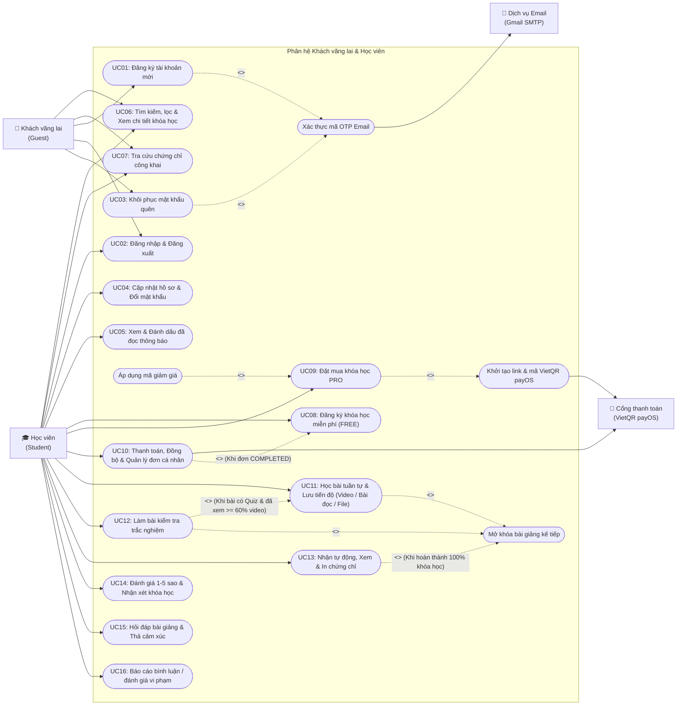
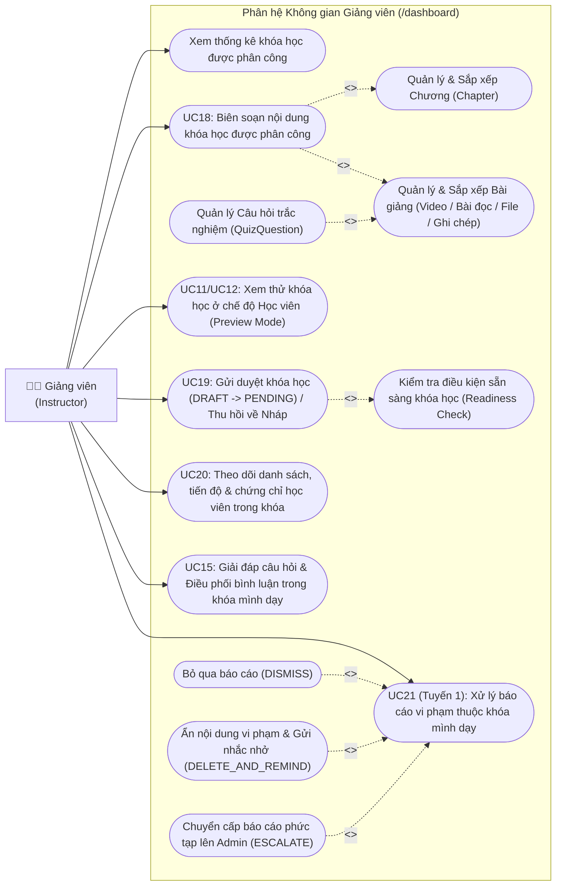
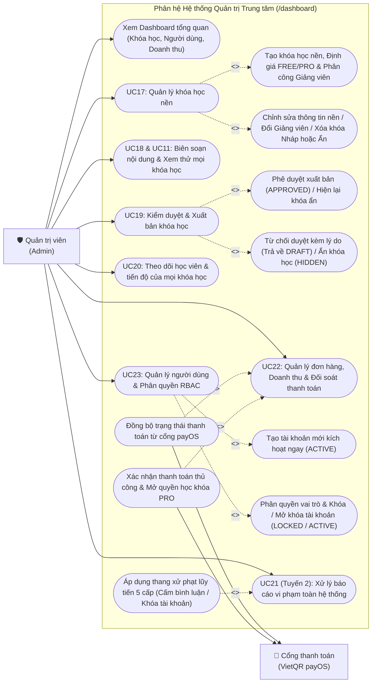

# THIẾT KẾ SƠ ĐỒ USE CASE VÀ ĐẶC TẢ CHI TIẾT HỆ THỐNG
**NextCode – Website đăng ký và học tập trực tuyến các khóa học lập trình**  
*Tài liệu mô tả chi tiết các tác nhân, sơ đồ Use Case tổng quát, sơ đồ phân rã theo tác nhân và bảng đặc tả chi tiết từng trường hợp sử dụng theo mã nguồn thực tế mới nhất*

---

## 1. Giới thiệu
Tài liệu này mô tả toàn bộ **Sơ đồ trường hợp sử dụng (Use Case Diagram)** và **Đặc tả chi tiết từng Use Case (Use Case Specification)** của hệ thống **NextCode**, được xây dựng và đối chiếu **100% theo mã nguồn thực tế hiện tại** (Backend NestJS + MongoDB và Frontend Vue 3 + TypeScript).

### Quy ước mô hình hóa
* **Tinh giản vai trò vận hành (Loại bỏ tác nhân Kế toán)**: Trong kiến trúc giao diện và luồng vận hành thực tế của hệ thống, toàn bộ nghiệp vụ quản lý đơn hàng, theo dõi lịch sử giao dịch, thống kê doanh thu, đồng bộ trạng thái cổng thanh toán và xác nhận thanh toán thủ công được **tập trung hoàn toàn về Quản trị viên (`ADMIN`)**. Hệ thống chỉ gồm **4 tác nhân người dùng** (`Khách vãng lai`, `Học viên`, `Giảng viên`, `Quản trị viên`) và **2 tác nhân hệ thống ngoài** (`Cổng thanh toán VietQR payOS`, `Dịch vụ Email SMTP`).
* **Quan hệ `<<include>>` (Bao gồm bắt buộc)**: Use Case cơ sở khi thực thi luôn bắt buộc gọi tới Use Case được bao gồm (ví dụ: *Đặt mua khóa học PRO* `<<include>>` *Tạo liên kết thanh toán & mã VietQR qua payOS*).
* **Quan hệ `<<extend>>` (Mở rộng có điều kiện)**: Use Case mở rộng chỉ được kích hoạt khi thỏa mãn một điều kiện cụ thể trong quá trình thực hiện Use Case cơ sở (ví dụ: *Áp dụng mã giảm giá* `<<extend>>` *Đặt mua khóa học PRO*; *Làm bài trắc nghiệm cuối bài* `<<extend>>` *Học bài giảng và lưu tiến độ* khi bài giảng có `hasQuiz = true`; *Cấp chứng chỉ tự động* `<<extend>>` *Học bài giảng / Làm trắc nghiệm* khi tiến độ khóa học đạt `100%`).
* **Quan hệ Kế thừa tác nhân (Generalization)**: Tác nhân `Học viên`, `Giảng viên` và `Quản trị viên` kế thừa các quyền tra cứu công khai của `Khách vãng lai` (xem trang chủ, tìm kiếm khóa học, xem chi tiết khóa học, tra cứu chứng chỉ) và dùng chung nhóm chức năng tài khoản đã đăng nhập (quản lý hồ sơ cá nhân, đổi mật khẩu, xem thông báo, đăng xuất).

---

## 2. Xác định các Tác nhân (Actors) của hệ thống

### 2.1. Các tác nhân người dùng (Primary Human Actors)

| STT | Tác nhân | Vai trò trong mã nguồn | Mô tả phạm vi trách nhiệm và quyền hạn |
| :-: | :--- | :--- | :--- |
| 1 | **Khách vãng lai** *(Guest)* | Chưa đăng nhập (`@Public()`) | Người dùng truy cập website khi chưa đăng nhập. Có thể xem trang chủ (khóa học nổi bật, khóa miễn phí, khóa Pro), tìm kiếm & lọc danh sách khóa học đã xuất bản (`APPROVED`), xem chi tiết khóa học (mô tả, mục tiêu, lộ trình chương/bài công khai, đánh giá sao), tra cứu tính hợp lệ của chứng chỉ qua mã số (`NC-YYYY-XXXXXXXX`), đăng ký tài khoản học viên mới qua OTP email, đăng nhập và khôi phục mật khẩu quên. |
| 2 | **Học viên** *(Student)* | `Role.STUDENT` | Người học đã đăng ký và kích hoạt tài khoản. Ngoài các quyền xem công khai, Học viên được: đăng ký học trực tiếp khóa miễn phí (`FREE`); xem trước giá, áp dụng mã giảm giá và tạo đơn mua khóa học trả phí (`PRO`); quét mã VietQR thanh toán qua payOS (hoặc bấm giả lập thanh toán khi demo), đồng bộ/hủy đơn và xem lịch sử đơn hàng & giao dịch; tham gia phòng học trực tuyến theo cơ chế mở khóa tuần tự (xem video tích lũy tối thiểu 60% thời lượng, đọc bài văn bản, xem trực tiếp tài liệu `.docx`, `.pdf`, `.md`, `.txt` nguyên bản và tải tài liệu, xem ghi chép & tóm tắt khóa `PRO`); làm bài trắc nghiệm cuối bài; nhận tự động, xem và in chứng chỉ hoàn thành khóa học; chấm sao & viết nhận xét đánh giá khóa học sau khi hoàn thành 100%; tham gia hỏi đáp, thả cảm xúc và báo cáo vi phạm dưới bài giảng. |
| 3 | **Giảng viên** *(Instructor)* | `Role.INSTRUCTOR` | Chuyên gia giảng dạy được Quản trị viên cấp tài khoản/phân quyền và phân công phụ trách khóa học. Giảng viên truy cập không gian quản lý (`/dashboard`) để: xem thống kê các khóa học được phân công; biên soạn cấu trúc chương (`Chapter`), bài giảng (`Lesson` gồm video tải lên/YouTube, bài đọc, file tài liệu đính kèm, ghi chép & tóm tắt khóa `PRO`) và câu hỏi trắc nghiệm (`QuizQuestion`); xem thử khóa học ở chế độ học viên (`Preview Mode` mở khóa toàn bộ bài); gửi khóa học chờ duyệt (`DRAFT` $\rightarrow$ `PENDING`) hoặc thu hồi về nháp (`PENDING` $\rightarrow$ `DRAFT`); theo dõi danh sách, tiến độ và chứng chỉ của học viên trong khóa mình dạy; tham gia giải đáp hỏi đáp bài giảng; xử lý báo cáo vi phạm **Tuyến 1** thuộc khóa học mình phụ trách (bỏ qua, ẩn nội dung & nhắc nhở, hoặc chuyển cấp lên Admin). |
| 4 | **Quản trị viên** *(Admin)* | `Role.ADMIN` | Người vận hành cao nhất của trung tâm đào tạo. Toàn quyền thực hiện các chức năng quản trị tại `/dashboard`: xem thống kê tổng quan toàn hệ thống (khóa học, người dùng, đơn hàng, doanh thu); khởi tạo khóa học nền (`DRAFT`), định giá khóa `FREE`/`PRO` và phân công Giảng viên; chỉnh sửa thông tin nền hoặc xóa khóa học (`DRAFT`/`HIDDEN`); biên soạn nội dung và xem thử mọi khóa học; kiểm duyệt khóa học do Giảng viên gửi lên (phê duyệt xuất bản `APPROVED`, từ chối kèm lý do `rejectReason` trả về `DRAFT`, ẩn khóa học `HIDDEN` hoặc hiện lại khóa ẩn); xem danh sách học viên của mọi khóa; quản lý toàn bộ đơn hàng khóa `PRO`, đối soát giao dịch payOS và xác nhận thanh toán thủ công để cấp quyền học; quản lý tài khoản người dùng (tạo tài khoản kích hoạt ngay, phân quyền vai trò, khóa/mở khóa tài khoản); xử lý báo cáo vi phạm **Tuyến 2** toàn hệ thống và áp dụng chế tài xử phạt lũy tiến tự động 5 cấp độ. |

### 2.2. Các tác nhân hệ thống ngoài (Secondary / External System Actors)

| STT | Tác nhân hệ thống ngoài | Giao thức tích hợp | Vai trò phối hợp với NextCode |
| :-: | :--- | :--- | :--- |
| 5 | **Cổng thanh toán VietQR payOS** *(payOS API v2)* | REST API (`payment-requests`) + Webhook (`HMAC-SHA256`) | Tiếp nhận yêu cầu từ `PayosService` để khởi tạo liên kết thanh toán và mã VietQR Napas 247 theo số tiền của đơn hàng; cung cấp API truy vấn trạng thái thanh toán (`PENDING`, `PAID`, `CANCELLED`, `EXPIRED`); hủy liên kết thanh toán khi đơn bị hủy; tự động gửi Webhook thông báo biến động số dư về `/api/v1/payments/payos/webhook` để hệ thống hoàn tất đơn hàng và mở khóa học `PRO`. |
| 6 | **Dịch vụ Email SMTP** *(Gmail SMTP / Nodemailer)* | Giao thức `SMTP` (TLS/SSL qua `MailService`) | Tiếp nhận yêu cầu gửi thư điện tử tự động chứa mã xác thực dùng một lần (OTP 6 chữ số, hiệu lực 5 phút) tới hộp thư của người dùng trong luồng đăng ký tài khoản mới và luồng khôi phục mật khẩu quên. |

---

## 3. Bảng tổng hợp danh mục các Use Case của hệ thống

Hệ thống bao gồm **23 Use Case** được chia thành **5 phân hệ nghiệp vụ**, phản ánh đầy đủ toàn bộ các Controller, Service và trang giao diện hiện có:

| Mã UC | Tên Use Case | Phân hệ | Tác nhân chính | Tác nhân phối hợp / Hệ thống ngoài | Endpoint / Trang giao diện chính |
| :---: | :--- | :--- | :--- | :--- | :--- |
| `UC01` | Đăng ký tài khoản và xác thực OTP Email | Xác thực & Tài khoản | Khách vãng lai | Dịch vụ Email SMTP | `POST /auth/register`, `POST /auth/verify-register-otp`, `POST /auth/resend-otp` (`/register`, `/verify-otp`) |
| `UC02` | Đăng nhập, làm mới phiên và đăng xuất | Xác thực & Tài khoản | Khách vãng lai, Học viên, Giảng viên, Quản trị viên | – | `POST /auth/login`, `POST /auth/refresh`, `POST /auth/logout` (`/login`) |
| `UC03` | Quên mật khẩu và đặt lại mật khẩu bằng OTP | Xác thực & Tài khoản | Khách vãng lai | Dịch vụ Email SMTP | `POST /auth/forgot-password`, `POST /auth/reset-password` (`/forgot-password`, `/reset-password`) |
| `UC04` | Quản lý hồ sơ cá nhân và đổi mật khẩu | Xác thực & Tài khoản | Học viên, Giảng viên, Quản trị viên | – | `GET /users/profile`, `PATCH /users/profile`, `PATCH /users/profile/password`, `POST /uploads/images` (`/profile`) |
| `UC05` | Xem và đánh dấu đã đọc thông báo | Xác thực & Tài khoản | Học viên, Giảng viên, Quản trị viên | – | `GET /notifications`, `PATCH /notifications/read-all` (`PublicHeader.vue`) |
| `UC06` | Tìm kiếm, lọc và xem chi tiết khóa học công khai | Khám phá & Công khai | Khách vãng lai, Học viên, Giảng viên, Quản trị viên | – | `GET /categories`, `GET /courses`, `GET /courses/featured`, `GET /courses/:id`, `GET /courses/:courseId/reviews` (`/`, `/courses`, `/courses/:id`) |
| `UC07` | Tra cứu và xác thực chứng chỉ công khai | Khám phá & Công khai | Khách vãng lai, Học viên, Giảng viên, Quản trị viên | – | `GET /certificates/verify/:code` (`/certificates/verify`, `/certificates/verify/:code`) |
| `UC08` | Đăng ký học khóa học miễn phí (`FREE`) | Học tập & Thanh toán | Học viên | – | `POST /courses/:courseId/enroll`, `GET /courses/:courseId/enrollment-status` (`/courses/:id`) |
| `UC09` | Đặt mua khóa học `PRO`, áp mã giảm giá và tạo mã VietQR | Học tập & Thanh toán | Học viên | Cổng thanh toán payOS | `POST /orders/preview`, `POST /orders` (`/checkout/:courseId`) |
| `UC10` | Thanh toán, đồng bộ trạng thái và quản lý đơn hàng cá nhân | Học tập & Thanh toán | Học viên | Cổng thanh toán payOS | `GET /orders/:id`, `POST /orders/:id/sync-payment`, `POST /orders/:id/simulate-payment`, `POST /orders/:id/cancel`, `POST /payments/payos/webhook`, `GET /orders/my-orders` (`/checkout/:courseId`, `/profile?tab=orders`) |
| `UC11` | Học bài giảng tuần tự, xem tài liệu đính kèm và lưu tiến độ | Học tập & Thanh toán | Học viên *(Giảng viên, Admin xem thử)* | – | `GET /enrollments/my-courses`, `GET /enrollments/courses/:courseId/learning`, `GET /enrollments/courses/:courseId/lessons/:lessonId`, `PATCH /enrollments/courses/:courseId/lessons/:lessonId/progress` (`/learn/:courseId`, `/profile?tab=courses`) |
| `UC12` | Làm bài kiểm tra trắc nghiệm cuối bài giảng | Học tập & Thanh toán | Học viên *(Giảng viên, Admin xem thử)* | – | `POST /enrollments/courses/:courseId/lessons/:lessonId/quiz-submit` (`/learn/:courseId`) |
| `UC13` | Nhận tự động, xem và in chứng chỉ hoàn thành khóa học | Học tập & Thanh toán | Học viên | – | `GET /certificates/my` (`/profile?tab=certificates`, `/learn/:courseId`) |
| `UC14` | Đánh giá và nhận xét khóa học sau khi hoàn thành | Tương tác & Cộng đồng | Học viên | – | `GET /courses/:courseId/reviews/me`, `PUT /courses/:courseId/reviews/me` (`/courses/:id`, `/learn/:courseId`) |
| `UC15` | Thảo luận hỏi đáp và bày tỏ cảm xúc tại bài giảng | Tương tác & Cộng đồng | Học viên, Giảng viên, Quản trị viên | – | `GET /courses/:courseId/lessons/:lessonId/comments`, `POST .../comments`, `POST .../comments/:commentId/reactions`, `DELETE .../comments/:commentId` (`/learn/:courseId`) |
| `UC16` | Báo cáo bình luận hoặc đánh giá vi phạm | Tương tác & Cộng đồng | Học viên, Giảng viên, Quản trị viên | – | `POST /courses/:courseId/lessons/:lessonId/comments/:commentId/report`, `POST /courses/:courseId/reviews/:reviewId/report` (`/learn/:courseId`, `/courses/:id`) |
| `UC17` | Khởi tạo khóa học nền, phân công giảng viên và cập nhật thông tin | Quản trị & Biên soạn | Quản trị viên | – | `GET /manage/instructors`, `POST /manage/courses`, `PATCH /manage/courses/:id`, `DELETE /manage/courses/:id` (`/dashboard/courses/new`, `/dashboard/courses/:id/edit`) |
| `UC18` | Biên soạn chương, bài giảng, học liệu và câu hỏi trắc nghiệm | Quản trị & Biên soạn | Giảng viên, Quản trị viên | – | `GET /manage/courses/:id`, `POST/PATCH/DELETE /manage/courses/:courseId/chapters...`, `.../lessons...`, `.../quiz-questions...`, `POST /uploads/videos`, `POST /uploads/files` (`/dashboard/courses/:id/edit`) |
| `UC19` | Gửi duyệt, thu hồi, phê duyệt, từ chối và ẩn/hiện khóa học | Quản trị & Biên soạn | Giảng viên, Quản trị viên | – | `POST /manage/courses/:id/submit`, `.../withdraw`, `.../approve`, `.../reject`, `.../hide` (`/dashboard/courses`, `/dashboard/courses/:id/edit`) |
| `UC20` | Theo dõi danh sách và tiến độ học viên theo khóa học | Quản trị & Biên soạn | Giảng viên, Quản trị viên | – | `GET /manage/courses/:courseId/students` (`/dashboard/courses/:id/students`) |
| `UC21` | Kiểm duyệt báo cáo vi phạm 2 tuyến và áp dụng chế tài xử phạt | Quản trị & Biên soạn | Giảng viên *(Tuyến 1)*, Quản trị viên *(Tuyến 2)* | – | `GET /manage/reports`, `PATCH /manage/reports/:reportId/resolve` (`/dashboard/reports`) |
| `UC22` | Quản lý đơn hàng, đối soát doanh thu và xác nhận thanh toán thủ công | Quản trị hệ thống | Quản trị viên | Cổng thanh toán payOS | `GET /manage/orders`, `POST /orders/:id/sync-payment`, `POST /manage/orders/:id/confirm` (`/dashboard/orders`) |
| `UC23` | Quản lý tài khoản người dùng, phân quyền vai trò và khóa/mở khóa | Quản trị hệ thống | Quản trị viên | – | `GET /manage/users`, `POST /manage/users`, `PATCH /manage/users/:id/role`, `PATCH /manage/users/:id/status`, `PATCH /auth/users/:id/role` (`/dashboard/users`) |

---

## 4. Các sơ đồ Use Case trực quan (Mermaid Diagrams)

### 4.1. Sơ đồ Use Case tổng quát của toàn hệ thống

```mermaid
flowchart LR
    %% Tác nhân bên trái
    Guest["👤 Khách vãng lai<br/>(Guest)"]
    Student["🎓 Học viên<br/>(Student)"]
    Instructor["👨‍🏫 Giảng viên<br/>(Instructor)"]
    Admin["🛡️ Quản trị viên<br/>(Admin)"]

    %% Tác nhân hệ thống ngoài bên phải
    SMTP["📧 Dịch vụ Email<br/>(Gmail SMTP)"]
    PayOS["🏦 Cổng thanh toán<br/>(VietQR payOS)"]

    subgraph NextCode["Hệ thống học lập trình trực tuyến NextCode"]
        direction TB

        subgraph SG_Public["1. Khám phá & Xác thực"]
            UC01(["UC01: Đăng ký & xác thực OTP"])
            UC02(["UC02: Đăng nhập & Đăng xuất"])
            UC03(["UC03: Quên & Đặt lại mật khẩu"])
            UC04(["UC04: Quản lý hồ sơ & Đổi mật khẩu"])
            UC05(["UC05: Xem & Đọc thông báo"])
            UC06(["UC06: Tìm kiếm, lọc & Xem chi tiết khóa học"])
            UC07(["UC07: Tra cứu & Xác thực chứng chỉ công khai"])
        end

        subgraph SG_Learning["2. Đăng ký học, Thanh toán, Học tập & Chứng chỉ"]
            UC08(["UC08: Đăng ký khóa học miễn phí (FREE)"])
            UC09(["UC09: Đặt mua khóa học PRO & Tạo mã VietQR"])
            UC10(["UC10: Thanh toán, Đồng bộ & Quản lý đơn cá nhân"])
            UC11(["UC11: Học bài tuần tự, Xem tài liệu & Lưu tiến độ"])
            UC12(["UC12: Làm bài trắc nghiệm cuối bài"])
            UC13(["UC13: Nhận, Xem & In chứng chỉ hoàn thành"])
        end

        subgraph SG_Community["3. Tương tác Hỏi đáp, Đánh giá & Báo cáo"]
            UC14(["UC14: Đánh giá khóa học sau khi hoàn thành"])
            UC15(["UC15: Thảo luận hỏi đáp & Thả cảm xúc bài giảng"])
            UC16(["UC16: Báo cáo bình luận / đánh giá vi phạm"])
        end

        subgraph SG_Manage["4. Biên soạn, Kiểm duyệt & Quản trị trung tâm"]
            UC17(["UC17: Tạo khóa học nền, Định giá & Phân công GV"])
            UC18(["UC18: Biên soạn Chương, Bài giảng & Trắc nghiệm"])
            UC19(["UC19: Gửi duyệt, Phê duyệt, Từ chối & Ẩn/Hiện khóa học"])
            UC20(["UC20: Theo dõi danh sách & Tiến độ học viên"])
            UC21(["UC21: Kiểm duyệt báo cáo vi phạm 2 tuyến & Xử phạt"])
            UC22(["UC22: Quản lý đơn hàng, Doanh thu & Xác nhận TT thủ công"])
            UC23(["UC23: Quản lý người dùng, Phân quyền & Khóa tài khoản"])
        end
    end

    %% Liên kết Khách vãng lai
    Guest --> UC01
    Guest --> UC02
    Guest --> UC03
    Guest --> UC06
    Guest --> UC07

    %% Liên kết Học viên
    Student --> UC02
    Student --> UC04
    Student --> UC05
    Student --> UC06
    Student --> UC07
    Student --> UC08
    Student --> UC09
    Student --> UC10
    Student --> UC11
    Student --> UC12
    Student --> UC13
    Student --> UC14
    Student --> UC15
    Student --> UC16

    %% Liên kết Giảng viên
    Instructor --> UC02
    Instructor --> UC04
    Instructor --> UC05
    Instructor --> UC11
    Instructor --> UC15
    Instructor --> UC16
    Instructor --> UC18
    Instructor --> UC19
    Instructor --> UC20
    Instructor --> UC21

    %% Liên kết Quản trị viên
    Admin --> UC02
    Admin --> UC04
    Admin --> UC05
    Admin --> UC11
    Admin --> UC15
    Admin --> UC16
    Admin --> UC17
    Admin --> UC18
    Admin --> UC19
    Admin --> UC20
    Admin --> UC21
    Admin --> UC22
    Admin --> UC23

    %% Liên kết Hệ thống ngoài
    UC01 --> SMTP
    UC03 --> SMTP
    UC09 --> PayOS
    UC10 --> PayOS
    UC22 --> PayOS
```

---

### 4.2. Sơ đồ Use Case phân rã của Khách vãng lai và Học viên (kèm quan hệ `<<include>>` / `<<extend>>`)

---

### 4.3. Sơ đồ Use Case phân rã của Giảng viên (Instructor)

---

### 4.4. Sơ đồ Use Case phân rã của Quản trị viên (Admin – Đã tích hợp quản lý Đơn hàng & Thanh toán)

---

## 5. Đặc tả chi tiết từng trường hợp sử dụng (Use Case Specifications)

### 5.1. Phân hệ 1: Xác thực, Tài khoản & Thông báo cá nhân (`UC01` – `UC05`)

#### 5.1.1. `UC01` – Đăng ký tài khoản và xác thực OTP Email
| Hạng mục | Nội dung đặc tả |
| :--- | :--- |
| **Mã & Tên Use Case** | `UC01` – Đăng ký tài khoản và xác thực OTP Email |
| **Tác nhân** | Khách vãng lai *(chính)*; Dịch vụ Email SMTP *(phối hợp)* |
| **Mô tả** | Cho phép khách truy cập tạo tài khoản học viên mới trên hệ thống và xác thực quyền sở hữu email bằng mã OTP 6 chữ số trước khi kích hoạt tài khoản. |
| **Tiền điều kiện** | Người dùng chưa đăng nhập và sở hữu một địa chỉ email chưa được kích hoạt (`ACTIVE`) hoặc bị khóa (`LOCKED`) trên hệ thống. |
| **Hậu điều kiện** | Bản ghi `User` được chuyển từ trạng thái `PENDING` sang `ACTIVE` với vai trò mặc định `STUDENT`; bản ghi `Otp` được đánh dấu `isUsed = true`; người dùng được cấp `accessToken` và cookie `refreshToken` để đăng nhập ngay. |
| **Luồng sự kiện chính** | 1. Khách vãng lai mở trang Đăng ký (`/register`), nhập Họ tên, Email, Mật khẩu, Xác nhận mật khẩu (cùng Ngày sinh, Nghề nghiệp, Lĩnh vực quan tâm nếu có) và bấm **Đăng ký**. 2. Hệ thống (`AuthService.register`) kiểm tra mật khẩu khớp, băm mật khẩu bằng Argon2, tạo mới (hoặc cập nhật nếu đang `PENDING`) bản ghi `User` với `status = PENDING` và `role = STUDENT`. 3. Hệ thống sinh mã OTP ngẫu nhiên 6 chữ số, băm bằng Argon2 (`codeHash`), lưu bản ghi `Otp` (`purpose = REGISTER`, hạn `expiresAt = 5 phút`, `failedAttempts = 0`) và gọi `MailService.sendRegisterOtp()` gửi email qua SMTP. 4. Giao diện chuyển sang trang Xác thực OTP (`/verify-otp`). Người dùng nhập mã OTP 6 chữ số nhận được từ hộp thư. 5. Hệ thống (`AuthService.verifyRegisterOtp`) kiểm tra mã OTP còn hạn, chưa vượt quá 5 lần thử sai và khớp với `codeHash`. 6. Hệ thống đánh dấu `otpRecord.isUsed = true`, chuyển trạng thái tài khoản sang `UserStatus.ACTIVE`, sinh JWT Access Token (15 phút) và thiết lập HttpOnly Cookie `refreshToken` (7 ngày), đưa học viên về trang chủ ở trạng thái đã đăng nhập. |
| **Luồng rẽ nhánh & Ngoại lệ** | • **E1 – Email đã tồn tại hoặc bị khóa**: Nếu email đã thuộc tài khoản `ACTIVE`, hệ thống trả lỗi `409 Conflict` (*"Email này đã được sử dụng trên hệ thống"*). Nếu tài khoản đang `LOCKED`, trả lỗi `401 Unauthorized`. • **E2 – Nhập sai hoặc hết hạn mã OTP**: Nếu mã OTP sai, hệ thống tăng `failedAttempts += 1` và báo số lần thử còn lại (tối đa 5 lần). Nếu `failedAttempts >= 5` hoặc quá 5 phút (`new Date() > expiresAt`), hệ thống từ chối và yêu cầu gửi lại mã mới. • **E3 – Yêu cầu gửi lại mã OTP (`POST /auth/resend-otp`)**: Hệ thống kiểm tra thời gian chờ `OTP_RESEND_COOLDOWN_SECONDS = 60 giây` kể từ `lastSentAt`. Nếu chưa đủ 60 giây thì báo số giây cần đợi thêm; nếu hợp lệ thì hủy OTP cũ, sinh và gửi OTP mới. |

---

#### 5.1.2. `UC02` – Đăng nhập, làm mới phiên và đăng xuất
| Hạng mục | Nội dung đặc tả |
| :--- | :--- |
| **Mã & Tên Use Case** | `UC02` – Đăng nhập, làm mới phiên và đăng xuất |
| **Tác nhân** | Khách vãng lai, Học viên, Giảng viên, Quản trị viên |
| **Mô tả** | Xác thực thông tin định danh của người dùng để cấp phiên làm việc bảo mật bằng cặp JWT Access Token và Refresh Token xoay vòng (Token Rotation), hỗ trợ tự động khôi phục phiên và đăng xuất an toàn. |
| **Tiền điều kiện** | Với đăng nhập: Tài khoản đã tồn tại ở trạng thái `ACTIVE`. Với làm mới phiên/đăng xuất: Trình duyệt có lưu cookie `refreshToken` (cô lập theo cổng client `refreshToken_<port>` hoặc `refreshToken`). |
| **Hậu điều kiện** | Đăng nhập/Làm mới thành công: Cấp `accessToken` mới và lưu bản ghi `RefreshToken` mới vào DB (thu hồi bản ghi cũ). Đăng xuất: Bản ghi `RefreshToken` hiện tại bị đánh dấu `isRevoked = true` và xóa cookie trên trình duyệt. |
| **Luồng sự kiện chính** | 1. Người dùng mở trang Đăng nhập (`/login`), nhập Email và Mật khẩu rồi bấm **Đăng nhập**. 2. Hệ thống (`AuthService.login`) tìm `User` theo email, kiểm tra trạng thái `ACTIVE` và đối chiếu mật khẩu với `passwordHash` bằng Argon2. 3. Hệ thống sinh JWT `accessToken` chứa `{ sub: userId, email, role }`, sinh chuỗi `refreshToken` ngẫu nhiên 80 ký tự hex, băm lưu vào bảng `RefreshToken` (`expiresAt = 7 ngày`, `isRevoked = false`) và gắn vào HttpOnly Cookie. 4. Khi tải lại trang hoặc khi `accessToken` hết hạn, Frontend tự động gọi `POST /auth/refresh`: hệ thống (`AuthService.refresh`) đối chiếu cookie với `tokenHash`, đánh dấu token cũ `isRevoked = true` và cấp cặp `accessToken` + `refreshToken` mới. 5. Khi người dùng bấm **Đăng xuất**, hệ thống (`AuthService.logout`) thu hồi `RefreshToken` hiện hành (`isRevoked = true`) và xóa cookie. |
| **Luồng rẽ nhánh & Ngoại lệ** | • **E1 – Tài khoản chưa xác thực OTP (`status === PENDING`)**: Hệ thống trả thông báo yêu cầu người dùng hoàn tất xác thực mã OTP email. • **E2 – Tài khoản bị khóa (`status === LOCKED`)**: Hệ thống từ chối đăng nhập (*"Tài khoản này đã bị khóa. Vui lòng liên hệ quản trị viên"*). • **E3 – Phát hiện tái sử dụng Refresh Token đã thu hồi (Reuse Detection)**: Nếu một `refreshToken` đã có `isRevoked = true` bị gửi lại lên `/auth/refresh`, hệ thống lập tức thu hồi **toàn bộ** `RefreshToken` của `userId` đó để bảo vệ tài khoản và buộc đăng nhập lại. |

---

#### 5.1.3. `UC03` – Quên mật khẩu và đặt lại mật khẩu bằng OTP
| Hạng mục | Nội dung đặc tả |
| :--- | :--- |
| **Mã & Tên Use Case** | `UC03` – Quên mật khẩu và đặt lại mật khẩu bằng OTP |
| **Tác nhân** | Khách vãng lai *(chính)*; Dịch vụ Email SMTP *(phối hợp)* |
| **Mô tả** | Giúp người dùng khôi phục quyền truy cập tài khoản khi quên mật khẩu thông qua mã xác thực OTP gửi về email đã đăng ký. |
| **Tiền điều kiện** | Người dùng nhớ địa chỉ email đăng ký tài khoản đang ở trạng thái `ACTIVE`. |
| **Hậu điều kiện** | Mật khẩu mới được băm bằng Argon2 và cập nhật vào `User.passwordHash`; toàn bộ `RefreshToken` cũ của tài khoản đều bị thu hồi (`isRevoked = true`). |
| **Luồng sự kiện chính** | 1. Tại trang Quên mật khẩu (`/forgot-password`), người dùng nhập địa chỉ Email và gửi yêu cầu. 2. Hệ thống (`AuthService.forgotPassword`) kiểm tra tài khoản. Nếu tồn tại và đang `ACTIVE`, hệ thống xóa các OTP `RESET_PASSWORD` cũ, sinh mã OTP 6 chữ số mới (`expiresAt = 5 phút`), lưu bản băm vào `Otp` và gọi `MailService.sendForgotPasswordOtp()`. 3. Hệ thống luôn trả về cùng một thông báo thống nhất (chống dò sự tồn tại của email) và chuyển sang trang Đặt lại mật khẩu (`/reset-password`). 4. Người dùng nhập Email, Mã OTP 6 chữ số, Mật khẩu mới và Xác nhận mật khẩu mới. 5. Hệ thống (`AuthService.resetPassword`) xác thực mã OTP, kiểm tra mật khẩu khớp, cập nhật `passwordHash` mới, đánh dấu `otpRecord.isUsed = true` và thu hồi toàn bộ phiên đăng nhập cũ của người dùng. |
| **Luồng rẽ nhánh & Ngoại lệ** | • **E1 – Email không tồn tại hoặc tài khoản không hoạt động**: Hệ thống vẫn hiển thị thông báo tiếp nhận tiêu chuẩn nhưng không gửi email để ngăn chặn tấn công dò quét tài khoản (User Enumeration). • **E2 – Mã OTP sai, quá hạn hoặc vượt quá 5 lần thử**: Hệ thống tăng `failedAttempts`, trả lỗi `400 Bad Request` và yêu cầu gửi lại mã mới (có kiểm tra cooldown 60 giây). |

---

#### 5.1.4. `UC04` – Quản lý hồ sơ cá nhân và đổi mật khẩu
| Hạng mục | Nội dung đặc tả |
| :--- | :--- |
| **Mã & Tên Use Case** | `UC04` – Quản lý hồ sơ cá nhân và đổi mật khẩu |
| **Tác nhân** | Học viên, Giảng viên, Quản trị viên |
| **Mô tả** | Cho phép người dùng đã đăng nhập xem, chỉnh sửa thông tin cá nhân, tải lên ảnh đại diện mới và thay đổi mật khẩu đăng nhập tại trang Hồ sơ cá nhân (`/profile`). |
| **Tiền điều kiện** | Người dùng đã đăng nhập với JWT hợp lệ. |
| **Hậu điều kiện** | Thông tin hồ sơ hoặc mật khẩu mới được lưu vào `User`; tệp ảnh đại diện cũ trên ổ đĩa được `UploadsService.deleteLocalFile()` tự động dọn dẹp nếu người dùng thay ảnh mới. |
| **Luồng sự kiện chính** | 1. Người dùng mở trang Hồ sơ cá nhân (`/profile`), hệ thống gọi `GET /users/profile` hiển thị Họ tên, Email, Vai trò, Ngày sinh, Nghề nghiệp, Lĩnh vực quan tâm và Ảnh đại diện. 2. Nếu người dùng chọn tải ảnh đại diện mới, trình duyệt gọi `POST /uploads/images?folder=avatars` (`UploadsService.finalizeUploadedImage` kiểm tra Magic Bytes định dạng `JPG/PNG/WEBP` và kích thước $\le 5\text{MB}$). 3. Người dùng chỉnh sửa thông tin và bấm **Lưu thay đổi** (`PATCH /users/profile`). Hệ thống cập nhật bản ghi `User` và xóa file ảnh đại diện cũ (nếu có). 4. Để đổi mật khẩu, người dùng chuyển sang tab **Bảo mật** (`/profile?tab=security`), nhập Mật khẩu hiện tại, Mật khẩu mới, Xác nhận mật khẩu mới và gửi `PATCH /users/profile/password`. 5. Hệ thống (`UsersService.changePassword`) kiểm tra mật khẩu hiện tại bằng Argon2, đảm bảo mật khẩu mới không trùng mật khẩu cũ rồi lưu bản băm mật khẩu mới. |
| **Luồng rẽ nhánh & Ngoại lệ** | • **E1 – File ảnh không hợp lệ**: Nếu file vượt quá 5MB hoặc chữ ký byte không phải `JPG/PNG/WEBP`, `UploadsService` xóa ngay file tạm và trả lỗi `400 Bad Request`. • **E2 – Mật khẩu hiện tại sai hoặc mật khẩu mới trùng mật khẩu cũ**: Hệ thống từ chối cập nhật và hiển thị thông báo lỗi cụ thể. |

---

#### 5.1.5. `UC05` – Xem và đánh dấu đã đọc thông báo
| Hạng mục | Nội dung đặc tả |
| :--- | :--- |
| **Mã & Tên Use Case** | `UC05` – Xem và đánh dấu đã đọc thông báo |
| **Tác nhân** | Học viên, Giảng viên, Quản trị viên |
| **Mô tả** | Cho phép người dùng theo dõi các thông báo từ hệ thống (nhắc nhở/cảnh cáo kiểm duyệt bình luận, đánh giá hoặc kết quả xử lý báo cáo vi phạm) qua biểu tượng chuông trên thanh Header. |
| **Tiền điều kiện** | Người dùng đã đăng nhập. |
| **Hậu điều kiện** | Khi chọn đánh dấu đã đọc, toàn bộ thông báo chưa đọc của người dùng được cập nhật `isRead = true` và số đếm `unreadCount` về `0`. |
| **Luồng sự kiện chính** | 1. Sau khi đăng nhập, thanh Header gọi `GET /notifications` lấy danh sách 20 thông báo mới nhất và tổng số thông báo chưa đọc (`unreadCount`). 2. Người dùng bấm vào biểu tượng chuông để mở danh sách thông báo. 3. Người dùng bấm **Đánh dấu đã đọc tất cả** (`PATCH /notifications/read-all`) hoặc bấm vào một thông báo có gắn `courseId` / `lessonId` để điều hướng tới bài học liên quan. |
| **Luồng rẽ nhánh & Ngoại lệ** | • Nếu người dùng chưa có thông báo nào, danh sách hiển thị trạng thái trống (*"Bạn chưa có thông báo nào"*). |

---

### 5.2. Phân hệ 2: Khám phá Khóa học & Tra cứu công khai (`UC06` – `UC07`)

#### 5.2.1. `UC06` – Tìm kiếm, lọc và xem chi tiết khóa học công khai
| Hạng mục | Nội dung đặc tả |
| :--- | :--- |
| **Mã & Tên Use Case** | `UC06` – Tìm kiếm, lọc và xem chi tiết khóa học công khai |
| **Tác nhân** | Khách vãng lai, Học viên, Giảng viên, Quản trị viên |
| **Mô tả** | Cho phép mọi người dùng khám phá danh sách khóa học đã được phê duyệt xuất bản (`status = APPROVED`), lọc đa điều kiện và xem trang giới thiệu chi tiết của từng khóa học. |
| **Tiền điều kiện** | Không yêu cầu đăng nhập (`@Public()`). Khóa học phải ở trạng thái `APPROVED`. |
| **Hậu điều kiện** | Hiển thị chính xác thông tin giới thiệu, cấu trúc chương/bài và đánh giá của khóa học mà không làm lộ đường dẫn video bài giảng (`videoUrl`), nội dung bài đọc (`content`), tài liệu (`fileUrl`) hoặc đáp án trắc nghiệm (`correctOption`). |
| **Luồng sự kiện chính** | 1. Người dùng truy cập Trang chủ (`/`) hoặc trang Danh sách khóa học (`/courses`). 2. Hệ thống gọi `GET /courses/featured`, `GET /categories` và `GET /courses` với các bộ lọc: từ khóa tên khóa học (`keyword`), loại khóa (`FREE` / `PRO`), danh mục (`categoryId`), trình độ (`level`), khoảng giá hiệu lực (`minPrice`, `maxPrice`), điểm đánh giá tối thiểu (`minRating`) và tiêu chí sắp xếp (`newest`, `price_asc`, `price_desc`, `rating_desc`). 3. Người dùng chọn một thẻ khóa học (khóa `PRO` hiển thị huy hiệu Vương miện vàng và giá ưu đãi nổi bật) để mở trang Chi tiết khóa học (`/courses/:id`). 4. Hệ thống (`CoursesService.getCourseById` và `ReviewsService.listCourseReviews`) trả về thông tin khóa học, giảng viên, danh mục, mục tiêu đầu ra, yêu cầu, đối tượng học viên (tự động ẩn các khối trống nếu khóa học không điền), danh sách chương/bài giảng (chỉ gồm tiêu đề, thứ tự, thời lượng và cờ `hasQuiz`) cùng thống kê và danh sách đánh giá công khai. |
| **Luồng rẽ nhánh & Ngoại lệ** | • **E1 – Khoảng giá lọc không hợp lệ**: Nếu `minPrice > maxPrice`, hệ thống trả lỗi `400 Bad Request`. • **E2 – Khóa học không tồn tại hoặc chưa xuất bản (`DRAFT`, `PENDING`, `HIDDEN`)**: API `GET /courses/:id` trả lỗi `404 Not Found` (*"Không tìm thấy khóa học"*). |

---

#### 5.2.2. `UC07` – Tra cứu và xác thực chứng chỉ công khai
| Hạng mục | Nội dung đặc tả |
| :--- | :--- |
| **Mã & Tên Use Case** | `UC07` – Tra cứu và xác thực chứng chỉ công khai |
| **Tác nhân** | Khách vãng lai, Học viên, Giảng viên, Quản trị viên |
| **Mô tả** | Cho phép bất kỳ cá nhân hoặc nhà tuyển dụng nào kiểm tra tính xác thực và hiệu lực của chứng chỉ NextCode thông qua mã số chứng chỉ hoặc quét mã QR trên chứng chỉ. |
| **Tiền điều kiện** | Người tra cứu có mã số chứng chỉ (định dạng `NC-YYYY-XXXXXXXX`) hoặc đường dẫn mã QR (`/certificates/verify/:code`). |
| **Hậu điều kiện** | Hiển thị kết quả xác thực công khai của chứng chỉ. |
| **Luồng sự kiện chính** | 1. Người dùng mở trang Tra cứu chứng chỉ (`/certificates/verify`) hoặc quét mã QR dẫn tới `/certificates/verify/:code`. 2. Người dùng nhập mã số chứng chỉ và bấm **Tra cứu** (`GET /certificates/verify/:code`). 3. Hệ thống (`CertificatesService.verifyByCode`) chuẩn hóa mã viết hoa, tìm trong bảng `Certificate` và đối chiếu thông tin `User` (học viên, giảng viên) cùng `Course`. 4. Giao diện hiển thị trạng thái hiệu lực (`VALID` = Hợp lệ / `REVOKED` = Đã thu hồi), Họ tên học viên, Tên khóa học, Giảng viên phụ trách và Ngày cấp. |
| **Luồng rẽ nhánh & Ngoại lệ** | • **E1 – Mã chứng chỉ không tồn tại**: Hệ thống trả lỗi `404 Not Found` (*"Không tìm thấy chứng chỉ với mã số này"*). |

---

### 5.3. Phân hệ 3: Đăng ký học, Thanh toán khóa PRO, Học tập tuần tự & Chứng chỉ (`UC08` – `UC13`)

#### 5.3.1. `UC08` – Đăng ký học khóa học miễn phí (`FREE`)
| Hạng mục | Nội dung đặc tả |
| :--- | :--- |
| **Mã & Tên Use Case** | `UC08` – Đăng ký học khóa học miễn phí (`FREE`) |
| **Tác nhân** | Học viên (`Role.STUDENT`) |
| **Mô tả** | Cho phép học viên đăng ký tham gia ngay một khóa học miễn phí (`type = FREE`) mà không cần qua bước thanh toán, đồng thời khởi tạo lộ trình mở khóa bài học đầu tiên. |
| **Tiền điều kiện** | Học viên đã đăng nhập; khóa học ở trạng thái `APPROVED`, thuộc loại `FREE`, có ít nhất 1 bài giảng và học viên chưa từng đăng ký khóa học này. |
| **Hậu điều kiện** | Một bản ghi `Enrollment` (`status = LEARNING`, `progressPercent = 0`) được tạo; các bản ghi `LessonProgress` được sinh cho toàn bộ bài giảng trong khóa (bài đầu tiên `UNLOCKED`, tất cả bài sau `LOCKED`). |
| **Luồng sự kiện chính** | 1. Trên trang Chi tiết khóa học (`/courses/:id`) của một khóa `FREE`, học viên bấm **Đăng ký học miễn phí** (`POST /courses/:courseId/enroll`). 2. Hệ thống (`EnrollmentsService.enrollCourse`) kiểm tra khóa học đang `APPROVED`, có `type === FREE` và cặp `(studentId, courseId)` chưa tồn tại trong `Enrollment`. 3. Hệ thống gọi `initializeEnrollment()` tạo bản ghi `Enrollment`, gắn `lastLessonId` là bài giảng đầu tiên và tạo danh sách `LessonProgress` cho toàn bộ bài giảng của khóa. 4. Giao diện chuyển thẳng học viên vào Phòng học trực tuyến (`/learn/:courseId`). |
| **Luồng rẽ nhánh & Ngoại lệ** | • **E1 – Gọi API đăng ký trực tiếp cho khóa `PRO`**: Hệ thống chặn với lỗi `403 Forbidden` (*"Khóa học Pro yêu cầu tạo đơn hàng và hoàn tất thanh toán trước khi vào học"*). • **E2 – Đã đăng ký khóa học trước đó**: Hệ thống trả lỗi `409 Conflict` (*"Bạn đã đăng ký khóa học này trước đó"*). |

---

#### 5.3.2. `UC09` – Đặt mua khóa học `PRO`, áp mã giảm giá và tạo mã VietQR
| Hạng mục | Nội dung đặc tả |
| :--- | :--- |
| **Mã & Tên Use Case** | `UC09` – Đặt mua khóa học `PRO`, áp mã giảm giá và tạo mã VietQR |
| **Tác nhân** | Học viên *(chính)*; Cổng thanh toán VietQR payOS *(phối hợp)* |
| **Mô tả** | Học viên xem thông tin thanh toán của khóa học `PRO`, chọn hoặc nhập mã giảm giá để Server tính toán số tiền cuối cùng, sau đó khởi tạo đơn hàng kèm mã VietQR tự động qua cổng payOS. |
| **Tiền điều kiện** | Học viên đã đăng nhập (`Role.STUDENT`); khóa học ở trạng thái `APPROVED`, có `type === PRO` và học viên chưa sở hữu `Enrollment` của khóa học này. |
| **Hậu điều kiện** | Bản ghi `Order` được lưu ở trạng thái `PENDING` với thời hạn `expiresAt` (mặc định 15 phút), kèm đầy đủ dữ liệu link thanh toán và ảnh mã VietQR từ payOS. |
| **Luồng sự kiện chính** | 1. Từ trang Chi tiết khóa học `PRO`, học viên bấm **Mua khóa học Pro** để mở trang Thanh toán (`/checkout/:courseId`). 2. Trình duyệt gọi `POST /orders/preview` (`OrdersService.previewCheckout`). Hệ thống trả về giá gốc, giá ưu đãi của khóa, danh sách mã giảm giá khả dụng (`NEXTCODE10`, `SINHVIEN20`, `PRO50K`, và `TEST2K` khi bật chế độ mô phỏng) cùng số tiền thực trả `finalAmount`. 3. *(Tùy chọn - `<<extend>>`)* Học viên chọn hoặc nhập một mã giảm giá: hệ thống kiểm tra điều kiện giá trị đơn tối thiểu `minOrderAmount` và tính lại `discountAmount`, `finalAmount` (đảm bảo tối thiểu `2.000đ`). 4. Học viên bấm **Tạo mã QR thanh toán** (`POST /orders`). 5. Hệ thống (`OrdersService.createOrder`) kiểm tra các đơn `PENDING` hiện có của học viên cho khóa này: nếu có đơn còn hạn cùng số tiền & mã giảm giá thì tái sử dụng; nếu đổi mã giảm giá khác thì hủy đơn chờ cũ trên DB và trên payOS. 6. Hệ thống sinh mã đơn nội bộ `orderCode` (`DHxxxxxx`) và mã số nguyên `payosOrderCode`, gọi `PayosService.createPaymentLink()` kèm chữ ký `HMAC-SHA256` để tạo yêu cầu thanh toán trên cổng payOS API v2. 7. Hệ thống lưu thông tin `paymentLinkId`, `checkoutUrl`, `qrCode`, `qrImageUrl`, `bankBin`, `bankName`, `accountNumber`, `accountName`, `transferDescription` (`NEXTCODE DHxxxxxx`) vào `Order` và hiển thị mã VietQR cùng đồng hồ đếm ngược trên giao diện. |
| **Luồng rẽ nhánh & Ngoại lệ** | • **E1 – Mã giảm giá không tồn tại hoặc chưa đủ giá trị đơn tối thiểu**: Hệ thống trả lỗi `400 Bad Request` kèm thông báo điều kiện áp dụng. • **E2 – Học viên đã sở hữu khóa học**: Trả lỗi `409 Conflict` (*"Bạn đã sở hữu khóa học này"*). • **E3 – Không kết nối được cổng payOS**: `PayosService` trả lỗi `502 Bad Gateway` và không tạo đơn sai lệch. |

---

#### 5.3.3. `UC10` – Thanh toán, đồng bộ trạng thái và quản lý đơn hàng cá nhân
| Hạng mục | Nội dung đặc tả |
| :--- | :--- |
| **Mã & Tên Use Case** | `UC10` – Thanh toán, đồng bộ trạng thái và quản lý đơn hàng cá nhân |
| **Tác nhân** | Học viên *(chính)*; Cổng thanh toán VietQR payOS *(phối hợp)* |
| **Mô tả** | Xử lý quá trình hoàn tất thanh toán đơn hàng khóa `PRO` (qua Webhook tự động từ payOS, đồng bộ chủ động hoặc giả lập demo), tự động mở quyền học khóa `PRO`, cho phép hủy đơn đang chờ và xem lịch sử đơn hàng/giao dịch cá nhân. |
| **Tiền điều kiện** | Học viên đã có bản ghi `Order` thuộc tài khoản của mình. |
| **Hậu điều kiện** | Khi thanh toán thành công: bản ghi `PaymentTransaction` (`status = SUCCESS`) được lưu duy nhất theo `reference`; `Order` chuyển sang `COMPLETED`; bản ghi `Enrollment` và `LessonProgress` được tạo tự động để học viên vào học ngay. |
| **Luồng sự kiện chính** | 1. Học viên dùng ứng dụng ngân hàng quét mã VietQR trên trang `/checkout/:courseId` và chuyển khoản đúng số tiền, nội dung `NEXTCODE DHxxxxxx`. 2. **Xác nhận tự động qua Webhook**: Cổng payOS gửi POST request tới `/api/v1/payments/payos/webhook`. Hệ thống (`OrdersService.handlePayosWebhook`) xác thực chữ ký `HMAC-SHA256` (`timingSafeEqual`), kiểm tra `amount >= order.finalAmount`, ghi nhận `PaymentTransaction`, cập nhật `Order.status = COMPLETED` và gọi `EnrollmentsService.createEnrollmentForCompletedOrder()`. 3. **Đồng bộ chủ động**: Trang thanh toán định kỳ (hoặc khi học viên bấm **Tôi đã chuyển khoản / Kiểm tra thanh toán**) gọi `POST /orders/:id/sync-payment`. Hệ thống truy vấn trực tiếp `PayosService.getPaymentLinkInfo(payosOrderCode)`; nếu payOS báo `PAID` và đủ tiền thì hoàn tất đơn và mở khóa học ngay. 4. Học viên có thể mở trang Hồ sơ cá nhân $\rightarrow$ tab **Đơn hàng & Giao dịch** (`/profile?tab=orders`, gọi `GET /orders/my-orders`) để xem danh sách đơn hàng (lọc theo trạng thái) và bảng lịch sử giao dịch thanh toán. |
| **Luồng rẽ nhánh & Ngoại lệ** | • **A1 – Giả lập thanh toán khi Demo (`POST /orders/:id/simulate-payment`)**: Khi `PAYMENT_SIMULATION_ENABLED=true` (ngoài môi trường Production), học viên có thể bấm nút giả lập thanh toán để hoàn tất đơn ngay với `paymentMethod = SIMULATION` và hủy link chờ trên payOS. • **A2 – Học viên chủ động hủy đơn đang chờ (`POST /orders/:id/cancel`)**: Khi đơn đang `PENDING`, học viên có thể hủy đơn; hệ thống chuyển trạng thái sang `CANCELLED` và gọi `PayosService.cancelPaymentLink()`. • **E1 – Đơn hàng quá hạn chờ thanh toán (`expiresAt <= now`)**: Hệ thống tự động chuyển trạng thái đơn sang `EXPIRED`. • **E2 – Số tiền chuyển khoản thấp hơn `finalAmount`**: Hệ thống lưu `PaymentTransaction` với `status = FAILED` và giữ đơn ở trạng thái chờ để đối soát, không mở quyền học. |

---

#### 5.3.4. `UC11` – Học bài giảng tuần tự, xem tài liệu đính kèm và lưu tiến độ
| Hạng mục | Nội dung đặc tả |
| :--- | :--- |
| **Mã & Tên Use Case** | `UC11` – Học bài giảng tuần tự, xem tài liệu đính kèm và lưu tiến độ |
| **Tác nhân** | Học viên *(chính)*; Giảng viên và Quản trị viên *(chế độ Xem thử `Preview Mode`)* |
| **Mô tả** | Cung cấp không gian phòng học trực tuyến (`/learn/:courseId`) để học viên xem video bài giảng, đọc nội dung bài đọc, xem trực tiếp định dạng gốc của tệp tài liệu đính kèm (`.docx`, `.pdf`, `.md`, `.txt`), xem ghi chép & tóm tắt (khóa `PRO`), lưu vị trí đang học và mở khóa tuần tự bài giảng kế tiếp. |
| **Tiền điều kiện** | Học viên đã có `Enrollment` hợp lệ với khóa học và bài giảng được chọn có trạng thái `UNLOCKED` hoặc `COMPLETED` (không bị `LOCKED`). Giảng viên phụ trách hoặc Admin được vào ở chế độ `isPreviewMode = true`. |
| **Hậu điều kiện** | Vị trí xem video `lastPositionSec` và tổng thời gian đã xem `watchedSeconds` được lưu vào `LessonProgress`; khi đạt điều kiện hoàn thành bài không có trắc nghiệm, bài hiện tại chuyển sang `COMPLETED`, bài kế tiếp chuyển sang `UNLOCKED` và `Enrollment.progressPercent` được cập nhật. |
| **Luồng sự kiện chính** | 1. Học viên mở khóa học từ trang chi tiết hoặc mục **Khóa học của tôi** (`/profile?tab=courses` $\rightarrow$ `/learn/:courseId`). 2. Hệ thống (`EnrollmentsService.getCourseLearning`) trả về cây chương/bài giảng kèm trạng thái tiến độ của từng bài và tự động chọn bài đang học gần nhất (`lastLessonId`). 3. Học viên chọn một bài giảng đã mở khóa (`GET /enrollments/courses/:courseId/lessons/:lessonId`). Hệ thống trả về `videoUrl`, `duration`, nội dung bài đọc `content`, tài liệu đính kèm (`fileUrl`, `fileName`), ghi chép `note` và tóm tắt `summary` (với khóa `PRO`). 4. Trên giao diện học tập:    - Nếu bài có tài liệu đính kèm (`.docx`, `.pdf`, `.md`, `.txt`), `LessonDocumentViewer.vue` hiển thị nguyên bản định dạng tài liệu ngay trong khung "Nội dung bài đọc" và cho phép tải tệp gốc ở khối đính kèm bên dưới.    - Nếu bài có video, trình phát tự động tua tới `lastPositionSec` đã lưu và định kỳ gửi `PATCH .../lessons/:lessonId/progress` cập nhật `lastPositionSec` và `watchedSeconds`. 5. Khi `watchedSeconds >= Math.ceil(duration * 0.6)` (xem tối thiểu **60% thời lượng video**) hoặc khi học viên bấm **Hoàn thành bài học** đối với bài đọc không có video, hệ thống ghi nhận `watchedFully = true`. 6. Nếu bài giảng không có câu hỏi trắc nghiệm (`hasQuiz = false`), hệ thống lập tức chuyển bài học sang `COMPLETED`, mở khóa bài giảng kế tiếp (`UNLOCKED`) và tính lại phần trăm tiến độ khóa học. |
| **Luồng rẽ nhánh & Ngoại lệ** | • **A1 – Chế độ Xem thử (`isPreviewMode = true`) cho Giảng viên và Admin**: Mọi bài giảng đều hiển thị ở trạng thái `UNLOCKED` để rà soát nội dung mà không ghi vào cơ sở dữ liệu. • **E1 – Cố tình truy cập bài giảng đang bị khóa (`status === LOCKED`)**: Máy chủ chặn với lỗi `403 Forbidden` (*"Bài học này đang bị khóa. Bạn cần hoàn thành bài học trước đó để mở khóa"*). • **E2 – Bài giảng có câu hỏi trắc nghiệm (`hasQuiz = true`)**: Khi đạt `watchedFully = true`, hệ thống chưa hoàn thành bài ngay mà mở khóa bảng câu hỏi trắc nghiệm (`quizUnlocked = true`) để học viên thực hiện `UC12`. |

---

#### 5.3.5. `UC12` – Làm bài kiểm tra trắc nghiệm cuối bài giảng
| Hạng mục | Nội dung đặc tả |
| :--- | :--- |
| **Mã & Tên Use Case** | `UC12` – Làm bài kiểm tra trắc nghiệm cuối bài giảng |
| **Tác nhân** | Học viên *(chính)*; Giảng viên và Quản trị viên *(chế độ Xem thử)* |
| **Mô tả** | Học viên trả lời bộ câu hỏi trắc nghiệm sau bài giảng để kiểm tra mức độ nắm vững kiến thức và đủ điều kiện hoàn thành bài học, mở khóa bài tiếp theo. |
| **Tiền điều kiện** | Bài giảng có câu hỏi trắc nghiệm (`hasQuiz = true`), đang mở khóa (`status !== LOCKED`), và nếu bài có video thì học viên đã xem tối thiểu 60% thời lượng video (`watchedFully = true`). |
| **Hậu điều kiện** | Từng câu trả lời được lưu vào bảng `QuizAttempt`; nếu đạt ngưỡng điểm qua bài, `LessonProgress` chuyển sang `quizPassed = true`, `status = COMPLETED` và mở khóa bài giảng kế tiếp. |
| **Luồng sự kiện chính** | 1. Sau khi phần trắc nghiệm được mở khóa trên trang `/learn/:courseId`, học viên chọn phương án trả lời cho tất cả câu hỏi của bài và bấm **Nộp bài trắc nghiệm** (`POST /enrollments/courses/:courseId/lessons/:lessonId/quiz-submit`). 2. Hệ thống (`EnrollmentsService.submitLessonQuiz`) kiểm tra danh sách câu trả lời hợp lệ, chấm điểm từng câu và lưu lịch sử vào `QuizAttempt`. 3. Hệ thống áp dụng quy tắc xét đạt:    - Nếu bài có **1 câu hỏi**: yêu cầu trả lời đúng **100%** (`1/1`).    - Nếu bài có **từ 2 câu hỏi trở lên**: yêu cầu tỷ lệ đúng đạt tối thiểu **70%** (`correctCount / totalQuestions >= 0.7`). 4. Với các câu trả lời **đúng**, hệ thống trả về lời giải thích chi tiết (`explanation`). 5. Nếu kết quả **Đạt (`passed = true`)**, hệ thống đánh dấu `quizPassed = true`, hoàn thành bài giảng, mở khóa bài tiếp theo và cập nhật `Enrollment.progressPercent`. |
| **Luồng rẽ nhánh & Ngoại lệ** | • **E1 – Chưa xem đủ 60% thời lượng video**: Máy chủ từ chối yêu cầu nộp bài với lỗi `400 Bad Request`. • **E2 – Nộp thiếu câu trả lời hoặc gửi trùng `questionId`**: Máy chủ trả lỗi `400 Bad Request` yêu cầu trả lời đầy đủ tất cả câu hỏi của bài. • **E3 – Kết quả Chưa đạt (`passed = false`)**: Hệ thống không mở bài tiếp theo, không tiết lộ đáp án đúng hay lời giải thích của câu sai, và cho phép học viên làm lại (`canRetry = true`). |

---

#### 5.3.6. `UC13` – Nhận tự động, xem và in chứng chỉ hoàn thành khóa học
| Hạng mục | Nội dung đặc tả |
| :--- | :--- |
| **Mã & Tên Use Case** | `UC13` – Nhận tự động, xem và in chứng chỉ hoàn thành khóa học |
| **Tác nhân** | Học viên (`Role.STUDENT`) |
| **Mô tả** | Hệ thống tự động cấp chứng chỉ điện tử có mã định danh duy nhất ngay khi học viên hoàn thành 100% bài giảng trong khóa học, cho phép học viên xem và in/xuất chứng chỉ. |
| **Tiền điều kiện** | Học viên hoàn thành bài giảng cuối cùng của khóa học (`completedCount === totalLessons` và `totalLessons > 0`). |
| **Hậu điều kiện** | `Enrollment` chuyển sang `status = COMPLETED`, ghi nhận `completedAt`; một bản ghi `Certificate` duy nhất được tạo cho cặp `(studentId, courseId)` với mã `NC-YYYY-XXXXXXXX`. |
| **Luồng sự kiện chính** | 1. Ngay khi học viên hoàn thành bài giảng cuối cùng (qua `UC11` hoặc `UC12`), `EnrollmentsService.completeLessonAndAdvance()` chuyển `Enrollment.status = COMPLETED` (`progressPercent = 100`) và gọi tự động `CertificatesService.issueForEnrollment()`. 2. Hệ thống sinh mã chứng chỉ duy nhất `NC-YYYY-XXXXXXXX`, lưu bản ghi `Certificate` (`status = VALID`, `qrCode = /certificates/verify/<code >`) và trả thông tin chứng chỉ về giao diện phòng học để chúc mừng học viên. 3. Học viên có thể mở Hồ sơ cá nhân $\rightarrow$ tab **Chứng chỉ của tôi** (`/profile?tab=certificates`, gọi `GET /certificates/my`) để xem danh sách chứng chỉ đã đạt, mở thẻ chứng chỉ (`CertificateCardView.vue`), in/lưu PDF qua trình duyệt hoặc mở trang xác thực công khai. |
| **Luồng rẽ nhánh & Ngoại lệ** | • Nếu học viên đã được cấp chứng chỉ cho khóa học đó từ trước, hệ thống trả về lại đúng bản ghi `Certificate` hiện có mà không sinh bản ghi trùng lặp. |

---

### 5.4. Phân hệ 4: Tương tác Hỏi đáp, Đánh giá khóa học & Báo cáo vi phạm (`UC14` – `UC16`)

#### 5.4.1. `UC14` – Đánh giá và nhận xét khóa học sau khi hoàn thành
| Hạng mục | Nội dung đặc tả |
| :--- | :--- |
| **Mã & Tên Use Case** | `UC14` – Đánh giá và nhận xét khóa học sau khi hoàn thành |
| **Tác nhân** | Học viên (`Role.STUDENT`) |
| **Mô tả** | Cho phép học viên đã hoàn thành 100% khóa học chấm điểm từ 1 đến 5 sao kèm nhận xét văn bản, hoặc chỉnh sửa đánh giá đã gửi, đồng thời tự động tính lại điểm đánh giá trung bình của khóa học. |
| **Tiền điều kiện** | Học viên đã hoàn thành 100% khóa học (`Enrollment.status === COMPLETED` hoặc `progressPercent >= 100`) hoặc đã từng gửi đánh giá hợp lệ cho khóa học đó. |
| **Hậu điều kiện** | Bản ghi `CourseReview` được tạo mới hoặc cập nhật; `Course.avgRating` được tính lại từ tất cả đánh giá có `visibilityStatus = VISIBLE`. |
| **Luồng sự kiện chính** | 1. Khi vừa hoàn thành khóa học (hộp thoại `CourseCompletionReviewModal.vue`) hoặc tại mục Đánh giá trên trang Chi tiết khóa học (`/courses/:id`), hệ thống gọi `GET /courses/:courseId/reviews/me` kiểm tra quyền đánh giá (`canReview`). 2. Học viên chọn số sao (`1..5`), nhập nội dung nhận xét (tùy chọn, tối đa 2000 ký tự) và bấm **Gửi đánh giá** (`PUT /courses/:courseId/reviews/me`). 3. Hệ thống (`ReviewsService.upsertMyCourseReview`) tạo mới hoặc cập nhật bản ghi `CourseReview`, đánh dấu cờ `hasComment = comment.length > 0`. 4. Hệ thống gọi `recalculateCourseRating()` tính lại điểm trung bình `avgRating` và phân bố 1–5 sao, ưu tiên hiển thị các đánh giá có nhận xét chữ lên đầu danh sách công khai. |
| **Luồng rẽ nhánh & Ngoại lệ** | • **E1 – Chưa hoàn thành 100% khóa học**: Hệ thống trả lỗi `403 Forbidden` (*"Bạn cần hoàn thành 100% khóa học trước khi gửi đánh giá"*). • **E2 – Tài khoản đang trong thời gian bị cấm bình luận (`commentBannedUntil > now`)**: Hệ thống chặn gửi đánh giá có nội dung chữ và thông báo thời điểm hết hạn cấm. • **E3 – Đánh giá cũ đã bị ẩn do vi phạm (`visibilityStatus === HIDDEN`)**: Học viên không thể chỉnh sửa lại đánh giá đã bị ẩn. |

---

#### 5.4.2. `UC15` – Thảo luận hỏi đáp và bày tỏ cảm xúc tại bài giảng
| Hạng mục | Nội dung đặc tả |
| :--- | :--- |
| **Mã & Tên Use Case** | `UC15` – Thảo luận hỏi đáp và bày tỏ cảm xúc tại bài giảng |
| **Tác nhân** | Học viên, Giảng viên, Quản trị viên |
| **Mô tả** | Cung cấp khu vực thảo luận hỏi đáp 2 cấp (câu hỏi gốc và các câu trả lời phản hồi) ngay trong từng bài giảng (`LessonDiscussionDrawer.vue`), hỗ trợ bày tỏ 7 loại cảm xúc và xóa bình luận theo quyền. |
| **Tiền điều kiện** | Người dùng đã đăng nhập; nếu là Học viên thì phải có `Enrollment` và bài giảng đó đã mở khóa (`LessonProgress.status !== LOCKED`). Tài khoản không bị khóa và không trong thời hạn `commentBannedUntil`. |
| **Hậu điều kiện** | Bản ghi `LessonComment` hoặc trạng thái `reactions` được lưu/cập nhật trong cơ sở dữ liệu. |
| **Luồng sự kiện chính** | 1. Trong phòng học (`/learn/:courseId`), người dùng mở ngăn **Hỏi đáp bài giảng** (`GET /courses/:courseId/lessons/:lessonId/comments`). Hệ thống hiển thị danh sách câu hỏi gốc (`parentId = null`) cùng các câu trả lời con (`parentId != null`) và gắn huy hiệu **Giảng viên khóa học** cho bình luận của giảng viên phụ trách. 2. Người dùng nhập câu hỏi mới hoặc bấm **Trả lời** một bình luận đã có (`POST .../comments` kèm `parentId`, `replyToUserId`). Hệ thống (`QuestionsService.createLessonComment`) lưu bản ghi `LessonComment`. 3. Người dùng có thể bày tỏ hoặc gỡ một trong 7 cảm xúc (`LIKE`, `LOVE`, `CARE`, `HAHA`, `WOW`, `SAD`, `ANGRY`) trên bình luận (`POST .../comments/:commentId/reactions`). 4. Tác giả bình luận, Giảng viên phụ trách khóa học hoặc Admin có thể xóa bình luận (`DELETE .../comments/:commentId`; nếu xóa câu hỏi gốc thì xóa luôn các câu trả lời con). |
| **Luồng rẽ nhánh & Ngoại lệ** | • **E1 – Học viên chưa đăng ký khóa học hoặc bài học còn đang `LOCKED`**: Hệ thống chặn truy cập hỏi đáp với lỗi `403 Forbidden`. • **E2 – Tài khoản đang bị cấm bình luận (`commentBannedUntil > now`)**: Hệ thống từ chối đăng bình luận và hiển thị rõ ngày giờ hết hạn cấm. |

---

#### 5.4.3. `UC16` – Báo cáo bình luận hoặc đánh giá vi phạm
| Hạng mục | Nội dung đặc tả |
| :--- | :--- |
| **Mã & Tên Use Case** | `UC16` – Báo cáo bình luận hoặc đánh giá vi phạm |
| **Tác nhân** | Học viên, Giảng viên, Quản trị viên |
| **Mô tả** | Cho phép người dùng báo cáo các câu hỏi, câu trả lời hoặc nhận xét đánh giá khóa học có nội dung spam, quảng cáo hoặc vi phạm tiêu chuẩn cộng đồng để đẩy vào hàng đợi kiểm duyệt 2 tuyến. |
| **Tiền điều kiện** | Người dùng đã đăng nhập và không phải là tác giả của chính bình luận/đánh giá đó; với đánh giá khóa học thì đánh giá phải có nội dung văn bản (`comment` không rỗng). |
| **Hậu điều kiện** | Lượt báo cáo được nhúng vào mảng `reports` của `LessonComment` / `CourseReview`, đồng thời tạo (hoặc cập nhật) bản ghi `Report` trong hàng đợi kiểm duyệt. |
| **Luồng sự kiện chính** | 1. Người dùng bấm nút **Báo cáo vi phạm** trên một bình luận bài giảng hoặc một đánh giá khóa học, nhập lý do báo cáo (tối đa 500 ký tự) và xác nhận gửi. 2. Hệ thống (`QuestionsService.reportComment` hoặc `ReviewsService.reportCourseReview`) kiểm tra người báo cáo không tự báo cáo chính mình và ghi nhận vào mảng `reports`. 3. Hệ thống phân tuyến tự động khi tạo bản ghi `Report`:    - Nếu tác giả bị báo cáo là Học viên thông thường: tạo `Report` với `status = PENDING` và `escalatedToAdmin = false` (đưa vào hàng đợi **Tuyến 1** của Giảng viên phụ trách khóa học).    - Nếu tác giả bị báo cáo là Giảng viên hoặc Admin: tự động tạo `Report` với `status = ESCALATED` và `escalatedToAdmin = true` (chuyển thẳng lên hàng đợi **Tuyến 2** của Admin để đảm bảo khách quan). |
| **Luồng rẽ nhánh & Ngoại lệ** | • **E1 – Tự báo cáo nội dung của chính mình**: Hệ thống từ chối với lỗi `400 Bad Request`. • **E2 – Báo cáo đánh giá chỉ chấm sao (không có nhận xét chữ)**: Hệ thống từ chối vì không có nội dung văn bản vi phạm. |

---

### 5.5. Phân hệ 5: Biên soạn, Kiểm duyệt & Quản trị hệ thống (`UC17` – `UC23`)

#### 5.5.1. `UC17` – Khởi tạo khóa học nền, phân công giảng viên và cập nhật thông tin
| Hạng mục | Nội dung đặc tả |
| :--- | :--- |
| **Mã & Tên Use Case** | `UC17` – Khởi tạo khóa học nền, phân công giảng viên và cập nhật thông tin |
| **Tác nhân** | Quản trị viên (`Role.ADMIN`) |
| **Mô tả** | Quản trị viên tạo mới khóa học nền ở trạng thái Nháp (`DRAFT`), cấu hình loại khóa (`FREE`/`PRO`), mức giá, danh mục, ảnh bìa, phân công Giảng viên phụ trách, cũng như cập nhật thông tin nền hoặc xóa khóa học. |
| **Tiền điều kiện** | Quản trị viên đã đăng nhập; giảng viên được chọn phân công đang ở trạng thái hoạt động (`role = INSTRUCTOR`, `status = ACTIVE`). |
| **Hậu điều kiện** | Bản ghi `Course` được tạo mới (ở trạng thái `DRAFT`), cập nhật hoặc xóa khỏi cơ sở dữ liệu (kèm dọn dẹp các tệp media liên quan trên ổ đĩa). |
| **Luồng sự kiện chính** | 1. Tại trang Tạo khóa học mới (`/dashboard/courses/new`), Admin tải lên ảnh bìa (`POST /uploads/images?folder=courses`), nhập Tên khóa học, Mô tả, chọn Loại khóa (`FREE` hoặc `PRO`), Trình độ, Giá gốc, Giá ưu đãi (nếu là khóa `PRO`), chọn Giảng viên phụ trách từ danh sách `GET /manage/instructors` (và điền Danh mục, Đối tượng học, Kết quả đạt được, Yêu cầu đầu vào nếu có). 2. Admin bấm **Tạo khóa học** (`POST /manage/courses`). Hệ thống (`CourseManageService.createCourse`) kiểm tra quy tắc giá (`FREE` phải có `price = 0`, `discountPrice = null`; `PRO` phải có `price > 0` và `0 < discountPrice < price`), kiểm tra giảng viên hợp lệ và tạo `Course` với `status = DRAFT`. 3. Khi cần chỉnh sửa thông tin nền hoặc đổi giảng viên phụ trách, Admin mở tab **Thông tin chung** tại `/dashboard/courses/:id/edit` và lưu thay đổi (`PATCH /manage/courses/:id`). 4. Khi cần xóa một khóa học đang ở trạng thái `DRAFT` hoặc `HIDDEN`, Admin chọn **Xóa khóa học** (`DELETE /manage/courses/:id`). Hệ thống xóa khóa học và gọi `UploadsService.deleteLocalFile()` xóa toàn bộ ảnh bìa, video và tài liệu đính kèm của khóa học. |
| **Luồng rẽ nhánh & Ngoại lệ** | • **E1 – Giảng viên gọi API tạo hoặc sửa thông tin khóa học nền**: Hệ thống chặn với lỗi `403 Forbidden` (*"Chỉ quản trị viên mới có quyền tạo/chỉnh sửa thông tin khóa học nền"*). • **E2 – Đổi loại khóa học (`PRO` $\leftrightarrow$ `FREE`) khi khóa không ở trạng thái `DRAFT`**: Hệ thống trả lỗi `409 Conflict`. Nếu đổi từ `PRO` sang `FREE` khi đang `DRAFT`, hệ thống tự động đặt lại `price = 0`, `discountPrice = null` và xóa `note`, `summary` của các bài giảng. • **E3 – Xóa khóa học đang `PENDING` hoặc `APPROVED`**: Hệ thống từ chối xóa với lỗi `409 Conflict` (cần thu hồi hoặc ẩn khóa học trước khi xóa). |

---

#### 5.5.2. `UC18` – Biên soạn chương, bài giảng, học liệu và câu hỏi trắc nghiệm
| Hạng mục | Nội dung đặc tả |
| :--- | :--- |
| **Mã & Tên Use Case** | `UC18` – Biên soạn chương, bài giảng, học liệu và câu hỏi trắc nghiệm |
| **Tác nhân** | Giảng viên được phân công (`Role.INSTRUCTOR`), Quản trị viên (`Role.ADMIN`) |
| **Mô tả** | Cho phép Giảng viên phụ trách khóa học (hoặc Admin) xây dựng và sắp xếp cấu trúc chương, bài giảng (video, bài đọc văn bản, tệp tài liệu `.pdf/.docx/.txt/.md`, ghi chép & tóm tắt khóa `PRO`) và bộ câu hỏi trắc nghiệm cho từng bài. |
| **Tiền điều kiện** | Người dùng là Admin hoặc là Giảng viên phụ trách khóa học (`course.instructorId === actor.userId`); nếu là Giảng viên thì khóa học phải đang ở trạng thái `DRAFT` hoặc `APPROVED` (không được sửa khi đang `PENDING` hoặc `HIDDEN`). |
| **Hậu điều kiện** | Nội dung `chapters`, `lessons`, `quizQuestions` trong `Course` được cập nhật; `totalChapters`, `totalLessons`, `totalDuration` được tính lại tự động; nếu Giảng viên sửa khóa học đang `APPROVED` thì khóa học tự động chuyển về `DRAFT` để chờ duyệt lại. |
| **Luồng sự kiện chính** | 1. Người biên soạn mở trang Chỉnh sửa khóa học $\rightarrow$ tab **Nội dung chương trình** (`/dashboard/courses/:id/edit?tab=content`, gọi `GET /manage/courses/:id`). 2. **Quản lý Chương (`Chapter`)**: Thêm chương mới (tối đa 50 chương/khóa), đổi tên chương, xóa chương hoặc kéo thả sắp xếp lại thứ tự chương (`PATCH .../chapters/reorder`). 3. **Quản lý Bài giảng (`Lesson`)**: Trong mỗi chương, thêm/sửa/xóa hoặc sắp xếp lại bài giảng (tối đa 50 bài/chương):    - Tải lên tệp video `MP4/WEBM` $\le 1\text{GB}$ (`POST /uploads/videos`) hoặc nhập mã nhúng `<iframe>` YouTube (chỉ áp dụng cho khóa `FREE`) kèm thời lượng `duration`.    - Soạn nội dung bài đọc văn bản (`content`) và/hoặc tải lên tệp tài liệu đính kèm `.pdf`, `.docx`, `.txt`, `.md` $\le 25\text{MB}$ (`POST /uploads/files`).    - Với khóa `PRO`: biên soạn thêm phần **Ghi chép bài giảng (`note`)** và **Tóm tắt trọng tâm (`summary`)**. 4. **Quản lý Câu hỏi trắc nghiệm (`QuizQuestion`)**: Thêm/sửa/xóa câu hỏi trắc nghiệm trong bài giảng (tối đa 10 câu/bài, mỗi câu từ 2–6 đáp án không trùng nhau, chỉ số đáp án đúng `correctOption` và lời giải thích `explanation`). Hệ thống tự động cập nhật cờ `lesson.hasQuiz`. 5. Sau mỗi thay đổi, hệ thống gọi `recalculateCourseTotals()` cập nhật tổng số chương, tổng số bài và tổng thời lượng của khóa học. |
| **Luồng rẽ nhánh & Ngoại lệ** | • **E1 – Khóa `PRO` sử dụng mã nhúng `<iframe>` YouTube hoặc khóa `FREE` nhập `note`/`summary`**: Hệ thống trả lỗi `400 Bad Request` (khóa `PRO` bắt buộc dùng video tải lên hệ thống; `note` và `summary` chỉ dành cho khóa `PRO`). • **E2 – Giảng viên sửa khóa học của giảng viên khác hoặc sửa khóa đang `PENDING`/`HIDDEN`**: Hệ thống chặn với lỗi `403 Forbidden` hoặc `409 Conflict`. |

---

#### 5.5.3. `UC19` – Gửi duyệt, thu hồi, phê duyệt, từ chối và ẩn/hiện khóa học
| Hạng mục | Nội dung đặc tả |
| :--- | :--- |
| **Mã & Tên Use Case** | `UC19` – Gửi duyệt, thu hồi, phê duyệt, từ chối và ẩn/hiện khóa học |
| **Tác nhân** | Giảng viên được phân công (`Role.INSTRUCTOR`), Quản trị viên (`Role.ADMIN`) |
| **Mô tả** | Quản lý toàn bộ vòng đời trạng thái xuất bản của khóa học (`DRAFT` $\leftrightarrow$ `PENDING` $\rightarrow$ `APPROVED` $\leftrightarrow$ `HIDDEN`) kèm bước kiểm tra độ sẵn sàng nội dung (`getCourseReadiness`). |
| **Tiền điều kiện** | Khóa học đang ở trạng thái nguồn hợp lệ tương ứng với từng thao tác chuyển trạng thái. |
| **Hậu điều kiện** | Trạng thái `Course.status` và `Course.rejectReason` được cập nhật nguyên tử trong cơ sở dữ liệu. |
| **Luồng sự kiện chính** | 1. **Kiểm tra độ sẵn sàng (`getCourseReadiness`)**: Trên tab **Trạng thái & Xuất bản** (`/dashboard/courses/:id/edit?tab=status`), hệ thống hiển thị danh sách lỗi bắt buộc (`issues`: thiếu tiêu đề, mô tả, trình độ, giá không hợp lệ, chưa có chương, chương chưa có bài giảng, bài giảng có video nhưng thời lượng $\le 0$) và cảnh báo (`warnings`: bài giảng khóa `PRO` chưa có ghi chép hoặc tóm tắt). 2. **Gửi duyệt (`DRAFT` $\rightarrow$ `PENDING`)**: Khi `readiness.ready === true`, Giảng viên (hoặc Admin) bấm **Gửi duyệt** (`POST /manage/courses/:id/submit`). Hệ thống xóa `rejectReason` cũ và chuyển khóa sang `PENDING`. 3. **Thu hồi yêu cầu duyệt (`PENDING` $\rightarrow$ `DRAFT`)**: Khi khóa đang chờ duyệt, Giảng viên (hoặc Admin) có thể bấm **Thu hồi** (`POST /manage/courses/:id/withdraw`) để đưa khóa về `DRAFT` chỉnh sửa tiếp. 4. **Phê duyệt xuất bản (`PENDING` / `HIDDEN` $\rightarrow$ `APPROVED`)**: Admin kiểm tra nội dung khóa học và bấm **Duyệt khóa học** (hoặc **Hiện lại khóa học** nếu đang `HIDDEN`) qua `POST /manage/courses/:id/approve`. Khóa học lập tức hiển thị công khai cho học viên. 5. **Từ chối duyệt (`PENDING` $\rightarrow$ `DRAFT`)**: Nếu nội dung chưa đạt, Admin bấm **Từ chối** (`POST /manage/courses/:id/reject`), nhập lý do từ chối từ 10–500 ký tự. Hệ thống lưu `rejectReason` và trả khóa về `DRAFT` để Giảng viên xem lý do và khắc phục. 6. **Ẩn khóa học (`APPROVED` $\rightarrow$ `HIDDEN`)**: Khi cần tạm ngừng tuyển sinh khóa học đang công khai, Admin bấm **Ẩn khóa học** (`POST /manage/courses/:id/hide`). |
| **Luồng rẽ nhánh & Ngoại lệ** | • **E1 – Gửi duyệt hoặc phê duyệt khi khóa học còn lỗi trong `readiness.issues`**: Hệ thống trả lỗi `400 Bad Request` kèm danh sách chi tiết các mục chưa đạt. • **E2 – Lý do từ chối dưới 10 ký tự hoặc quá 500 ký tự**: Hệ thống trả lỗi `400 Bad Request`. |

---

#### 5.5.4. `UC20` – Theo dõi danh sách và tiến độ học viên theo khóa học
| Hạng mục | Nội dung đặc tả |
| :--- | :--- |
| **Mã & Tên Use Case** | `UC20` – Theo dõi danh sách và tiến độ học viên theo khóa học |
| **Tác nhân** | Giảng viên được phân công (`Role.INSTRUCTOR`), Quản trị viên (`Role.ADMIN`) |
| **Mô tả** | Giúp Giảng viên phụ trách khóa học và Quản trị viên theo dõi số lượng học viên đăng ký, tỷ lệ hoàn thành, tiến độ phần trăm và mã số chứng chỉ của từng học viên trong một khóa học cụ thể. |
| **Tiền điều kiện** | Người dùng là Admin hoặc là Giảng viên phụ trách khóa học đó. |
| **Hậu điều kiện** | Hiển thị số liệu thống kê tổng hợp và danh sách phân trang học viên của khóa học. |
| **Luồng sự kiện chính** | 1. Từ danh sách khóa học quản lý (`/dashboard/courses`), Giảng viên hoặc Admin chọn **Học viên** trên một khóa học để mở trang Quản lý học viên khóa học (`/dashboard/courses/:id/students`). 2. Hệ thống (`EnrollmentsService.getCourseStudentsForManager`, `GET /manage/courses/:courseId/students`) tổng hợp và trả về:    - 4 chỉ số thống kê: Tổng số học viên (`totalStudents`), Đang theo học (`learningStudents`), Đã hoàn thành (`completedStudents`), Tiến độ trung bình toàn khóa (`avgProgress`).    - Danh sách học viên kèm Họ tên, Email, Ảnh đại diện, Ngày đăng ký, Phần trăm hoàn thành (`progressPercent`), Trạng thái (`LEARNING` / `COMPLETED`), Ngày hoàn thành và Mã số chứng chỉ (`certificateCode` nếu đã cấp). 3. Người quản lý có thể tìm kiếm học viên theo họ tên/email, lọc theo trạng thái (`ALL`, `LEARNING`, `COMPLETED`) và sắp xếp theo ngày đăng ký hoặc tiến độ tăng/giảm dần. |
| **Luồng rẽ nhánh & Ngoại lệ** | • **E1 – Giảng viên truy cập danh sách học viên của khóa học do giảng viên khác phụ trách**: Hệ thống chặn với lỗi `403 Forbidden`. |

---

#### 5.5.5. `UC21` – Kiểm duyệt báo cáo vi phạm 2 tuyến và áp dụng chế tài xử phạt
| Hạng mục | Nội dung đặc tả |
| :--- | :--- |
| **Mã & Tên Use Case** | `UC21` – Kiểm duyệt báo cáo vi phạm 2 tuyến và áp dụng chế tài xử phạt |
| **Tác nhân** | Giảng viên (`Role.INSTRUCTOR` – Tuyến 1), Quản trị viên (`Role.ADMIN` – Tuyến 2) |
| **Mô tả** | Xử lý các báo cáo vi phạm bình luận hỏi đáp (`QUESTION`, `ANSWER`) và đánh giá khóa học (`REVIEW`) theo mô hình phân cấp 2 tuyến, tự động gộp các báo cáo trùng trên cùng một nội dung, gửi thông báo kết quả và áp dụng thang xử phạt lũy tiến 5 cấp độ. |
| **Tiền điều kiện** | Người dùng đăng nhập với vai trò `INSTRUCTOR` hoặc `ADMIN`; báo cáo đang ở trạng thái chờ xử lý (`PENDING` hoặc `ESCALATED`). |
| **Hậu điều kiện** | Toàn bộ báo cáo cùng trỏ vào `targetId` đó được cập nhật trạng thái (`RESOLVED`, `DISMISSED` hoặc `ESCALATED`); nội dung vi phạm bị ẩn (`visibilityStatus = HIDDEN`), điểm `Course.avgRating` được tính lại (nếu là đánh giá), bộ đếm `User.violationCount` / `commentBannedUntil` / `status` được cập nhật và `Notification` được gửi cho người vi phạm cùng những người đã báo cáo. |
| **Luồng sự kiện chính** | 1. Giảng viên hoặc Admin mở trang **Báo cáo vi phạm** (`/dashboard/reports`, gọi `GET /manage/reports`). Hệ thống tự động gộp các báo cáo trùng lặp của cùng một bình luận/đánh giá thành một dòng kèm số lượt báo cáo (`duplicateReportCount`) và hiển thị số lần vi phạm tích lũy (`targetAuthorViolationCount`) của tác giả. 2. **Xử lý ở Tuyến 1 (Giảng viên phụ trách khóa học)** đối với các báo cáo `PENDING` nhắm vào học viên trong khóa mình dạy (`PATCH /manage/reports/:reportId/resolve`):    - **Bỏ qua báo cáo (`DISMISS`)**: Giữ nguyên bình luận/đánh giá, chuyển báo cáo sang `DISMISSED` và gửi thông báo kết quả cho người báo cáo.    - **Xóa/Ẩn & Nhắc nhở (`DELETE_AND_REMIND`)**: Ẩn nội dung vi phạm (`visibilityStatus = HIDDEN`), tính lại `avgRating` (nếu là `REVIEW`), cộng `+1` vào `User.violationCount` (nếu nội dung đó chưa từng tính vi phạm), ghi vào `User.violationHistory` và gửi thông báo nhắc nhở cho người vi phạm cùng thông báo hoàn tất cho người báo cáo.    - **Chuyển lên Admin (`ESCALATE`)**: Chuyển báo cáo sang trạng thái `ESCALATED` (`escalatedToAdmin = true`) để đẩy lên hàng đợi Tuyến 2 của Admin (được khuyến nghị khi tác giả đã có từ 5 lần vi phạm trở lên). 3. **Xử lý ở Tuyến 2 (Quản trị viên - Admin)** đối với các báo cáo `ESCALATED` (hoặc `PENDING` toàn hệ thống): Ngoài quyền `DISMISS` và `DELETE_AND_REMIND`, Admin có quyền xem lịch sử 5 lần vi phạm gần nhất của tác giả và chọn **Xử lý & Áp dụng hình phạt (`APPLY_PENALTY`)** (kèm tùy chọn đánh dấu **Vi phạm đặc biệt nghiêm trọng** `severeViolation`). 4. Khi Admin chọn `APPLY_PENALTY`, hệ thống (`computePenalty`) tự động áp dụng mức chế tài dựa trên tổng số lần vi phạm mới (`violationCount`):    - **Cấp 1 (1 – 5 lần vi phạm)**: Ẩn nội dung & gửi nhắc nhở.    - **Cấp 2 (6 – 10 lần vi phạm)**: Cấm bình luận **24 giờ** (`commentBannedUntil = base + 24h`).    - **Cấp 3 (11 – 15 lần vi phạm)**: Cấm bình luận **7 ngày** & gửi cảnh cáo chính thức.    - **Cấp 4 (16 – 19 lần vi phạm)**: Cấm bình luận **30 ngày** & gửi cảnh cáo chính thức.    - **Cấp 5 ($\ge 20$ lần vi phạm hoặc tích chọn `severeViolation = true`)**: Đình chỉ/Khóa tài khoản ngay lập tức (`User.status = LOCKED`) và gửi cảnh cáo chính thức. |
| **Luồng rẽ nhánh & Ngoại lệ** | • **E1 – Giảng viên cố tình chọn `APPLY_PENALTY` hoặc xử lý báo cáo nhắm vào chính mình**: Máy chủ chặn với lỗi `403 Forbidden`. • **E2 – Áp dụng hình phạt lên tài khoản `ADMIN` khác**: Máy chủ chặn với lỗi `400 Bad Request`. |

---

#### 5.5.6. `UC22` – Quản lý đơn hàng, đối soát doanh thu và xác nhận thanh toán thủ công
| Hạng mục | Nội dung đặc tả |
| :--- | :--- |
| **Mã & Tên Use Case** | `UC22` – Quản lý đơn hàng, đối soát doanh thu và xác nhận thanh toán thủ công |
| **Tác nhân** | Quản trị viên (`Role.ADMIN`) *(chính)*; Cổng thanh toán VietQR payOS *(phối hợp)* |
| **Mô tả** | Quản trị viên theo dõi toàn bộ đơn hàng mua khóa học `PRO` và thống kê doanh thu thực nhận trên hệ thống, chủ động đồng bộ trạng thái giao dịch với cổng payOS hoặc xác nhận thanh toán thủ công để mở quyền học cho học viên. |
| **Tiền điều kiện** | Quản trị viên đã đăng nhập (`Role.ADMIN`). |
| **Hậu điều kiện** | Khi đồng bộ hoặc xác nhận thủ công thành công: bản ghi `PaymentTransaction` được lưu, `Order` chuyển sang `COMPLETED` và `Enrollment` được khởi tạo tự động cho học viên. |
| **Luồng sự kiện chính** | 1. Quản trị viên mở trang **Đơn hàng & Thanh toán** (`/dashboard/orders`, gọi `GET /manage/orders`). 2. Hệ thống (`OrdersService.getManageOrders`) trả về 4 thẻ chỉ số thống kê (Tổng doanh thu thực nhận `totalRevenue`, Tổng số đơn hàng `totalOrders`, Đơn đã hoàn tất `completedOrders`, Đơn đang chờ thanh toán `pendingOrders`) cùng danh sách đơn hàng phân trang. 3. Quản trị viên có thể lọc đơn hàng theo trạng thái (`ALL`, `PENDING`, `COMPLETED`, `CANCELLED`) hoặc tìm kiếm theo mã đơn (`orderCode`), tên/email học viên, tên khóa học. 4. Với các đơn hàng đang ở trạng thái `PENDING` hoặc `EXPIRED`, Quản trị viên có thể thực hiện:    - **Đồng bộ từ payOS (`POST /orders/:id/sync-payment`)**: Hệ thống truy vấn trực tiếp API payOS theo `payosOrderCode` để cập nhật trạng thái thực tế và mở khóa học nếu học viên đã thanh toán trên cổng.    - **Xác nhận thanh toán thủ công (`POST /manage/orders/:id/confirm`)**: Khi đã đối chiếu sao kê ngân hàng thực tế, Admin bấm **Xác nhận**; hệ thống (`OrdersService.confirmOrderManually`) tạo bản ghi `PaymentTransaction` (`provider = MANUAL`, lưu `confirmedBy` trong `rawPayload`), chuyển `Order.status = COMPLETED`, hủy link chờ trên payOS và gọi `EnrollmentsService.createEnrollmentForCompletedOrder()` để cấp quyền học khóa `PRO` ngay cho học viên. |
| **Luồng rẽ nhánh & Ngoại lệ** | • **E1 – Xác nhận thủ công cho đơn hàng đã bị hủy (`status === CANCELLED`)**: Hệ thống trả lỗi `400 Bad Request` (*"Không thể xác nhận đơn hàng đã bị hủy"*). |

---

#### 5.5.7. `UC23` – Quản lý tài khoản người dùng, phân quyền vai trò và khóa/mở khóa tài khoản
| Hạng mục | Nội dung đặc tả |
| :--- | :--- |
| **Mã & Tên Use Case** | `UC23` – Quản lý tài khoản người dùng, phân quyền vai trò và khóa/mở khóa tài khoản |
| **Tác nhân** | Quản trị viên (`Role.ADMIN`) |
| **Mô tả** | Quản trị viên quản lý toàn bộ danh sách tài khoản trong hệ thống, tạo tài khoản mới (Giảng viên, Học viên, Quản trị viên) được kích hoạt ngay không cần chờ OTP, thay đổi vai trò phân quyền (RBAC) và khóa hoặc mở khóa tài khoản. |
| **Tiền điều kiện** | Quản trị viên đã đăng nhập (`Role.ADMIN`). |
| **Hậu điều kiện** | Bản ghi `User` được tạo mới hoặc cập nhật `role` / `status`; khi một tài khoản bị đổi vai trò hoặc bị khóa (`LOCKED`), toàn bộ `RefreshToken` của tài khoản đó bị thu hồi (`isRevoked = true`) để áp dụng quyền mới hoặc đăng xuất cưỡng bức ngay lập tức. |
| **Luồng sự kiện chính** | 1. Quản trị viên mở trang **Quản lý người dùng** (`/dashboard/users`, gọi `GET /manage/users`). 2. Hệ thống (`UsersService.listManageUsers`) hiển thị thống kê số lượng tài khoản theo từng nhóm (Tổng tài khoản, Học viên, Giảng viên, Quản trị viên, Đã khóa) và danh sách người dùng hỗ trợ tìm kiếm theo họ tên/email, lọc theo vai trò, lọc theo trạng thái (`ACTIVE`, `LOCKED`, `PENDING`) và sắp xếp. 3. **Tạo tài khoản mới (`POST /manage/users`)**: Admin bấm **Tạo tài khoản mới**, nhập Họ tên, Email, Mật khẩu khởi tạo, chọn Vai trò và bấm xác nhận. Hệ thống (`UsersService.createManageUser`) băm mật khẩu bằng Argon2 và tạo tài khoản với `status = ACTIVE` ngay lập tức. 4. **Phân quyền vai trò (`PATCH /manage/users/:id/role`)**: Admin chọn vai trò mới trên dòng người dùng; hệ thống cập nhật `User.role` và thu hồi toàn bộ `RefreshToken` của người dùng đó. 5. **Khóa / Mở khóa tài khoản (`PATCH /manage/users/:id/status`)**: Admin bấm nút **Khóa** (chuyển sang `LOCKED` và thu hồi toàn bộ `RefreshToken`) hoặc **Mở khóa** (chuyển từ `LOCKED` về `ACTIVE`). |
| **Luồng rẽ nhánh & Ngoại lệ** | • **E1 – Admin tự hạ quyền hoặc tự khóa tài khoản của chính mình (`currentAdminId === targetUserId`)**: Hệ thống chặn ở cả giao diện lẫn máy chủ với lỗi `400 Bad Request` để bảo vệ an toàn quản trị hệ thống. • **E2 – Tạo tài khoản với Email đã tồn tại**: Hệ thống trả lỗi `409 Conflict`. |

---

## 6. Ma trận phân quyền Tác nhân – Use Case (RBAC Matrix)

Bảng dưới đây tổng hợp quyền thực thi của **4 tác nhân người dùng** (sau khi đã loại bỏ hoàn toàn vai trò Kế toán và gộp toàn bộ nghiệp vụ đơn hàng/thanh toán về Quản trị viên):

| Mã UC | Tên Use Case | Khách vãng lai *(Guest)* | Học viên *(Student)* | Giảng viên *(Instructor)* | Quản trị viên *(Admin)* |
| :---: | :--- | :---: | :---: | :---: | :---: |
| `UC01` | Đăng ký tài khoản và xác thực OTP Email | ✔ | – | – | – |
| `UC02` | Đăng nhập, làm mới phiên và đăng xuất | ✔ *(Đăng nhập)* | ✔ | ✔ | ✔ |
| `UC03` | Quên mật khẩu và đặt lại mật khẩu bằng OTP | ✔ | – | – | – |
| `UC04` | Quản lý hồ sơ cá nhân và đổi mật khẩu | – | ✔ | ✔ | ✔ |
| `UC05` | Xem và đánh dấu đã đọc thông báo | – | ✔ | ✔ | ✔ |
| `UC06` | Tìm kiếm, lọc và xem chi tiết khóa học công khai | ✔ | ✔ | ✔ | ✔ |
| `UC07` | Tra cứu và xác thực chứng chỉ công khai | ✔ | ✔ | ✔ | ✔ |
| `UC08` | Đăng ký học khóa học miễn phí (`FREE`) | – | ✔ | – | – |
| `UC09` | Đặt mua khóa học `PRO`, áp mã giảm giá và tạo mã VietQR | – | ✔ | – | – |
| `UC10` | Thanh toán, đồng bộ trạng thái và quản lý đơn hàng cá nhân | – | ✔ | – | – |
| `UC11` | Học bài giảng tuần tự, xem tài liệu đính kèm và lưu tiến độ | – | ✔ *(Học chính thức)* | ✔ *(Xem thử Preview)* | ✔ *(Xem thử Preview)* |
| `UC12` | Làm bài kiểm tra trắc nghiệm cuối bài giảng | – | ✔ *(Chấm & lưu)* | ✔ *(Làm thử Preview)* | ✔ *(Làm thử Preview)* |
| `UC13` | Nhận tự động, xem và in chứng chỉ hoàn thành khóa học | – | ✔ | – | – |
| `UC14` | Đánh giá và nhận xét khóa học sau khi hoàn thành | – | ✔ | – | – |
| `UC15` | Thảo luận hỏi đáp và bày tỏ cảm xúc tại bài giảng | – | ✔ *(Bài đã mở)* | ✔ *(Khóa mình dạy / Khóa công khai)* | ✔ *(Toàn hệ thống)* |
| `UC16` | Báo cáo bình luận hoặc đánh giá vi phạm | – | ✔ | ✔ | ✔ |
| `UC17` | Khởi tạo khóa học nền, phân công giảng viên và cập nhật thông tin | – | – | – | ✔ |
| `UC18` | Biên soạn chương, bài giảng, học liệu và câu hỏi trắc nghiệm | – | – | ✔ *(Khóa được phân công)* | ✔ *(Mọi khóa học)* |
| `UC19` | Gửi duyệt, thu hồi, phê duyệt, từ chối và ẩn/hiện khóa học | – | – | ✔ *(Gửi duyệt / Thu hồi)* | ✔ *(Toàn quyền duyệt / từ chối / ẩn / hiện)* |
| `UC20` | Theo dõi danh sách và tiến độ học viên theo khóa học | – | – | ✔ *(Khóa được phân công)* | ✔ *(Mọi khóa học)* |
| `UC21` | Kiểm duyệt báo cáo vi phạm 2 tuyến và áp dụng chế tài xử phạt | – | – | ✔ *(Tuyến 1: Nhắc nhở / Chuyển cấp)* | ✔ *(Tuyến 2: Toàn hệ thống & Xử phạt 5 cấp)* |
| `UC22` | Quản lý đơn hàng, đối soát doanh thu và xác nhận thanh toán thủ công | – | – | – | ✔ |
| `UC23` | Quản lý tài khoản người dùng, phân quyền vai trò và khóa/mở khóa | – | – | – | ✔ |
